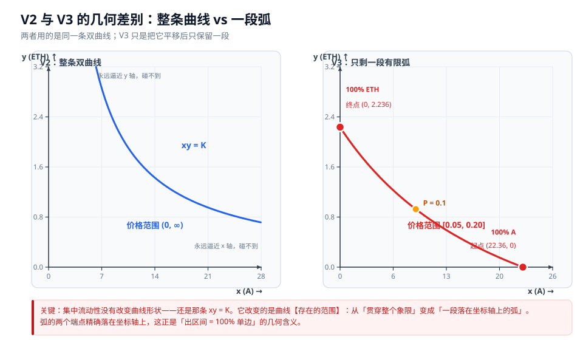

# 02 · V2：恒定乘积与无常损失

> **本章回答什么问题**
>
> 1. 为什么说 V2 的流动性是"**均匀分布**"的？这个"均匀"到底指什么？
> 2. 我一个人买卖，池子会给我什么价格？**滑点从哪来？能算出来吗？**
> 3. LP 到底在赚什么、亏什么？它在和谁做对手？
> 4. 我在池子里的两种币，**数量**是怎么随价格变化的？
> 5. 为什么说池子"永远不会失衡"？这句话是什么意思？
> 6. **无常损失（Impermanent Loss, IL）** 的公式怎么来的？什么时候才真正亏？
> 7. 一个币涨 50 倍再跌回原点，我会怎样？
> 8. 为什么"0.3% × 成交量"这个算法**严重高估** LP 收益？
> 9. **Rug Pull 在链上到底发生了什么？** 撤池子会直接拿走我的币吗？
>
> 本章全部基于 [01-地基](01-地基-坐标系统与价格.md) 建立的坐标系。如果对"价格 = 射线斜率"还不熟，建议先回看第 01 章 1.3 节。

---

## 2.1 "流动性均匀分布"到底指什么

这句话经常被误读，先澄清。

### 2.1.1 准确含义：`L = √K` 在整条价格轴上处处相同

在 V2 里，**流动性深度**定义为：

$$L = \sqrt{x \cdot y} = \sqrt{K}$$

由于 V2 只有一个全区间池子，`K` 对整条曲线是同一个数，所以：

> **一句话：V2 的 `L` 是一个常数 —— 无论价格走到哪里，池子的深度都一样大。**

用价格空间画出来就是一条**水平线**：

```
L（流动性深度）
^
|████████████████████████████████████████████████████  ← V2
|████████████████████████████████████████████████████     每个价格的 L 都是 √K
|████████████████████████████████████████████████████
|
+──────────────────────────────────────────────────────→ P（价格）
0        0.99  1.0  1.01                             ∞
          └─ 实际交易区 ─┘
```

对比 V3（详见 [03-V3 集中流动性](03-V3-集中流动性.md)）——它只在 LP 指定的区间里有 `L`：

```
L
^
|                          ▓▓▓▓
|                          ▓▓▓▓   ← 只有这个区间有流动性
|                          ▓▓▓▓
|
+──────────────────────────────────────────→ P（价格）
              0.99        1.0        1.01
```

### 2.1.2 不是指"两种币的数量相等"

❌ 常见误解："均匀分布"是说池子里 A 和 ETH 一半一半
✅ 正确理解：**"均匀"描述的是 `L` 沿价格轴的分布，不是说两种币的数量相等。**

**两种币的数量几乎永远不相等。** 由 01 章 1.3.3 的公式：

$$x = \sqrt{\frac{K}{P}}, \qquad y = \sqrt{K \cdot P}$$

在主例子 A（`K = 1000`, `P = 0.1`）中：

| 币 | 数量 | 按 ETH 计价的价值 |
|---|---|---|
| A | `√(1000/0.1) = 100 A` | `100 × 0.1 = 10 ETH` |
| ETH | `√(1000 × 0.1) = 10 ETH` | `10 ETH` |

**这个池子里"数量"是 100 比 10，但"价值"是 10 比 10。**

> **一句话：V2 池子里两种币的【价值】永远各占一半（下一节证明），但【数量】几乎永远不等 —— 数量比恰好等于价格 `P`。**

### 2.1.3 代价：资金被摊薄到几乎用不到的地方

既然 `L` 铺满了 `(0, ∞)` 整个价格轴，那么**绝大部分深度会落在实际根本不会出现的价格上**。

以稳定币对 DAI/USDC 为例：它的价格几乎永远在 `0.99 ~ 1.01` 之间波动。但 V2 在价格 `10`、`0.01`、`1000` 的地方也压着同样多的资金 —— **这些资金永远等不到交易。**

> Uniswap 官方文档对此的说明是：V2 的流动性"大部分从未被使用"，DAI/USDC 池中实际参与真实交易区间的资金**仅约 0.5%**，其余都处于闲置状态。
>
> （数据来源：Uniswap 官方 V2 / 集中流动性文档）

**这就是 V3 要解决的问题**，也是"资本效率"这个词的来源。

```
资金分布对比（同样是 10 万美元）

V2：  ████████████████████████████████████████  铺满 (0, ∞)
      └── 只有这 0.5% 真的在赚手续费（图中极小一段）──┘

V3：                              ████           只铺在 [0.99, 1.01]
                                  └ 100% 都在赚手续费
```

> **一句话：V2 用"处处都有深度"换来了"资金利用率极低" —— 稳定币池子里 99.5% 的资金是闲置的。**

---

## 2.2 滑点与价格冲击的完整推导

现在推导"我卖东西，池子给我什么价"。

### 2.2.1 成交公式

设池中有 `x` 个 A、`y` 个 ETH。我卖入 `Δx` 个 A，换出 `Δy` 个 ETH。

恒定乘积要求交易前后 `K` 不变（此处先忽略手续费）：

$$(x + \Delta x)(y - \Delta y) = x \cdot y$$

展开左边：

$$xy - x\Delta y + y\Delta x - \Delta x \Delta y = xy$$

约去 `xy`：

$$y \Delta x - x \Delta y - \Delta x \Delta y = 0$$

$$y \Delta x = \Delta y (x + \Delta x)$$

解得：

$$\boxed{\Delta y = \frac{y \cdot \Delta x}{x + \Delta x}}$$

> **一句话：这就是恒定乘积 AMM 的报价公式。注意分母是 `x + Δx`，不是 `x` —— 这个 `+ Δx` 就是滑点的全部来源。**

### 2.2.2 平均成交价永远差于现货价

**平均成交价** = 你实际换出的 ETH 除以你卖入的 A：

$$\bar{P} = \frac{\Delta y}{\Delta x} = \frac{y}{x + \Delta x}$$

**现货价**（交易前的边际价）：

$$P = \frac{y}{x}$$

由于 `Δx > 0`，必然有 `x + Δx > x`，因此：

$$\frac{y}{x + \Delta x} < \frac{y}{x} \quad\Longrightarrow\quad \bar{P} < P$$

> **一句话：只要你的单子不是无限小，平均成交价就【必然】差于现货价。这不是手续费造成的，是恒定乘积曲线本身的性质 —— 即使手续费为零，滑点依然存在。**

### 2.2.3 边际价格

对曲线 `y = K/x` 求导：

$$\frac{dy}{dx} = -\frac{K}{x^2} = -\frac{x \cdot y}{x^2} = -\frac{y}{x} = -P$$

所以**边际价格**（无限小交易的成交价）就是：

$$\boxed{-\frac{dy}{dx} = \frac{y}{x} = P}$$

**边际价格 = 现货价格 = 射线斜率。** 三者是同一个东西。

### 2.2.4 价格冲击

交易后的新价格：

$$P_1 = \frac{y - \Delta y}{x + \Delta x} = \frac{K/(x+\Delta x)}{x + \Delta x} = \frac{K}{(x+\Delta x)^2}$$

交易前的价格 `P₀ = K/x²`。两者相除：

$$\frac{P_1}{P_0} = \frac{x^2}{(x+\Delta x)^2} = \frac{1}{\left(1 + \dfrac{\Delta x}{x}\right)^2}$$

**精确式：**

$$\boxed{\frac{P_1}{P_0} = \frac{1}{(1+a)^2}}, \qquad a = \frac{\Delta x}{x}$$

展开做一阶近似（`a` 很小时 `1/(1+a)² ≈ 1 - 2a`）：

$$\boxed{\frac{\Delta P}{P} \approx -2 \cdot \frac{\Delta x}{x}}$$

> **一句话：价格冲击约等于交易规模占池子比例的两倍。卖入的 A 相当于池子存量的 1%，价格就跌约 2%。**
>
> ⚠️ **注意**：`-2a` 是小单近似。当 `a` 接近或超过 0.1 时误差很大（见下面的数值表）。

### 2.2.5 数值验算（主例子 A：100 A + 10 ETH，K = 1000，P = 0.1）

以下全部忽略手续费，只看曲线本身的滑点：

| 卖入 `Δx` | `a = Δx/x` | 换出 `Δy` (ETH) | 平均成交价 (ETH/A) | 滑点 | 新价格 `P₁` | 实际 `ΔP/P` | 近似 `-2a` |
|---|---|---|---|---|---|---|---|
| 1 A | 1% | 0.0990099 | 0.0990100 | **−0.99%** | 0.0980296 | **−1.97%** | −2% |
| 10 A | 10% | 0.909091 | 0.0909091 | **−9.09%** | 0.0826446 | **−17.36%** | −20% |
| 20 A | 20% | 1.666667 | 0.0833333 | **−16.67%** | 0.0694444 | **−30.56%** | −40% |

**逐项验算**：

- `Δx = 10 A`：`Δy = 10 × 10/(100+10) = 100/110 = 0.909091 ETH` ✓
- 平均成交价 `= 0.909091/10 = 0.0909091`，对比现货 `0.1` → `−9.09%` ✓
- 新储备 `110 A + 9.090909 ETH`，新价格 `= 9.090909/110 = 0.0826446` ✓
- 精确冲击 `= 1/(1.1)² − 1 = 1/1.21 − 1 = −17.36%` ✓
- 近似值 `−2 × 0.1 = −20%`，**高估了 2.64 个百分点** ✓（说明大单不能用近似式）

**第一行（1 A，占池子 1%）的近似非常准**：`−1.97%` vs `−2%`。

> **一句话：滑点 = 平均成交价与现货价的差（可观测）；价格冲击 = 交易前后现货价的变化（改变池子状态）。前者是"你这一单亏了多少"，后者是"你把市场推到哪了"。**

---

## 2.3 LP 是被动对手方

这是理解 LP 风险的关键视角。

**池子不能拒单。** 只要还有币、只要有 `swap` 交易发过来，合约就必须按曲线成交。没有"今天行情不好先暂停"这个选项。

于是 LP 的处境是：

```
交易者买 A（把 ETH 塞进池子）
        ↓
池子被迫卖出 A、买入 ETH
        ↓
A 变少、ETH 变多 → 价格被推高
        ↓
结果是：LP 在 A 便宜的【上涨前】卖掉了 A
```

反过来：

```
交易者卖 A（把 A 砸进池子）
        ↓
池子被迫买入 A、卖出 ETH
        ↓
A 变多、ETH 变少 → 价格被压低
        ↓
结果是：LP 在 A 下跌的【下跌中】买入了 A
```

> **一句话：LP 是一个不能拒单的被动对手方 —— 它机械地在涨的时候卖出、在跌的时候买入，也就是【必然高抛低吸】，但高抛低吸的方向永远是"抛掉涨的那个、接下跌的那个"。**

**这听起来像是好事（高抛低吸不是稳赚吗？）。问题在于：**

- 你抛掉的 A 如果继续涨，你手里换成的是涨得慢的 ETH → **跑输持有**
- 你接下的 A 如果继续跌，你手里拿着的是跌得多的 A → **同样跑输持有**

**两个方向都跑输。** 这就是下一节的 IL。

> ⚠️ **重要修正**：LP 并不"稳赚波动"。波动带来的收益只来自**手续费**，波动本身只会让你跑输持币。详见 2.7 节和 2.9 节。

---

## 2.4 LP 持仓公式

### 2.4.1 推导

设你持有 LP 池中份额比例为 `s`（`0 < s ≤ 1`）。

由 01 章 1.3.3 的坐标换算，池子的储备是：

$$x_{\text{pool}} = \sqrt{\frac{K}{P}}, \qquad y_{\text{pool}} = \sqrt{K \cdot P}$$

你的份额是 `s` 倍：

$$\boxed{A_{\text{你}} = s \cdot \sqrt{\frac{K}{P}}}$$

$$\boxed{ETH_{\text{你}} = s \cdot \sqrt{K \cdot P}}$$

### 2.4.2 一个漂亮的推论：数量比 = 价格

两者相除：

$$\frac{ETH_{\text{你}}}{A_{\text{你}}} = \frac{s\sqrt{KP}}{s\sqrt{K/P}} = \sqrt{\frac{KP}{K/P}} = \sqrt{P^2} = P$$

$$\boxed{\frac{ETH_{\text{你}}}{A_{\text{你}}} = P}$$

> **一句话：你手里两种币的【数量比】，恰好等于当前价格。这不是"池子在维持平衡"，这就是价格的定义本身。**

### 2.4.3 数量比例的两个反直觉推论

**推论 1：价格下跌时，你的两种币数量都在减少方向的相反侧。**

看公式：

$$A_{\text{你}} \propto \frac{1}{\sqrt{P}}, \qquad ETH_{\text{你}} \propto \sqrt{P}$$

| 价格变化 | 你的 A 数量 | 你的 ETH 数量 |
|---|---|---|
| `P` 上涨 | **减少** | **增加** |
| `P` 下跌 | **增加** | **减少** |

**推论 2：价值永远是 50/50。**

你的持仓按 ETH 计价的总价值：

$$V = A_{\text{你}} \cdot P + ETH_{\text{你}} = s\sqrt{\frac{K}{P}} \cdot P + s\sqrt{KP} = s\sqrt{KP} + s\sqrt{KP} = 2s\sqrt{KP}$$

其中 A 部分的价值：

$$A_{\text{你}} \cdot P = s\sqrt{KP} = \frac{V}{2}$$

> **一句话：V2 的 LP 持仓，在【任何】价格下两种币的价值都精确各占一半。这不是被维持的状态，而是代数恒等式（见 2.5）。**

### 2.4.4 数值验证（主例子 C：MEME/ETH）

池子 `100 ETH + 1,000,000 MEME`，`K = 1e8`，`P₀ = 0.0001 ETH/MEME`。你占 `s = 1%`。

**入场时（P = 0.0001）：**

$$ETH_{\text{你}} = 0.01 \times \sqrt{10^8 \times 0.0001} = 0.01 \times \sqrt{10^4} = 0.01 \times 100 = 1 \text{ ETH} \ \checkmark$$

$$MEME_{\text{你}} = 0.01 \times \sqrt{\frac{10^8}{0.0001}} = 0.01 \times \sqrt{10^{12}} = 0.01 \times 10^6 = 10{,}000 \text{ MEME} \ \checkmark$$

**涨 50 倍（P = 0.005）：**

$$ETH_{\text{你}} = 0.01 \times \sqrt{10^8 \times 0.005} = 0.01 \times \sqrt{5 \times 10^5} = 0.01 \times 707.107 = 7.071 \text{ ETH} \ \checkmark$$

$$MEME_{\text{你}} = 0.01 \times \sqrt{\frac{10^8}{0.005}} = 0.01 \times \sqrt{2 \times 10^{10}} = 0.01 \times 141{,}421.36 = 1{,}414 \text{ MEME} \ \checkmark$$

| | 入场 (P = 0.0001) | 50 倍后 (P = 0.005) | 变化 |
|---|---|---|---|
| 你的 MEME | 10,000 | **1,414** | **−86%** |
| 你的 ETH | 1 | **7.071** | **+607%** |
| A 部分价值 (ETH) | 1 | 7.071 | — |
| ETH 部分价值 (ETH) | 1 | 7.071 | — |
| **总价值 (ETH)** | **2** | **14.142** | +607% |

**验算最后两行**：`1,414 × 0.005 = 7.071`，和 `7.071` 相等 → 依然 **50/50** ✓

---

## 2.5 V2 的价值恒等式：池子永远不会"失衡"

### 2.5.1 恒等式

池子里 A 的总价值（以 ETH 计价）：

$$V_A = x \cdot P = x \cdot \frac{y}{x} = y$$

池子里 ETH 的总价值：

$$V_{ETH} = y$$

所以：

$$\boxed{x \cdot \left(\frac{y}{x}\right) = y}$$

> **一句话：池子里 A 的价值恒等于 ETH 的价值。这是一条代数恒等式 —— 它不可能被违反，也不需要任何人去维持。**

### 2.5.2 这条恒等式在任何计价单位下都成立

这是关键点。设改用 USD 计价，A 的美元价格是 `P_usd`，则：

$$V_A^{usd} = x \cdot P_{usd}, \qquad V_{ETH}^{usd} = y \cdot P_{ETH}$$

而 `P_usd = P · P_ETH`（A 的美元价 = A 的 ETH 价 × ETH 的美元价），所以：

$$V_A^{usd} = x \cdot P \cdot P_{ETH} = y \cdot P_{ETH} = V_{ETH}^{usd} \quad \checkmark$$

**换成 BTC、黄金、任何计价单位，两边依然相等。**

### 2.5.3 所以"失衡"这个词是错的

❌ 常见误解：交易多了池子会"失衡"，需要有人去调整
✅ 正确理解：**池子没有"平衡态"可以失。** `x·(y/x) = y` 是恒等式，就像 `a × (b/a) = b` 一样 —— 它和池子里有多少币、价格是多少**完全无关**。

**也不存在一个"看不见的手"在维持它。** 没有预言机、没有 keeper、没有维护逻辑（回看 [01-地基](01-地基-坐标系统与价格.md) 1.5 节）。

> **一句话：50/50 不是池子努力维持的结果，而是"价格 = 储备比"这个定义的直接推论。只要你接受 `P = y/x`，50/50 就自动成立。**

---

## 2.6 撤资公式

当你烧掉 LP 代币取回资产时：

$$\boxed{\text{取出量} = \text{池子当前储备} \times \frac{\text{你的 LP 代币}}{\text{totalSupply}}}$$

对两种币分别计算：

$$A_{\text{取出}} = x_{\text{pool}} \times \frac{\text{你的 LP}}{\text{totalSupply}}, \qquad ETH_{\text{取出}} = y_{\text{pool}} \times \frac{\text{你的 LP}}{\text{totalSupply}}$$

### 三个必须理解的性质

**性质 1：池子不记得你的入场价。**

合约里只存 `reserve0`、`reserve1`、`totalSupply` 和每个人的 LP 余额。**没有"入场价格""成本基础"这类字段。** LP 代币是完全同质化的（fungible），A 在什么价位存进去的和 B 存进去的没有任何区别。

**性质 2：你能取回的是"份额"，不是"你存进去的那些币"。**

你存进去的是 `1 ETH + 10,000 MEME`，取出来时可能是 `1.002577 ETH + 10,025.77 MEME`（赚了手续费），也可能是 `7.071 ETH + 1,414 MEME`（价格大涨，被迫换仓）。

**性质 3：你的 LP 代币余额从头到尾没变过。**

变的只是"每个 LP 代币能兑出多少"这个比值。

```
你的 LP 代币数量：      1%  →  1%  →  1%   （永远不变）
池子的储备：          变化  →  变化  →  变化
实际取回：            跟着池子走
```

> **一句话：撤资 = 按份额切蛋糕。池子不记价、不记成本、不记你是谁 —— 它只有一个 `totalSupply` 和一个储备。**

---

## 2.7 无常损失（Impermanent Loss, IL）

### 2.7.1 完整推导

**设定**：你在价格 `P₀` 时入场，池子为 `(x₀, y₀)`，`K = x₀y₀`，你占份额 `s`。
价格随后变成 `P₁ = r · P₀`。

**第一步：你的 LP 仓位现在值多少？**

由 2.4.3，LP 持仓在价格 `P₁` 时的总价值（以 ETH 计价）：

$$V_{LP} = 2s\sqrt{K \cdot P_1}$$

在 `P₀` 时的价值：

$$V_0 = 2s\sqrt{K \cdot P_0}$$

两者相除，`K` 和 `s` 都约掉：

$$\frac{V_{LP}}{V_0} = \sqrt{\frac{P_1}{P_0}} = \sqrt{r}$$

**第二步：如果你当初不存 LP，只是拿着那两个币，现在值多少？**

你在 `P₀` 时有：`A₀ = s√(K/P₀)` 个 A，`ETH₀ = s√(K·P₀)` 个 ETH。

拿到价格 `P₁` 不动，价值：

$$V_{HODL} = A_0 \cdot P_1 + ETH_0 = s\sqrt{\frac{K}{P_0}} \cdot rP_0 + s\sqrt{KP_0} = s\sqrt{KP_0} \cdot r + s\sqrt{KP_0}$$

$$V_{HODL} = s\sqrt{KP_0}\,(1 + r)$$

**第三步：相除得到 IL。**

$$\frac{V_{LP}}{V_{HODL}} = \frac{2s\sqrt{KP_1}}{s\sqrt{KP_0}(1+r)} = \frac{2\sqrt{r}}{1+r}$$

$$\boxed{IL(r) = \frac{2\sqrt{r}}{1+r} - 1}$$

> **一句话：IL 只取决于价格倍数 `r`，与池子大小、你的份额、时间长短全都无关。**

### 2.7.2 数值表

| 价格倍数 `r` | `2√r/(1+r)` | `IL` |
|---|---|---|
| 0.5（腰斩） | 0.94281 | **−5.7%** |
| 2（翻倍） | 0.94281 | **−5.7%** |
| 0.1 | 0.57496 | **−42.5%** |
| 5 | 0.74536 | **−25.5%** |
| 10 | 0.57496 | **−42.5%** |
| 0.02 | 0.27730 | **−72.3%** |
| 50 | 0.27730 | **−72.3%** |
| 100 | 0.19802 | **−80.2%** |
| 1000 | 0.06318 | **−93.7%** |

**逐项验算（举三例）**：

- `r = 2`：`2√2/3 − 1 = 2(1.414214)/3 − 1 = 2.828427/3 − 1 = 0.942809 − 1 = −5.72%` ✓
- `r = 50`：`2√50/51 − 1 = 2(7.071068)/51 − 1 = 14.142136/51 − 1 = 0.277297 − 1 = −72.27%` ✓
- `r = 1000`：`2√1000/1001 − 1 = 2(31.622777)/1001 − 1 = 63.245553/1001 − 1 = 0.063182 − 1 = −93.68%` ✓

### 2.7.3 IL 的对称性

注意表中 `r = 2` 和 `r = 0.5` 都是 `−5.7%`，`r = 10` 和 `r = 0.1` 都是 `−42.5%`。

这是因为：

$$IL(r) = \frac{2\sqrt{r}}{1+r} - 1, \qquad IL(1/r) = \frac{2/\sqrt{r}}{1 + 1/r} - 1 = \frac{2\sqrt{r}}{r+1} - 1 = IL(r)$$

> **一句话：涨 10 倍和跌到 1/10，IL 完全一样。IL 惩罚的是【偏离幅度】，不区分方向。**

**这纠正了一个极其常见的误解：**

❌ 常见误解：只有暴跌才会亏，涨了是好事
✅ 正确理解：**暴涨和暴跌造成的 IL 完全相同。** 对 LP 而言，一个币涨 10 倍和跌 90% 一样难受 —— 因为你被迫在上涨途中把它卖光了。

### 2.7.4 IL 只在撤资时才"实现"

"无常"（Impermanent）这个词的含义：

```
价格偏离  →  账面 IL 出现（但仓位还在池子里）
价格回归  →  账面 IL 消失
撤资      →  IL 被锁定，变成真实损失
```

- **不撤资 = 不实现**。价格如果回到 `P₀`，`r = 1`，`IL(1) = 2(1)/2 − 1 = 0`。
- **一旦撤资，当时的 IL 就变成永久损失。**

> ⚠️ 但要注意：**"不实现"不等于"没有损失"。** 如果价格永远不回来，你的仓位就一直被锁在错误的比例上，机会成本是实实在在的。对长期单边下跌的币，IL 实际上就是永久损失。

### 2.7.5 LP 的金融本质：50/50 多头 + 空头波动率

从 2.7.1 的中间结果可以读出 LP 的本质。

`V_LP ∝ √r`，而 `V_HODL ∝ (1+r)/2`（归一化后）。

对 `V_LP` 求二阶导：

$$\frac{d}{dr}\sqrt{r} = \frac{1}{2\sqrt{r}}, \qquad \frac{d^2}{dr^2}\sqrt{r} = -\frac{1}{4 r^{3/2}} < 0$$

**二阶导恒为负** —— 这是 IL 的数学根源。

| 视角 | 解释 |
|---|---|
| **持仓结构** | 始终 50/50 的两种币（2.4.3），所以是"半个多头" |
| **收益结构** | `V ∝ √P`，是价格的**凹函数** → 做空波动率（short gamma） |
| **收益来源** | 只有手续费。波动本身只会带来 IL |
| **风险来源** | 价格**大幅单边移动**（任意方向） |

> **一句话：LP = 50/50 多头 + 空头波动率。你收取手续费作为"卖出波动率"的权利金；一旦价格大幅偏离，你就赔付。**

**这解释了一个关键事实**：LP 在**震荡行情**里赚钱（波动小、手续费累积、IL 不实现），在**单边行情**里亏钱（IL 快速扩大）。这和卖出期权完全同构。

---

## 2.8 往返行情：涨 50 倍再跌回原点会怎样

这是一个能把 IL 讲透的思想实验。

### 2.8.1 设定（主例子 C）

| | 数值 |
|---|---|
| 池子 | `100 ETH + 1,000,000 MEME` |
| `K` | `1e8` |
| `P₀` | `0.0001 ETH/MEME` |
| 你的份额 `s` | `1%` |
| 你的持仓 | `1 ETH + 10,000 MEME` |

**行情路径**：`0.0001 → 0.0002 → 0.0005 → 0.001 → 0.005（峰值，50 倍）→ 回落 → 0.0001`

### 2.8.2 峰值时刻（P = 0.005）

由 2.4.4：

| | 数值 |
|---|---|
| 池子 | `141,421 MEME + 707.1 ETH` |
| 你的持仓 | `1,414 MEME + 7.071 ETH` |
| 你的 MEME 变化 | `10,000 → 1,414`（**−86%**） |
| 你的总价值（ETH） | `2 → 14.142` |
| **IL** | **−72.3%** |

**"IL = −72.3%"的准确含义**：如果你当初不存 LP、只是拿着 `1 ETH + 10,000 MEME`，在 `P = 0.005` 时你会拥有：

$$10{,}000 \times 0.005 + 1 = 50 + 1 = 51 \text{ ETH}$$

而 LP 仓位只值 `14.142 ETH`：

$$\frac{14.142}{51} - 1 = -72.3\% \quad \checkmark$$

### 2.8.3 回到原点（P 回到 0.0001）

**关键结论：仓位几乎回到起点，而且两侧都变多了。**

| | 入场 | 50 倍峰值 | **回到原点** |
|---|---|---|---|
| 你的 MEME | 10,000 | 1,414 | **10,025.77**（+0.258%） |
| 你的 ETH | 1 | 7.071 | **1.002577**（+0.258%） |
| 总价值 (ETH) | 2 | 14.142 | **2.005155**（+0.258%） |
| **IL** | 0 | −72.3% | **→ 0** |

**验算**：

- `K` 增长 `+0.516%`（这是往返过程中手续费的累积）
- 价值 `∝ √K`，所以 `√1.00516 = 1.002577` → 两侧各 `+0.258%` ✓
- `10,000 × 1.002577 = 10,025.77 MEME` ✓
- `1 × 1.002577 = 1.002577 ETH` ✓

### 2.8.4 一个漂亮的验证：为什么价格能回到原点，而池子变富了

价格回到了 `P₀`，但池子里两种币都多了 `0.258%`。这两件事矛盾吗？

**不矛盾。** 用 `P = y²/K`（由 `P = y/x` 和 `x = K/y` 联立）来看：

$$\frac{P_1}{P_0} = \frac{y_1^2 / K_1}{y_0^2 / K_0} = \left(\frac{y_1}{y_0}\right)^2 \cdot \frac{K_0}{K_1}$$

代入数值：

$$= (1.002577)^2 \times \frac{1}{1.00516} = 1.005158 \times 0.994866 = 1.0000 \quad \checkmark$$

**分子涨了 `+0.516%`，分母也涨了 `+0.516%`，正好抵消。**

> **一句话：手续费让 `K` 增长，正好"吸收"了池子里多出来的币，使得价格能够回到原点。池子变富和价格不变，这两件事在数学上是同一件事。**

### 2.8.5 但这里藏着一个陷阱

上面的结论"回到原点就 IL 归零、还多赚 0.258%"，听起来很美好。**但它是建立在"价格确实回到原点"这个假设上的。**

```
价格回到原点  →  IL = 0，净赚手续费 0.258%
价格不回来    →  IL 被锁定（如 −72.3% 甚至 −85%+）
```

**而对于趋势性资产（尤其是 MEME），"价格回到原点"是最不可能发生的情形之一。** 详见 [06-实战-MEME做市与区间决策](06-实战-MEME做市与区间决策.md)。

---

## 2.9 费用估算陷阱：为什么"0.3% × 成交量"是错的

### 2.9.1 朴素估算 vs 真实结果

主例子 C 的往返行情中，如果按最朴素的算法：

$$\text{预期手续费} = f \times \text{成交量} \approx 0.3\% \times \text{成交量} \approx 3.6 \text{ ETH}$$

**但池子在整轮往返中的净增价值只有 `0.5155 ETH`。**

（验算：池子总价值从 `200 ETH` 变成 `200 × 1.002577 = 200.5155 ETH`，净增 `0.5155 ETH`。）

**差了约 7 倍。** 而且这还是在**手续费全额留在池子里、没有第三方分成**的理想情况下。

> **一句话："费率 × 成交量"这个算法会严重高估 LP 收益。真实收益可能只有它的零头。**

### 2.9.2 原因一：上涨段收的 ETH 手续费，会被下跌段的卖方拿走一部分

**机制**：

```
价格上涨  →  交易者用 ETH 买 MEME  →  手续费以 ETH 形式留在池子里
                                              ↓
                                     池子的 y（ETH 数量）变大
                                              ↓
                          由往返定律 P/P₀ = ((y₀+E)/y₀)²，y 变大意味着价格被推高
                                              ↓
                          后来卖 MEME 的人，能按"更好的价格"换到更多 ETH
                                              ↓
                    上涨段收的 ETH 手续费，有一部分在下跌段【还给】了卖方
```

**对照公式**（见 [99-附录](99-附录-公式速查与源码索引.md)）：

$$\frac{P}{P_0} = \left(\frac{y_0 + E}{y_0}\right)^2, \qquad E = \text{累计净 ETH 流入}$$

**手续费本质上是"净流入的 ETH"，它会通过这条定律直接推高价格。** 而这个被推高的价格，正是后来卖方能拿走的额外价值。

> **一句话：ETH 手续费不是被"锁住"的收益，它变成了价格的一部分，而价格的受益方包括后来的卖方。**

### 2.9.3 原因二：贬值币种收的手续费会跟着贬值

**这是 MEME 场景下最狠的一刀。**

在下跌段，交易者用 MEME 买 ETH，池子收到的是 **MEME 计价的手续费**：

| 时刻 | 事件 | 数值 |
|---|---|---|
| 收取时 | 下行段累计收到 MEME 手续费 | **2,578 MEME** |
| 收取时 | 按当时价格折算 | **价值 1.8 ETH** |
| 崩盘后 | 价格回到 `0.0001 ETH/MEME` | `2,578 × 0.0001` = **0.258 ETH** |
| **损失** | | **−85.7%** |

**验算**：

$$\frac{0.258}{1.8} - 1 = -85.67\% \quad \checkmark$$

（隐含的收取均价：`1.8 / 2,578 = 0.000698 ETH/MEME`）

> **一句话：手续费以什么币收，你就承担那个币的贬值风险。在 MEME 池里做 LP，下跌段收到的手续费本身就在贬值 —— 你赚的是"数量"，亏的是"价值"。**

### 2.9.4 正确的心智模型

```
❌  手续费 = 费率 × 成交量
        （把手续费当成稳定的现金流）

✅  手续费 = 费率 × 成交量 × （1 − 币种贬值损耗） − 被后续交易者拿走的部分
        （手续费是一种资产，它自己也有价格风险）
```

**实务建议**：

- 用**稳定币或主流币**计价手续费更安全（例如 ETH/USDC 池，手续费以 USDC 和 ETH 收取，两者都相对稳定）
- 在**贬值型资产**池里做 LP，必须把"手续费贬值"计入成本
- **不要**用"APR = 费率 × 日均成交量 / TVL"这类指标做决策，它系统性地高估收益

详见 [06-实战-MEME做市与区间决策](06-实战-MEME做市与区间决策.md)。

---

## 2.10 Rug Pull 机制：链上到底发生了什么

### 2.10.1 先破除一个误解

❌ 常见误解：撤池子会把我的币直接拿走
✅ 正确理解：**按比例撤池【不影响】任何其他人的持币数量。** 真正致命的是它摧毁了池子的**深度**，让随后的砸盘能以极低成本把价格打到地板。

下面用逐笔交易的方式讲清楚。

### 2.10.2 设定

| | 数值 |
|---|---|
| 池子 | `1,000,000 MEME + 100 ETH` |
| `K` | `1e8` |
| `P` | `0.0001 ETH/MEME` |
| LP 总份额 | 100 单位 |
| 分配 | 攻击者 **90**、**你 1**（1%）、其他人 9 |
| 你的持仓 | `1 ETH + 10,000 MEME` |

### 2.10.3 交易一：攻击者撤池

**谁发了什么交易**：攻击者调用 `burn(90)`

**哪两个数字变了**：

| 量 | 之前 | 之后 |
|---|---|---|
| `x`（MEME） | 1,000,000 | **100,000** |
| `y`（ETH） | 100 | **10** |
| `K` | `1e8` | **`1e6`（−99%）** |
| `P` | 0.0001 | **0.0001（不变！）** |
| `totalSupply` | 100 | 10 |

**你的份额变成什么**：

- 你持有的 LP 代币数量没变（1 单位）
- 但 `totalSupply` 从 100 变成 10 → 你的比例从 **1% 变成 10%**
- 你的实际持仓 = `10% × 100,000 = 10,000 MEME`，`10% × 10 = 1 ETH`
- **和撤池前完全一样！**

> **一句话：按比例撤池是最"公平"的操作 —— 撤出者的份额被移除，其他人的持仓数量分毫不变。价格也不变（因为比例没变）。**

**但它摧毁了 `K`：从 `1e8` 塌到 `1e6`。池子变浅了 100 倍。**

### 2.10.4 交易二：攻击者砸盘

攻击者手里现在有撤池拿到的 `900,000 MEME + 90 ETH`。他把 MEME 全砸进池子。

**谁发了什么交易**：攻击者调用 `swap`，卖入 `900,000 MEME`

**哪两个数字变了**：

$$\Delta y = \frac{y \cdot \Delta x}{x + \Delta x} = \frac{10 \times 900{,}000}{100{,}000 + 900{,}000} = \frac{9{,}000{,}000}{1{,}000{,}000} = 9 \text{ ETH}$$

| 量 | 之前 | 之后 |
|---|---|---|
| `x`（MEME） | 100,000 | **1,000,000** |
| `y`（ETH） | 10 | **1** |
| `P` | 0.0001 | **0.000001（−99%）** |

**你的份额变成什么**：

- 你的 10% 份额现在对应：`10% × 1,000,000 = 100,000 MEME`，`10% × 1 = 0.1 ETH`

| | 撤池前 | 砸盘后 |
|---|---|---|
| 你的 MEME | 10,000 | **100,000** |
| 你的 ETH | 1 | **0.1** |
| 你的总价值 (ETH) | **2** | **0.2** |
| | | **−90%** |

**验算总价值**：`100,000 × 0.000001 + 0.1 = 0.1 + 0.1 = 0.2 ETH` ✓

### 2.10.5 攻击者赚了多少？对比"直接砸盘"

如果攻击者**不撤池**，直接砸 `900,000 MEME` 进原始池子（`1,000,000 MEME + 100 ETH`）：

$$\Delta y = \frac{100 \times 900{,}000}{1{,}000{,}000 + 900{,}000} = \frac{90{,}000{,}000}{1{,}900{,}000} = 47.37 \text{ ETH}$$

| 策略 | 攻击者拿到 | 价格跌幅 |
|---|---|---|
| **直接砸盘** | `47.37 ETH` | −72.3% |
| **先撤池再砸盘** | `90 + 9 = 99 ETH` | **−99%** |

$$\text{差额} = 99 - 47.37 = 51.63 \text{ ETH}$$

> **一句话：先撤池再砸盘，攻击者多拿 51.63 ETH，价格还砸得更狠。这就是为什么所有 Rug Pull 都必然包含"撤池"这一步 —— 撤池是攻击的【前置条件】，不是顺手做的事。**

### 2.10.6 完整时间线

```
① 攻击者建池并注入绝大部分流动性（90%）
        │
        │  买家涌入，用 ETH 买入 MEME
        │  → 池子积累了 ETH，价格被推高
        ▼
② 攻击者调用 burn(90%)
        │  x: 1,000,000 → 100,000 MEME
        │  y: 100 → 10 ETH
        │  K: 1e8 → 1e6   ← 深度塌陷 99%
        │  P: 0.0001 → 0.0001  ← 价格【没变】，所以没人察觉
        ▼
③ 攻击者调用 swap，砸入 900,000 MEME
        │  Δy = 9 ETH
        │  P: 0.0001 → 0.000001   ← 价格暴跌 99%
        ▼
④ 攻击者带走 99 ETH，留下一个几乎空了的池子
   持有者手里只有 MEME，而 MEME 已经归零
```

### 2.10.7 为什么"价格不变"这一步很关键

在第 ② 步，**价格一点没变**。所以在区块浏览器、在 K 线图上，**这一步看起来什么都没有发生**。

**但池子的深度已经塌了 99%。**

> **一句话：撤池攻击最阴的地方在于 —— 它改变的是【深度】，不是【价格】。而绝大多数人只看价格。**

### 2.10.8 防御要点

| 检查项 | 为什么 |
|---|---|
| **LP 是否已锁定 / 烧毁** | 只有锁定 LP 才能防止第 ② 步 |
| **LP 集中度** | 如果部署者持有 >90% 的 LP，撤池成本极低 |
| **`K` 的历史变化** | 监控 `K` 的异常跳变 —— 价格没动但 `K` 塌了，就是危险信号 |
| **池子深度 vs 市值** | 深度远小于市值 = 一笔卖单就能砸穿 |
| **是否有 hook（V4）** | 见 [05-V4-Hook机制](05-V4-Hook机制.md)，恶意 hook 可以锁住撤资 |

**其中"看 `K` 而不是看价格"是本章最有实操价值的结论。** 价格可以在撤池时纹丝不动，但 `K` 会立刻塌陷。

---

## 2.11 曲线对比图



> **图注**：左图是 V2 —— 池子状态可以沿着整条 `xy = K` 双曲线滑动，两端无限逼近坐标轴但永远碰不到，因此价格范围是 `(0, ∞)`。右图是 V3 —— 同样的双曲线只保留一段有限弧，**两端精确落在坐标轴上**（在 [03-V3 集中流动性](03-V3-集中流动性.md) 主例子 B 中，端点是 `(0, 2.236)` 和 `(22.36, 0)`），因此价格被限制在 `[p_a, p_b]`。两张图的横轴都是 A 的数量、纵轴都是 ETH 的数量，射线斜率都是价格。本图在 02 章仅作对照，完整推导见 03 章。

---

## 2.12 本章要点

1. **"均匀分布"指 `L = √K` 在整条价格轴 `(0, ∞)` 上处处相同**，不是指两种币数量相等。数量比恰好等于价格 `P`。代价是资金利用率极低 —— 稳定币池中实际参与交易的资金**仅约 0.5%**（官方文档数据）。

2. **成交公式**：
   $$\Delta y = \frac{y \cdot \Delta x}{x + \Delta x}$$

   **平均成交价**永远差于现货价：`y/(x+Δx) < y/x`，**这是曲线性质，与手续费无关**。

   **边际价格** `= −dy/dx = y/x = P`。

   **价格冲击**精确式 `P₁/P₀ = 1/(1+a)²`，小单近似 `ΔP/P ≈ −2·Δx/x`。

3. **LP 是不能拒单的被动对手方** —— 必然高抛低吸，且两个方向都跑输持有。

4. **LP 持仓公式**：
   $$A_{\text{你}} = s\sqrt{K/P}, \qquad ETH_{\text{你}} = s\sqrt{K \cdot P}, \qquad \frac{ETH_{\text{你}}}{A_{\text{你}}} = P$$
   两种币的**价值永远精确各占一半**。

5. **价值恒等式 `x·(y/x) = y`** 是代数恒等式，在任何计价单位下都成立。**池子永远不会"失衡"，也不需要任何人维护。** 没有预言机、没有 keeper（回看 [01-地基](01-地基-坐标系统与价格.md) 1.5）。

6. **撤资公式**：`取出量 = 池子储备 × (你的 LP / totalSupply)`。池子**不记入场价、不记成本**，LP 代币完全同质化。

7. **无常损失**：
   $$IL(r) = \frac{2\sqrt{r}}{1+r} - 1$$
   只取决于价格倍数。关键数值：`2×`/−5.7%，`10×`/−42.5%，`50×`/−72.3%，`100×`/−80.2%，`1000×`/−93.7%。
   **IL 具有对称性 `IL(r) = IL(1/r)`** —— 涨 10 倍和跌 90% 一样痛。
   **LP = 50/50 多头 + 空头波动率。**

8. **往返行情**（主例子 C）：50 倍涨完再跌回原点 → 仓位回到起点，**两侧都多约 0.258%**（`K` `+0.516%`，价值 `∝ √K`），**IL → 0**。这是因为 `K` 的增长正好吸收了池子里多出来的币：
   $$\frac{P_1}{P_0} = \left(\frac{y_1}{y_0}\right)^2 \cdot \frac{K_0}{K_1} = 1.002577^2 \times \frac{1}{1.00516} = 1.0000$$

9. **费用估算陷阱**：朴素地用"`0.3% × 成交量` ≈ `3.6 ETH`"会严重高估 —— 实际净增只有 **`0.5155 ETH`**。两个原因：
   - **上涨段收的 ETH 手续费会推高价格，被下跌段的卖方拿走一部分**
   - **贬值币种收的手续费跟着贬值**：下行段收的 `2,578 MEME`，收取时值 `1.8 ETH`，崩盘后只值 `0.258 ETH`（**−85.7%**）

10. **Rug Pull 的关键机制**：按比例撤池**不会**直接拿走你的币（你的持仓数量分毫不变），但它让 `K` 从 `1e8` 塌到 `1e6`。**撤池时价格纹丝不动，所以没人察觉。** 随后攻击者砸盘，价格 `−99%`，你的仓位价值 `−90%`。
    **先撤池再砸盘 vs 直接砸盘：攻击者多拿 `51.63 ETH`。**
    **防御的关键是看 `K` 的变化，而不是看价格。**

---

> **上一章**：[01-地基：坐标系统与价格](01-地基-坐标系统与价格.md)
>
> **下一章**：[03-V3 集中流动性](03-V3-集中流动性.md) —— 为什么 V3 的曲线只是一段弧？`L` 是什么？资本效率从哪来？
>
> **延伸阅读**：
> - [05-V4-Hook机制](05-V4-Hook机制.md) —— 恶意 hook 如何锁住撤资
> - [06-实战-MEME做市与区间决策](06-实战-MEME做市与区间决策.md) —— IL 在区间外会怎样继续恶化
> - [08-误区纠正与安全检查](08-误区纠正与安全检查.md) —— 完整的迷思清单
> - [99-附录](99-附录-公式速查与源码索引.md) —— 公式速查
