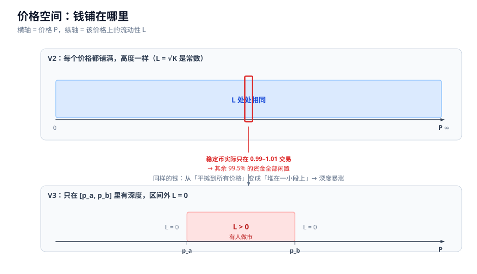
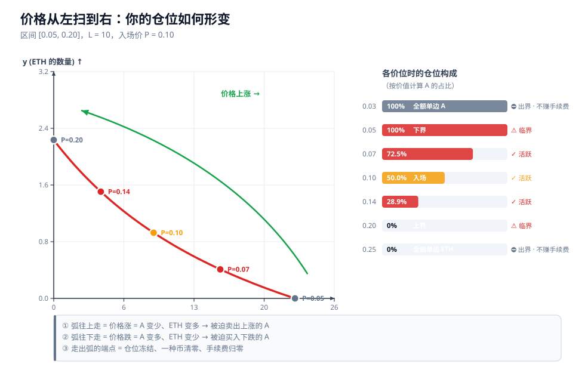

# 03 · V3 集中流动性

> **本章回答什么问题**：V3 把流动性「集中」起来，到底改变了什么？为什么它能把资本效率提高上百倍，代价又是什么？
>
> 本章的核心洞察是**几何的**：V3 没有发明新的定价曲线，它只是把 V2 那条双曲线**平移**了一下，让第一象限里只剩一段**有限的弧**。理解这一点，后面所有的公式、tick、资本效率、出界困境都会自然落位。

前置阅读：先看 [01-地基](01-地基-坐标系统与价格.md) 的「价格 = 储备比 = 射线斜率」框架，以及 [02-V2](02-V2-恒定乘积与无常损失.md) 的恒定乘积推导。

---

## 1. 集中流动性的几何本质

### 1.1 先回顾 V2 的曲线

在状态空间（横轴 `x` = A 数量，纵轴 `y` = ETH 数量）里，V2 池子必须落在

$$x \cdot y = K$$

这条曲线上。这是一条**矩形双曲线**，它以两条坐标轴为渐近线：

```text
        【V2】双曲线贯穿整个第一象限
   y
   ^
   |
   |○ ← 无限逼近 y 轴，但永远碰不到
   | ╲
   |  ╲
   |   ╲
   |    ●  ← 池子状态点，从原点连到它的直线斜率 = P
   |     ╲
   |      ╲
   |       ╲
   |        ○ ← 无限逼近 x 轴，但永远碰不到
   +──────────────→ x
   (0,0)

   价格范围：(0, ∞)
```

**「碰不到坐标轴」这件事直接对应「价格可以取到任意值」**：

| 曲线上的位置 | `x` | `y` | 价格 `P = y/x` |
|---|---|---|---|
| 极度靠近 y 轴 | → 0 | → ∞ | → ∞ |
| 极度靠近 x 轴 | → ∞ | → 0 | → 0 |

所以 V2 的报价能力覆盖 `(0, ∞)` 的全部价格区间 —— 但代价是把资金平摊到了所有价格上。详见 [02-V2](02-V2-恒定乘积与无常损失.md)。

### 1.2 V3 做的事：把双曲线平移

V3 里一个价格区间为 `[p_a, p_b]`、流动性为 `L` 的仓位，其实际储备 `(x, y)` 满足

$$\boxed{\left(x + \frac{L}{\sqrt{p_b}}\right)\left(y + L\sqrt{p_a}\right) = L^2}$$

**这个方程的来历**（下一节会给出完整推导）：令虚拟储备满足 `x_v · y_v = L²`，则

$$x = x_v - \frac{L}{\sqrt{p_b}}, \qquad y = y_v - L\sqrt{p_a}$$

也就是说：**V3 的持仓曲线，就是把标准双曲线 `x_v · y_v = L²` 向左、向下各平移一段**：

```text
   平移前的双曲线                     平移后的双曲线
   x_v · y_v = L²                    (x + L/√p_b)(y + L√p_a) = L²

   y_v                                y
   ^                                  ^
   |                                  |  ← 渐近线整体外移
   |    ╲                             |
   |     ╲                            |    ╲
   |      ╲                           |     ╲
   |       ╲                          |      ╲
   +──────────→ x_v                   +──────────→ x
                                        ↑
                                  平移量 (L/√p_b, L√p_a)
```

### 1.3 平移的后果：只剩一段有限弧，且端点精确落在坐标轴上

平移之后，**第一象限里只剩下一段有限的弧**。更重要的是，这段弧的两个端点**精确地落在坐标轴上**。

端点处两个坐标之一**恒等于零**，这不是近似，是代数的必然：

```text
   P = p_a  ⟹  y_real = L(√p_a − √p_a) = 0   ⟹  点落在 x 轴上
   P = p_b  ⟹  x_real = L(1/√p_b − 1/√p_b) = 0   ⟹  点落在 y 轴上
```

```text
        【V3】只剩一段有限弧，两端落在坐标轴上
   y
   ^
   |
   |● ← 精确落在 y 轴
   | ╲
   |  ╲
   |   ●
   |    ╲
   |     ●  ← P = 0.10（区间中部）
   |      ╲
   |       ●
   |        ╲
   +─────────●──→ x
   (0,0)      ↑ 精确落在 x 轴

   价格范围：[p_a, p_b]
```

**对比一下两者的差别：**

| | V2 | V3 的一个仓位 |
|---|---|---|
| 曲线形态 | 完整双曲线 | 同一族双曲线的一段弧 |
| 端点 | 渐近逼近坐标轴，永不触及 | **精确落在坐标轴上** |
| 价格范围 | `(0, ∞)` | `[p_a, p_b]` |
| 币种构成 | 两端趋近单边（但不等于） | 端点处**精确**单边 |

### 1.4 用主例子 B 验证端点

主例子 B 的设定是：`P₀ = 0.1`，区间 `[p_a, p_b] = [0.05, 0.20]`，`L = 10`。

把 `P = p_a = 0.05` 代入 `x_real`：

$$x_{real} = 10\left(\frac{1}{\sqrt{0.05}} - \frac{1}{\sqrt{0.20}}\right) = 10\,(4.472136 - 2.236068) = 10 \times 2.236068 = 22.36 \text{ A}$$

$$y_{real} = 10\left(\sqrt{0.05} - \sqrt{0.05}\right) = 0 \text{ ETH}$$

→ 端点是 `(22.36, 0)`，**精确落在 x 轴上**。 ✅

把 `P = p_b = 0.20` 代入 `y_real`：

$$y_{real} = 10\left(\sqrt{0.20} - \sqrt{0.05}\right) = 10\,(0.447214 - 0.223607) = 10 \times 0.223607 = 2.236 \text{ ETH}$$

$$x_{real} = 10\left(\frac{1}{\sqrt{0.20}} - \frac{1}{\sqrt{0.20}}\right) = 0 \text{ A}$$

→ 端点是 `(0, 2.236)`，**精确落在 y 轴上**。 ✅

两个端点与 [99-附录 主例子 B](99-附录-公式速查与源码索引.md) 的记录完全一致。

**顺手验证平移后的方程确实成立**（取 `P = 0.10`，此时 `x = 9.262`、`y = 0.926`）：

$$\left(9.262 + \frac{10}{\sqrt{0.20}}\right)\left(0.926 + 10\sqrt{0.05}\right) = (9.262 + 22.361)(0.926 + 2.236) = 31.623 \times 3.162 = 100 = L^2 \; ✅$$

### 1.5 重要澄清：形状没变，变的是定义域

> ❌ **常见误解**：集中流动性发明了一条新的定价曲线。
>
> ✅ **正确理解**：曲线**形状完全没变**，还是同一族矩形双曲线。变的只是它的**定义域**：从 `(0, ∞)` 收缩到了 `[p_a, p_b]`。

「集中」这个词容易让人以为流动性被压缩了、曲线被掰弯了。**实际发生的事是：曲线还是那条曲线，只是被裁剪到只剩一段，并把裁剪后的残段平移回第一象限。**

用一个比喻：V2 是一根无限长的橡皮筋铺满整个象限；V3 是从这根橡皮筋上**剪下长度对应 `[p_a, p_b]` 的那一段**，然后把这一段挪到靠近原点的位置。**橡皮筋本身的弹性规律（曲率）一个字都没改。**

> **一句话：V3 没有改变价格公式，只是限制了这条公式被使用的价格范围。**

### 1.6 一个容易困惑的细节：价格射线指向「虚拟点」

看图时会发现一个矛盾：弧的端点在 x 轴上，从原点连过去斜率是 0，但那个端点的价格应该是 `p_a = 0.05`，不是 0。

**原因是：价格射线从原点连向的是「虚拟点」，不是「实际持仓点」。**

$$\text{价格} = \frac{y_{virtual}}{x_{virtual}} = \frac{y + L\sqrt{p_a}}{x + L/\sqrt{p_b}}$$

在下端点 `P = p_a` 处验证：

$$\frac{0 + 10\sqrt{0.05}}{22.36 + 10/\sqrt{0.20}} = \frac{2.236}{22.36 + 22.36} = \frac{2.236}{44.72} = 0.05 \; ✅$$

在上端点 `P = p_b` 处验证：

$$\frac{2.236 + 10\sqrt{0.05}}{0 + 10/\sqrt{0.20}} = \frac{2.236 + 2.236}{22.36} = \frac{4.472}{22.36} = 0.20 \; ✅$$

所以状态空间里有两套点，不要混淆：

| | 实际持仓点 `(x, y)` | 虚拟点 `(x_v, y_v)` |
|---|---|---|
| 轨迹 | 平移后的弧，端点落在坐标轴上 | 标准双曲线 `x_v·y_v = L²` |
| 价格射线 | **不**从原点连向它 | **从原点连向它**，斜率 = `P` |

> **一句话：实际持仓画出的弧与原点「不同源」；价格是从原点到虚拟点的射线斜率。**

---

## 2. 数学形式

### 2.1 流动性 `L` 的定义

V3 用一个标量 `L` 描述仓位的「深度」：

$$L = \sqrt{x_{virtual} \cdot y_{virtual}}$$

虚拟储备按价格 `P` 分配：

$$x_{virtual} = \frac{L}{\sqrt{P}}, \qquad y_{virtual} = L\sqrt{P}$$

**验证定义自洽**：`x_v · y_v = (L/√P)(L√P) = L²`，故 `√(x_v·y_v) = L` ✅
**验证比值正确**：`y_v / x_v = (L√P)/(L/√P) = P` ✅

### 2.2 实际储备的完整推导

**第 1 步：写出虚拟储备。**

由 `x_v · y_v = L²` 且 `y_v / x_v = P`，得 `y_v = P·x_v`，代入：

$$x_v \cdot (P x_v) = L^2 \;\Longrightarrow\; x_v = \frac{L}{\sqrt{P}}, \qquad y_v = L\sqrt{P}$$

**第 2 步：找出「区间外」的两块虚拟流动性。**

关键在于想清楚：**当价格走到区间端点时，仓位的哪一种币会归零？**

- 当 `P → p_b`（上界），仓位里的 token0 全部卖光，`x_real = 0`。此时虚拟 token0 仍是 `L/√p_b`。
  → 说明区间上端「多余」出来的虚拟 token0 是 `L/√p_b`。
- 当 `P → p_a`（下界），仓位里的 token1 全部卖光，`y_real = 0`。此时虚拟 token1 仍是 `L√p_a`。
  → 说明区间下端「多余」出来的虚拟 token1 是 `L√p_a`。

这两块之所以叫「多余」，是因为**它们代表的是区间之外的流动性，仓位在区间内根本用不到它们**。

**第 3 步：实际储备 = 虚拟储备 − 多余部分。**

$$\boxed{x_{real} = x_v - \frac{L}{\sqrt{p_b}} = L\left(\frac{1}{\sqrt{P}} - \frac{1}{\sqrt{p_b}}\right)}$$

$$\boxed{y_{real} = y_v - L\sqrt{p_a} = L\left(\sqrt{P} - \sqrt{p_a}\right)}$$

**第 4 步：端点验证。**

| 代入 | `x_real` | `y_real` |
|---|---|---|
| `P = p_a` | `L(1/√p_a − 1/√p_b)` | `L(√p_a − √p_a) = 0` ✅ |
| `P = p_b` | `L(1/√p_b − 1/√p_b) = 0` ✅ | `L(√p_b − √p_a)` |

**第 5 步：与 v3-core 源码对照。**

上面的推导不是「数学上说得通」，而是**和合约里真正在跑的代码一致**。[`SqrtPriceMath.sol`](https://raw.githubusercontent.com/Uniswap/v3-core/main/contracts/libraries/SqrtPriceMath.sol) 中：

```solidity
/// @dev Calculates liquidity / sqrt(lower) - liquidity / sqrt(upper),
/// i.e. liquidity * (sqrt(upper) - sqrt(lower)) / (sqrt(upper) * sqrt(lower))
function getAmount0Delta(uint160 sqrtRatioAX96, uint160 sqrtRatioBX96, uint128 liquidity, bool roundUp)
    internal pure returns (uint256 amount0)

/// @dev Calculates liquidity * (sqrt(upper) - sqrt(lower))
function getAmount1Delta(uint160 sqrtRatioAX96, uint160 sqrtRatioBX96, uint128 liquidity, bool roundUp)
    internal pure returns (uint256 amount1)
```

取 `A = P`、`B = p_b` 代入 `getAmount0Delta`：

$$amount0 = L \cdot \frac{\sqrt{p_b} - \sqrt{P}}{\sqrt{p_b}\sqrt{P}} = L\left(\frac{1}{\sqrt{P}} - \frac{1}{\sqrt{p_b}}\right) = x_{real} \; ✅$$

取 `A = p_a`、`B = P` 代入 `getAmount1Delta`：

$$amount1 = L\left(\sqrt{P} - \sqrt{p_a}\right) = y_{real} \; ✅$$

**推导与实现完全吻合。**

### 2.3 边界值速查

| 情形 | `x_real` | `y_real` |
|---|---|---|
| `P ≤ p_a`（低于区间） | `L(1/√p_a − 1/√p_b)` | `0` |
| `p_a < P < p_b`（区间内） | `L(1/√P − 1/√p_b)` | `L(√P − √p_a)` |
| `P ≥ p_b`（高于区间） | `0` | `L(√p_b − √p_a)` |

**注意第一行和第三行：出界之后，数量被「钳制」在端点值上，不再随价格变化。** 这个性质是第 7 节「出界困境」的全部根源。

### 2.4 为什么合约里存的是 `√P` 而不是 `P`

合约里存的不是 `P`，而是 `sqrtPriceX96`，一个 **Q64.96 定点数**：

```solidity
sqrtPriceX96 = √P × 2^96
```

[`TickMath.sol`](https://raw.githubusercontent.com/Uniswap/v3-core/main/contracts/libraries/TickMath.sol) 开头的注释说得很直接：

```solidity
/// @title Math library for computing sqrt prices from ticks and vice versa
/// @notice Computes sqrt price for ticks of size 1.0001, i.e. sqrt(1.0001^tick) as fixed point Q64.96 numbers.
///         Supports prices between 2**-128 and 2**128
```

**理由有三个，第一个是决定性的：**

**① 所有公式里 `P` 都只以 `√P` 的形式出现。**

回看第 2.2 节的推导结果：`x_real` 里是 `1/√P`，`y_real` 里是 `√P`。`P` 本身从不单独出现。

**② 价格推进在 `√P` 坐标下是线性的（这才是关键）。**

在区间内注入 `Δy` 的 token1，价格上涨：

$$\Delta\sqrt{P} = \frac{\Delta y}{L} \quad\Longrightarrow\quad \sqrt{P_{new}} = \sqrt{P} + \frac{\Delta y}{L}$$

源码注释印证了这一点：

```solidity
/// @dev The formula we compute is within <1 wei of the lossless version: sqrtPX96 +- amount / liquidity
```

**这是一个纯加法。** 如果存的是 `P`，每一步都要先开方再平方，swap 循环里会塞进大量昂贵的定点开方运算。存 `√P` 让**核心循环退化成加法与乘除**。

**③ 从 `√P` 反推 tick 只需要一次对数。** 见第 3 节。

### 2.5 主例子 B 的完整数值表

以下数值直接引自 [99-附录 主例子 B](99-附录-公式速查与源码索引.md)：

| 价格 P | A 数量 | ETH 数量 | 总价值(ETH) | A 占价值 |
|---|---|---|---|---|
| 0.03 | 22.36 | 0 | 0.671 | 100% |
| 0.05 | 22.36 | 0 | 1.118 | 100% |
| 0.07 | 15.44 | 0.410 | 1.490 | 72.5% |
| 0.10 | 9.262 | 0.926 | 1.852 | 50.0% |
| 0.14 | 4.365 | 1.506 | 2.117 | 28.9% |
| 0.20 | 0 | 2.236 | 2.236 | 0% |
| 0.25 | 0 | 2.236 | 2.236 | 0% |

**逐行解释：**

**① `P = 0.03` 与 `P = 0.05` 两行数值完全相同。**

这是**钳制**的直接证据。`0.03 < p_a = 0.05`，仓位已经出界，持仓冻结在 `x_real = 22.36`、`y_real = 0`，不再随价格变化。价值 `22.36 × 0.03 = 0.671 ETH` 之所以变小，纯粹是因为 A 更便宜了，**仓位本身的币数没动**。

**② `P = 0.05`：下界，`y = 0` 精确成立。**

`y_real = L(√0.05 − √0.05) = 0`。这是弧落在 x 轴上的那个端点。价值 `22.36 × 0.05 = 1.118 ETH`。

**③ `P = 0.10`：恰好 50/50，这不是巧合。**

区间 `[0.05, 0.20]` 的几何均值是

$$\sqrt{p_a \cdot p_b} = \sqrt{0.05 \times 0.20} = \sqrt{0.01} = 0.1$$

**正好等于 `P₀`。** 在几何均值处，两侧价值必然相等，可以证明：

$$V = x \cdot P + y = L\left(\sqrt{P} - \frac{P}{\sqrt{p_b}}\right) + L\left(\sqrt{P} - \sqrt{p_a}\right) = L\left(2\sqrt{P} - \sqrt{p_a} - \frac{P}{\sqrt{p_b}}\right)$$

当 `P = √(p_a·p_b)` 时，`P/√p_b = √(p_a·p_b)/√p_b = √p_a`，于是

$$V = L\left(2\sqrt{P} - 2\sqrt{p_a}\right) = 2L\left(\sqrt{P} - \sqrt{p_a}\right)$$

而 A 侧价值 `x·P = L(P/√P − P/√p_b) = L(√P − √p_a)`，恰好是 `V` 的一半。**所以几何均值处 A 占价值精确等于 50%。** ✅

代入：`V = 2 × 10 × (0.316228 − 0.223607) = 20 × 0.092621 = 1.852 ETH`，与表中 `1.852` 一致。

**④ `P = 0.07` 与 `0.14`：区间内，两侧都在变化。**

- 价格下跌时（`0.07`），A 数量增加（`15.44`），ETH 数量减少（`0.410`），A 占比升到 `72.5%`。
- 价格上涨时（`0.14`），A 数量减少（`4.365`），ETH 数量增加（`1.506`），A 占比降到 `28.9%`。

**这就是「被迫高抛低吸」在数值上的样子**，机制说明见 [02-V2](02-V2-恒定乘积与无常损失.md)。

**⑤ `P = 0.20`：上界，`x = 0` 精确成立。**

`x_real = L(1/√0.20 − 1/√0.20) = 0`。弧落在 y 轴上的端点。价值 `2.236 ETH`。

**⑥ `P = 0.25` 与 `P = 0.20` 两行完全相同。**

上界之外的钳制。`2.236 ETH` 这个数字从此不再变化 —— **价格再怎么涨，都与你无关了。**

**⑦ 一条贯穿全表的规律：A 占价值单调递减。**

从 `100%` 一路降到 `0%`，中间穿过 `50%`。**仓位本质上是一个「自动卖出 A、买入 ETH」的机器**，价格越高卖得越多。

**⑧ 总价值随价格变化。**

从 `0.671` 涨到 `2.236 ETH`。这说明**你依然在做多这个交易对**，只是暴露随价格变化（越涨越像纯 ETH 持仓，越跌越像纯 A 持仓）。

### 2.6 分段（钳制）公式

把三行合并，得到实际持仓的完整表达式：

$$x_{real} = \begin{cases} L\left(\dfrac{1}{\sqrt{p_a}} - \dfrac{1}{\sqrt{p_b}}\right), & P \le p_a \\[8pt] L\left(\dfrac{1}{\sqrt{P}} - \dfrac{1}{\sqrt{p_b}}\right), & p_a < P < p_b \\[8pt] 0, & P \ge p_b \end{cases}$$

$$y_{real} = \begin{cases} 0, & P \le p_a \\[6pt] L\left(\sqrt{P} - \sqrt{p_a}\right), & p_a < P < p_b \\[6pt] L\left(\sqrt{p_b} - \sqrt{p_a}\right), & P \ge p_b \end{cases}$$

> **一句话：区间内的公式只有两条 `L(1/√P − 1/√p_b)` 和 `L(√P − √p_a)`；一旦出界，两者都被冻结成常数。**

---

## 3. tick 机制

### 3.1 `P(i) = 1.0001^i`

价格轴被离散化成一根根刻度（tick）：

$$P(i) = 1.0001^{\,i}$$

**相邻两个 tick 的价格差恒为 0.01%。** 这由 `1.0001 = 1 + 0.01%` 直接得到，与 `i` 的大小无关。

### 3.2 为什么底数是 1.0001

**因为它是等比的。** 价格是一个跨数量级的量（MEME 可以 `0.0001`，BTC 可以 `100000`），如果用等差刻度，低价区间的相对分辨率会趋近于零，高价区间又浪费得离谱。

等比刻度保证：**无论价格在 `0.0001` 还是 `100000`，每一格代表的相对精度都是 `0.01%`。**

`0.01%` 这个具体数字是精度与表示范围之间的折中：够细（比大多数交易对的费率还小一个数量级），又不至于让 tick 总数爆炸。

### 3.3 可表示的价格范围

[`TickMath.sol`](https://raw.githubusercontent.com/Uniswap/v3-core/main/contracts/libraries/TickMath.sol) 给出了硬边界：

```solidity
/// @dev The minimum tick ... computed from log base 1.0001 of 2**-128
int24 internal constant MIN_TICK = -887272;
/// @dev The maximum tick ... computed from log base 1.0001 of 2**128
int24 internal constant MAX_TICK = -MIN_TICK;
```

| 常量 | 值 |
|---|---|
| `MIN_TICK` | `-887272` |
| `MAX_TICK` | `887272` |
| `MIN_SQRT_RATIO` | `4295128739` |
| `MAX_SQRT_RATIO` | `1461446703485210103287273052203988822378723970342` |
| 可表示价格 | `2⁻¹²⁸` 到 `2¹²⁸` |

**换算**：解 `1.0001^i = 2^128`，得 `i = 128·ln2 / ln1.0001 = 88.72 / 0.0001 ≈ 887272`。所以 `√P` 的最大值约为 `2^64`，乘上 `2^96` 后正好塞进 `uint160`。**价格范围的上限是由 `uint160` 容器的宽度决定的。**

### 3.4 tick 数值速查

| tick | 价格 | 含义 |
|---|---|---|
| `−100` | `0.99005` | DAI/USDC 区间下界附近 |
| `−60` | `0.99402` | |
| `−10` | `0.99900` | |
| `−1` | `0.99990` | |
| `0` | `1.00000` | |
| `+1` | `1.00010` | |
| `+10` | `1.00100` | |
| `+60` | `1.00602` | |
| `+100` | `1.01005` | DAI/USDC 区间上界附近 |

**所以 DAI/USDC 的 `[0.99, 1.01]` 区间约等于 `tick [−100, +100]`。** 这个换算是主例子 D 的基础。

### 3.5 `tickSpacing` 是什么

**`tickSpacing` = 允许作为区间边界的 tick 粒度。**

不是每一根 tick 都能当仓位的边界，只有每隔 `tickSpacing` 根的那些才行：

```text
tickSpacing = 1   |  |  |  |  |  |  |  |  |  |    ← 每根 tick 都能当边界
tickSpacing = 10  |-----|-----|-----|-----|----    ← 只有 …, −20, −10, 0, 10, 20 …
tickSpacing = 60  |─────────60─────────|──────     ← 只有 …, −120, −60, 0, 60 …
```

`Tick.sol` 里的注释给了精确定义：

```solidity
/// @param tickSpacing The amount of required tick separation, realized in multiples of `tickSpacing`
///     e.g., a tickSpacing of 3 requires ticks to be initialized every 3rd tick i.e., ..., -6, -3, 0, 3, 6, ...
```

**它决定了你的区间最窄能做成多窄**（以价格 `1.0` 为中心衡量）：

| tickSpacing | 最窄区间 | 价格范围 | 宽度 |
|---|---|---|---|
| `1` | `[−1, +1]` | `[0.99990, 1.00010]` | 0.02% |
| `10` | `[−10, +10]` | `[0.99900, 1.00100]` | 0.20% |
| `60` | `[−60, +60]` | `[0.99402, 1.00602]` | 1.20% |

**同样的资金，区间越窄，堆在当前价格附近的深度越厚** —— 这就是第 6 节要量化的资本效率来源。

### 3.6 费率与 tickSpacing 的映射

标准映射是：

| 费率 | `tickSpacing` | 典型用途 |
|---|---|---|
| 0.01% | `1` | 稳定币对 |
| 0.05% | `10` | 主流交易对 |
| 0.30% | `60` | 标准活跃对 |
| 1.00% | `200` | 长尾 / 高波动 |

**核对 [`UniswapV3Factory.sol`](https://raw.githubusercontent.com/Uniswap/v3-core/main/contracts/UniswapV3Factory.sol) 源码时发现一个细节：核心工厂的构造函数里只内置了三档。**

```solidity
constructor() {
    owner = msg.sender;
    ...
    feeAmountTickSpacing[500]   = 10;    // 0.05%
    feeAmountTickSpacing[3000]  = 60;    // 0.30%
    feeAmountTickSpacing[10000] = 200;   // 1.00%
}
```

**`0.01% → 1` 这一档不在构造函数里**，而是通过 owner 可调用的 `enableFeeAmount(100, 1)` 在部署之后追加的：

```solidity
function enableFeeAmount(uint24 fee, int24 tickSpacing) public override {
    require(msg.sender == owner);
    require(fee < 1000000);
    // tick spacing is capped at 16384 to prevent the situation where tickSpacing is so large that
    // TickBitmap#nextInitializedTickWithinOneWord overflows int24 container from a valid tick
    // 16384 ticks represents a >5x price change with ticks of 1 bips
    require(tickSpacing > 0 && tickSpacing < 16384);
    require(feeAmountTickSpacing[fee] == 0);
    ...
}
```

**这段代码透露了两个有用的事实：**

1. **`tickSpacing` 有硬上限 `16384`**，原因是 `TickBitmap` 在寻找下一个已初始化 tick 时会溢出 `int24` 容器。源码注释顺带给出了标定：`16384` 个 tick 相当于约 5 倍的价格变化。
2. **费率的粒度上限是 `fee < 1000000`**，即费率以「百万分之一」为单位表示（`1.00% = 10000`）。

**为什么低费率配小 spacing、高费率配大 spacing？两个理由：**

**① 效率匹配。** 稳定币对的价格几乎不动，只有把区间做得极窄（`±0.5%` 量级）才能在有限资金下堆出足够的深度。相反，高波动币对本来就不可能靠窄区间盈利，放宽粒度不损失什么。

**② 省 gas。** 价格移动时，每穿越一根**已初始化的** tick，都要更新一次流动性加总和相关记账，每次更新都要花钱。`tickSpacing` 越大，同样的价格移动穿越的活跃 tick 越少，大额交易的 gas 越低。

### 3.7 tick 内部结构：`liquidityGross` 与 `liquidityNet`

每个被初始化过的 tick 都存一份 `Tick.Info`：

```solidity
struct Info {
    // the total position liquidity that references this tick
    uint128 liquidityGross;
    // amount of net liquidity added (subtracted) when tick is crossed from left to right (right to left)
    int128 liquidityNet;
    // fee growth per unit of liquidity on the _other_ side of this tick (relative to the current tick)
    // only has relative meaning, not absolute — the value depends on when the tick is initialized
    uint256 feeGrowthOutside0X128;
    uint256 feeGrowthOutside1X128;
    // the cumulative tick value on the other side of the tick
    int56 tickCumulativeOutside;
    // the seconds per unit of liquidity on the _other_ side of this tick (relative to the current tick)
    uint160 secondsPerLiquidityOutsideX128;
    // the seconds spent on the other side of the tick (relative to the current tick)
    uint32 secondsOutside;
    // true iff the tick is initialized, i.e. the value is exactly equivalent to the expression liquidityGross != 0
    // these 8 bits are set to prevent fresh sstores when crossing newly initialized ticks
    bool initialized;
}
```

**两个流动性字段的分工：**

| 字段 | 含义 | 用途 |
|---|---|---|
| `liquidityGross` | 引用这个 tick 的**全部**流动性之和 | 判断 tick 是否「已初始化」（非零即为是） |
| `liquidityNet` | 从左向右穿越时，活跃流动性的**净变化量** | 穿越时只需一次加减即可更新当前活跃流动性 |

**为什么两个都要？** 因为一个 tick 可能同时是很多仓位的下界和很多仓位的上界：

```text
        仓位甲          仓位乙
    |──────────────|
              |──────────────|
              ↑
         这个 tick
    作为甲的【上界】 → liquidityNet 里记 −L甲
    作为乙的【下界】 → liquidityNet 里记 +L乙
    liquidityGross = L甲 + L乙 （恒为正，用于判断是否已初始化）
    liquidityNet   = L乙 − L甲 （可正可负，用于穿越时更新）
```

源码里 `update()` 的这两行精确表达了这一点：

```solidity
// when the lower (upper) tick is crossed left to right (right to left), liquidity must be added (removed)
info.liquidityNet = upper
    ? int256(info.liquidityNet).sub(liquidityDelta).toInt128()
    : int256(info.liquidityNet).add(liquidityDelta).toInt128();
```

**结果就是：穿越一根 tick 的成本是 O(1)，与这根 tick 上挂了多少个仓位无关。** 这是 V3 能做到「一个池子服务成千上万个不同区间」的关键。

### 3.8 复合曲线是分段的，且在 tick 边界处不连续

单个仓位有一条平滑的弧，但**整个池子**的曲线是**所有仓位的叠加**。某个价格上的总深度是：

$$L(P) = \sum_{i:\ p_{a,i} \le P \le p_{b,i}} L_i$$

**这是一个阶梯函数** —— 每穿越一根已初始化的 tick，就有一个或多个仓位的 `L` 加入或退出，`L(P)` 发生跳变。

由于价格冲击

$$\Delta\sqrt{P} = \frac{\Delta y}{L} \quad\Longrightarrow\quad \frac{\Delta P}{P} = \frac{2\,\Delta y}{L\sqrt{P}}$$

**与 `L` 成反比**，所以 `L(P)` 的跳变直接导致**滑点在 tick 边界处跳变**：

```text
L(P)
^
|         ██
|         ██              ██
|   ██    ██       ██     ██        ██
|   ██    ██       ██     ██        ██
+──────────────────────────────────────────→ P
    ↑     ↑        ↑      ↑         ↑
  厚墙    薄区     厚墙    薄区      厚墙
 价格黏   价格跳   价格黏   价格跳   价格黏

ΔP/P ∝ 1/L  →  厚墙处价格走不动，薄区处价格跳变
```

**「复合曲线分段且不连续」是 V3 相对 V2 的一个本质差异**：V2 的曲线处处可导、深度恒定；V3 的曲线在每个 tick 边界都有折点。具体的交易含义（流动性阶梯、薄区价格跳变、自我强化的雪崩）在 [06-实战](06-实战-MEME做市与区间决策.md) 展开。

### 3.9 类比：价格轴的像素与最小字号

```text
tick         = 价格轴的「像素」
tickSpacing  = 允许使用的「最小字号」
```

稳定币对需要精细排版，就用最小字号（`tickSpacing = 1`）；MEME 这种高波动资产不需要那么细，就用大字号（`tickSpacing = 200`），**排版（也就是交易）更快、更省 gas。**

> **一句话：tick 把连续的价格轴变成离散刻度，`tickSpacing` 决定这套刻度能被用得多细；越细越精确，越粗越便宜。**

---

## 4. 费用累积机制

V3 有一个非常漂亮的设计：**swap 过程中不为任何单个仓位写存储，手续费全部在「读取时」才结算。** 这一节讲清楚它怎么做到。

### 4.1 如果朴素地做，会发生什么

最直接的想法是：每笔 swap 结束后，遍历所有受影响的仓位，把手续费加到各自的 `tokensOwed` 上。

**这在 gas 上完全不可行。** 一个有几千个仓位的池子，每笔 swap 都要写几千次存储（每次 `SSTORE` 起步就是数千 gas）。V3 的设计目标之一就是让**单笔 swap 的成本与仓位数量无关**。

### 4.2 解法：全局累加器 + 每个 tick 的 `outside` 值

V3 用两层累加器把「按仓位记账」变成了「按单位流动性记账」：

| 累加器 | 位置 | 含义 |
|---|---|---|
| `feeGrowthGlobal0X128` / `feeGrowthGlobal1X128` | 池子 | 全池累计「每单位流动性分到的手续费」 |
| `feeGrowthOutside0X128` / `feeGrowthOutside1X128` | 每个 tick | 该 tick **另一侧**的累计手续费 |

**关键洞察：手续费累积量是一个单调递增的标量，而「某个区间内累积了多少」可以用「全局减去区间外」算出来。**

所以池子只需要维护**一个全局值**，加上**每根 tick 一个 outside 值**，就能推出任意区间内的手续费累积量 —— **不需要给每个仓位单独记账。**

对于 `feeGrowthGlobal`，每笔 swap 只更新两个 `uint256`（token0 和 token1 各一个），**成本是 O(1)，与仓位数量无关。**

### 4.3 `feeGrowthInside` 的合成

[`Tick.sol`](https://raw.githubusercontent.com/Uniswap/v3-core/main/contracts/libraries/Tick.sol) 里的 `getFeeGrowthInside` 就是干这件事的，逻辑如下：

```solidity
// calculate fee growth below
uint256 feeGrowthBelow0X128;
if (tickCurrent >= tickLower) {
    feeGrowthBelow0X128 = lower.feeGrowthOutside0X128;
} else {
    feeGrowthBelow0X128 = feeGrowthGlobal0X128 - lower.feeGrowthOutside0X128;
}

// calculate fee growth above
uint256 feeGrowthAbove0X128;
if (tickCurrent < tickUpper) {
    feeGrowthAbove0X128 = upper.feeGrowthOutside0X128;
} else {
    feeGrowthAbove0X128 = feeGrowthGlobal0X128 - upper.feeGrowthOutside0X128;
}

feeGrowthInside0X128 = feeGrowthGlobal0X128 - feeGrowthBelow0X128 - feeGrowthAbove0X128;
```

**用公式表达：**

$$\text{feeGrowthInside} = \text{feeGrowthGlobal} - \text{feeGrowthBelow} - \text{feeGrowthAbove}$$

其中 `below` / `above` 的取值取决于当前 tick 相对于边界在哪一侧：

$$\text{feeGrowthBelow} = \begin{cases} \text{tick.feeGrowthOutside}, & \text{tickCurrent} \ge \text{tickLower} \\ \text{global} - \text{tick.feeGrowthOutside}, & \text{tickCurrent} < \text{tickLower} \end{cases}$$

$$\text{feeGrowthAbove} = \begin{cases} \text{tick.feeGrowthOutside}, & \text{tickCurrent} < \text{tickUpper} \\ \text{global} - \text{tick.feeGrowthOutside}, & \text{tickCurrent} \ge \text{tickUpper} \end{cases}$$

**为什么要这种「翻转」的条件分支？** 因为 `feeGrowthOutside` 只记录「tick 另一侧」的累积量，而「另一侧」是相对于当前 tick 而言的。源码注释说明了这一点：

```solidity
// fee growth per unit of liquidity on the _other_ side of this tick (relative to the current tick)
// only has relative meaning, not absolute — the value depends on when the tick is initialized
```

**`outside` 值是「有相对含义」的** —— 它到底代表左侧还是右侧，取决于当前 tick 站在哪边。所以每次穿越 tick 时，要把这个值「翻转」一次。`cross()` 函数就是干这个的：

```solidity
function cross(...) internal returns (int128 liquidityNet) {
    Tick.Info storage info = self[tick];
    info.feeGrowthOutside0X128 = feeGrowthGlobal0X128 - info.feeGrowthOutside0X128;
    info.feeGrowthOutside1X128 = feeGrowthGlobal1X128 - info.feeGrowthOutside1X128;
    ...
    liquidityNet = info.liquidityNet;
}
```

**注意 `cross()` 是「减法翻转」而不是「清零」**：`new = global − old`。这样累积量在左右两侧之间来回切换时保持正确，而且**每次穿越只写两个 `uint256`**。

还有一个初始化约定值得注意：

```solidity
if (liquidityGrossBefore == 0) {
    // by convention, we assume that all growth before a tick was initialized happened _below_ the tick
    if (tick <= tickCurrent) {
        info.feeGrowthOutside0X128 = feeGrowthGlobal0X128;
        info.feeGrowthOutside1X128 = feeGrowthGlobal1X128;
        ...
    }
    info.initialized = true;
}
```

**「约定：tick 被初始化之前的所有增长，都算在它下方。」** 这个约定让新初始化的 tick 无需遍历历史即可得到正确的 `outside` 值。

### 4.4 仓位侧：只存一个检查点，读取时才结算

仓位这一侧的存储结构（[`Position.sol`](https://raw.githubusercontent.com/Uniswap/v3-core/main/contracts/libraries/Position.sol)）：

```solidity
struct Info {
    // the amount of liquidity owned by this position
    uint128 liquidity;
    // fee growth per unit of liquidity as of the last update to liquidity or fees owed
    uint256 feeGrowthInside0LastX128;
    uint256 feeGrowthInside1LastX128;
    // the fees owed to the position owner in token0/token1
    uint128 tokensOwed0;
    uint128 tokensOwed1;
}
```

**注意：仓位里存的是 `feeGrowthInside` 的一个「检查点」（`...LastX128`），不是手续费余额本身。**

手续费的计算发生在仓位被触碰时（加流动性、撤流动性、或收集手续费）：

```solidity
// (feeGrowthInside 增量) × (本仓位的 liquidity) ÷ Q128
uint128 tokensOwed0 = uint128(
    FullMath.mulDiv(feeGrowthInside0X128 - _self.feeGrowthInside0LastX128, _self.liquidity, FixedPoint128.Q128)
);
```

**用公式表达：**

$$\Delta\text{tokensOwed}_0 = L_{position} \times \frac{\text{feeGrowthInside}_0^{now} - \text{feeGrowthInside}_0^{last}}{2^{128}}$$

**这就是核心机制：**

```text
swap 发生时：
   只更新 feeGrowthGlobal0X128 / feeGrowthGlobal1X128  （2 个存储槽）
   以及穿越到的 tick 的 outside 值                    （每根 tick 2 个存储槽）
   ✗ 完全不碰任何仓位

用户来收手续费时：
   读 feeGrowthInside（由 global + 两根 tick 的 outside 算出）
   减去自己上次的检查点
   乘以自己的 liquidity
   → 得到这次应得的手续费
```

**两种路径的成本对比：**

| | 朴素做法 | V3 的做法 |
|---|---|---|
| swap 时每笔存储写入 | 与仓位数量成正比 | **O(1) 全局 + O(穿越 tick 数)** |
| 仓位记账时机 | 每笔 swap | **只在仓位被触碰时** |
| 手续费能否「自动复利」 | 可以 | **不能**，必须主动 collect 后再加回流动性 |

**注意最后一行的代价**：因为手续费不会自动加入 `liquidity`，**未收集的手续费不参与做市、不产生新手续费**。这一点在 [06-实战](06-实战-MEME做市与区间决策.md) 讨论策略时有用。

顺带一提，源码有一行防御，说明「两个 tick 相同 = 没有区间」的仓位不允许被 poke：

```solidity
if (liquidityDelta == 0) {
    require(_self.liquidity > 0, 'NP'); // disallow pokes for 0 liquidity positions
    ...
}
```

### 4.5 为什么这是 V3 高效的关键

**把「按仓位记账」换成「按单位流动性记账」，是把 O(仓位数) 的链上成本压成 O(1) 的核心技巧。**

这个模式在其他 AMM 里也反复出现 —— 记账的不是「谁有多少钱」，而是「每单位权益累积了多少收益」，权益人自己在读取时做减法。它的代价是**收益不会自动复投**，收益方必须主动「结算」。

> **一句话：`feeGrowthGlobal` 累加全局，每个 tick 存 `feeGrowthOutside`；任意区间的手续费由「全局 − 下方 − 上方」合成，swap 全程不写任何仓位存储。**

---

## 5. V3 的其他特性

### 5.1 仓位是 ERC-721，不是同质化 LP 代币

V2 的 LP token 是同质化的 ERC-20，因为所有 LP 的份额是同质的（按比例分整个池子）。

**V3 里每个仓位的「商品」都不一样** —— 区间不同、费率不同、创建时间不同，手续费累积也不同。所以 V3 用 **ERC-721（非同质化代币）** 表示仓位，由 `NonfungiblePositionManager` 管理。

**这个设计带来的连锁效应：**

| 影响 | 说明 |
|---|---|
| 仓位可转让、可出售 | NFT 可以挂单交易，「带手续费的仓位」本身成为资产 |
| 不能简单质押 | 质押需要转移 NFT 所有权，这正是 V4 `Subscribers` 想解决的问题，见 [05-V4 Hook](05-V4-Hook机制.md) |
| 仓位数量影响 gas | 一个地址下的 NFT 越多，批量操作的边际成本越高 |
| 仓位的元数据是「派生」的 | NFT 本身只记录 `liquidity` 标量，具体币数用第 2 节公式在读取时算出 |

**最后一点很重要**：仓位 NFT 并不「持有」A 和 ETH，它只记录一个**流动性标量** `L` 和区间边界。**具体的币数是读取时用 `L(1/√P − 1/√p_b)` 和 `L(√P − √p_a)` 现算出来的。**

> ❌ **常见误解**：你的仓位里存着若干个 A 和若干个 ETH。
>
> ✅ **正确理解**：你的仓位里存着 `liquidity` 这个标量；币数是由它和当前价格**推导**出来的。价格一变，币数就变，**不需要任何交易来「调整」你的持仓**。

### 5.2 内置 TWAP 累加器（预言机）

回看 3.7 节的 `Tick.Info`，除了手续费字段，还有一组和时间相关的字段：

```solidity
int56 tickCumulativeOutside;                  // 该 tick 另一侧的累计 tick 值
uint160 secondsPerLiquidityOutsideX128;       // 该 tick 另一侧「每单位流动性的秒数」
uint32 secondsOutside;                        // 在该 tick 另一侧停留的秒数
```

**V3 把预言机的记账直接内嵌进了 swap 路径**，所以每个池子天然自带一个**时间加权平均价格（TWAP）**预言机，不需要额外部署。这是 V3 相对 V2 一个常被忽略的升级。

**代价**：这些字段的维护也要花 gas，而且 `feeGrowthOutside` 的「翻转」逻辑要和它们一起做（见 `cross()` 里那几行同时翻转）。这是「免费预言机」的实际成本。

### 5.3 区间单（Range Order）：免费的限价单

这是集中流动性的一个**副产品**，不是专门设计的功能，但非常有用。

**把一个仓位的区间完全放在当前价格的同一侧，它的行为就等价于一张限价单：**

```text
情形一：区间完全在【当前价格上方】
        当前 P ──────→ [p_a, p_b]
        你存入的是【全部 A】（因为 P < p_a 时 y_real = 0）
        价格涨进区间 → 系统自动把你的 A 逐步换成 ETH
        价格涨过 p_b  → 你的 A 全部换成 ETH，订单成交

        = 一张【卖出 A】的限价单 ✅

情形二：区间完全在【当前价格下方】
        [p_a, p_b] ←────── 当前 P
        你存入的是【全部 ETH】（因为 P > p_b 时 x_real = 0）
        价格跌进区间 → 系统自动把你的 ETH 逐步换成 A
        价格跌过 p_a  → 你的 ETH 全部换成 A，订单成交

        = 一张【买入 A】的限价单 ✅
```

**为什么说「免费」？** 因为限价单在传统交易所要付挂单费，而区间单在等待成交的过程中**还在赚手续费**。

| | 传统限价单 | V3 区间单 |
|---|---|---|
| 挂单期间 | 不产生收益 | **持续赚取手续费** |
| 成交方式 | 一次性撮合 | 价格穿过区间时逐步成交 |
| 未成交时 | 资金闲置 | 资金仍在做市 |
| 成交价格 | 精确的点 | **区间内的平均价格**（有滑点性质） |

> ⚠️ **注意**：区间单的「成交价」不是一个精确的点，而是价格穿过整个区间时的**加权平均**。区间越宽，成交价的离散程度越大。它和真正的限价单在成交价格上不等价。

> **一句话：因为仓位在区间外会退化成单边持仓，「把区间放在价格一侧」就自然变成了限价单 —— 而且是等待期间还在赚手续费的那种。**

---

## 6. 资本效率

### 6.1 `E` 的推导

**定义**：资本效率倍数 `E` = 相同资金量下，V3 提供的流动性 `L` 是 V2 的多少倍。

$$E = \frac{L_{v3}}{L_{v2}} \bigg|_{\text{相同资金 } V}$$

**第 1 步：写出两种情形下「资金 `V`」与 `L` 的关系。**

V2（全区间）里，价值 `V` 与 `L` 的关系是（记 V2 的流动性为 `L_{v2}`）：

$$x = \frac{L_{v2}}{\sqrt{P}}, \quad y = L_{v2}\sqrt{P} \;\Longrightarrow\; V = x \cdot P + y = L_{v2}\sqrt{P} + L_{v2}\sqrt{P} = 2 L_{v2}\sqrt{P}$$

$$\Longrightarrow\; L_{v2} = \frac{V}{2\sqrt{P}}$$

V3 里，价值是 A 侧价值和 ETH 侧价值之和：

$$V = x \cdot P + y = L\left(\frac{P}{\sqrt{P}} - \frac{P}{\sqrt{p_b}}\right) + L\left(\sqrt{P} - \sqrt{p_a}\right) = L\left(2\sqrt{P} - \frac{P}{\sqrt{p_b}} - \sqrt{p_a}\right)$$

$$\Longrightarrow\; L_{v3} = \frac{V}{2\sqrt{P} - \dfrac{P}{\sqrt{p_b}} - \sqrt{p_a}}$$

**第 2 步：相除。**

$$E = \frac{L_{v3}}{L_{v2}} = \frac{V / \left(2\sqrt{P} - \frac{P}{\sqrt{p_b}} - \sqrt{p_a}\right)}{V / (2\sqrt{P})}$$

$$\boxed{E = \frac{2\sqrt{P}}{2\sqrt{P} - \dfrac{P}{\sqrt{p_b}} - \sqrt{p_a}}}$$

**第 3 步：在几何均值处化简。**

当 `P = √(p_a · p_b)` 时，有 `P/√p_b = √(p_a·p_b)/√p_b = √p_a`，分母变成 `2√P − 2√p_a`：

$$E = \frac{2\sqrt{P}}{2\sqrt{P} - 2\sqrt{p_a}} = \frac{\sqrt{P}}{\sqrt{P} - \sqrt{p_a}} = \frac{1}{1 - \sqrt{p_a / P}}$$

$$\boxed{E = \frac{1}{1 - \sqrt{p_a / P}} \quad \left(P = \sqrt{p_a \cdot p_b}\right)}$$

**第 4 步：读懂这个公式。**

分母 `1 − √(p_a/P)` 衡量的是「区间下界离当前价格有多近」：

```text
p_a 越接近 P   ⟹  √(p_a/P) → 1  ⟹  分母 → 0  ⟹  E → ∞
p_a 越远离 P   ⟹  √(p_a/P) → 0  ⟹  分母 → 1  ⟹  E → 1
```

**区间越窄，`p_a` 越贴近 `P`，`E` 越大。** 当区间退化到全区间（`p_a → 0`）时 `E → 1`，V3 退化成 V2 —— 符合直觉。

### 6.2 资本效率表

以下数值取自 [99-附录 资本效率表](99-附录-公式速查与源码索引.md)。
**口径：`E` 在区间的几何均值 $P^* = \sqrt{p_a p_b}$ 处取值**（即仓位 50/50 的价格点）：

| 区间（中枢 0.1） | 宽度 | E |
|---|---|---|
| `[0.05, 0.20]` | ×2 / ÷2 | 3.4× |
| `[0.08, 0.125]` | ±22% | 9.5× |
| `[0.09, 0.11]` | ±10% | 20.4× |
| `[0.099, 0.101]` | ±1% | **200.5×** |

**规律可以用一个更精确的近似式概括。** 令 `w = √(p_b/p_a)`（区间上下界之比的开方），可把 `E` 写成只依赖 `w` 的形式：

$$E = \frac{\sqrt{w}}{\sqrt{w} - 1}$$

再令对数半宽 `δ = ln w`（即 `p_b = P·e^{δ}`、`p_a = P·e^{−δ}`），当区间较窄（`δ` 小）时：

$$E = \frac{e^{\delta/2}}{e^{\delta/2} - 1} \approx \frac{2}{\delta}$$

**也就是说：区间宽度减半，资本效率大约翻倍。** 用表中数值验证（`δ` 按几何均值处的 `ln w` 计算）：

| 区间 | `δ` | 近似 `2/δ` | 实际 `E` |
|---|---|---|---|
| `[0.09, 0.11]` | `0.1003` | `19.9` | `20.4` |
| `[0.099, 0.101]` | `0.0100` | `200.0` | `200.5` |

**区间越窄，这个近似越准。** 第一行有约 2.5% 的偏差，第二行已经几乎完全吻合 —— 说明 `E ≈ 2/δ` 是「窄区间」极限下的行为。

```text
E
^
|                                              ●  200.5×
|
|
|                             ●  20.4×
|
|              ●  9.5×
|
|   ●  3.4×
|
+──────────────────────────────────────────────────→ 区间宽度
  ×2/÷2        ±22%        ±10%         ±1%
```

> **口径**：本表的 `E` 一律在区间的**几何均值** $P^* = \sqrt{p_a p_b}$ 处取值 —— 那正是仓位 50/50 的价格点，也是下节主例子 D 的口径。
> 若改用 $P = 0.1$ 求值，后两行会得到 `19.5×` 和 `199.5×`。两种口径结论一致（都是数量级提升），但**本套文档统一采用几何均值口径**。

### 6.3 主例子 D 的实证

主例子 D 是一个真实量级的检验（DAI/USDC，`$100k`，区间 `[0.99, 1.01]`，`P = 1.00`）：

| 量 | 值 |
|---|---|
| 入场仓位 | `49,750.6 USDC + 50,249.4 DAI` |
| `L` | `10,024,688` |
| 同样资金放 V2 的 `L` | `50,000` |
| **资本效率 `E`** | **`200.49`** |

**验证 `L` 的来历**：把 `V = $100,000`、`P = 1`、`p_a = 0.99`、`p_b = 1.01` 代入第 6.1 节的公式：

$$L_{v3} = \frac{100000}{2 - \dfrac{1}{\sqrt{1.01}} - \sqrt{0.99}} = \frac{100000}{2 - 0.995037 - 0.994987} = \frac{100000}{0.00997537} = 10{,}024{,}688 \; ✅$$

**验证 V2 对照**：`L_{v2} = V/(2√P) = 100000/2 = 50,000` ✅

**验证 `E`**：`E = 10,024,688 / 50,000 = 200.49` ✅

**注意主例子 D 里一个反直觉的细节**：入场持仓是 `49,750.6 USDC + 50,249.4 DAI`，**不是 50/50**。

原因是 `P = 1.00` **不是**该区间的几何均值 —— `√(0.99 × 1.01) = 0.999950`，略小于 `1`。所以严格来说两侧价值并不相等，USDC 侧略少。**两侧相差 `498.8`，相当于总资金的约 `0.50%`** —— 数值不大，但它是真实的，而且和 6.2 节那个 ⚠️ 口径提示源自同一个原因：`E` 的取值、以及「两侧是否等值」，都取决于 `P` 是不是区间的几何均值。

**顺便得到「资本效率 200 倍」的直观含义：**

```text
同样 $100,000：
  V2  →  L = 50,000        （深度铺满 0 到 ∞）
  V3  →  L = 10,024,688    （深度只铺在 [0.99, 1.01]）

在 [0.99, 1.01] 这个价格带里，V3 的深度是 V2 的 200 倍。
代价是：一旦价格离开这个带，V3 的深度直接变成 0。
```

**再往下推一步**：按主例子 D 的记录，该仓位举例每天收 `$50.12` 手续费，对应 `18.3%` APR，**回本约 5 天**。也就是说，**只要价格在 `[0.99, 1.01]` 内待满 5 天，手续费收入就覆盖了本金中「被占用」的机会成本**；而如果价格 5 天内就出界，这个账要重算 —— 那正是 [06-实战](06-实战-MEME做市与区间决策.md) 的主题。

> **一句话：V3 的资本效率 `E = 1/(1 − √(p_a/P))`，把资金从「铺满所有价格」压缩到「只铺在 `[p_a, p_b]`」，压缩得越狠，倍数越高，出界后归零也越快。**

---

## 7. 出界困境

### 7.1 出界后发生了什么

由 2.3 节的钳制公式，一旦价格离开 `[p_a, p_b]`：

| 出界方向 | 持仓状态 | 手续费 |
|---|---|---|
| `P ≤ p_a`（跌破下界） | `100% A`，`y = 0` | **0** |
| `P ≥ p_b`（涨破上界） | `100% ETH`，`x = 0` | **0** |

**两件事同时发生：币种退化成纯单边，收入归零。**

在主例子 B 的数值表里就可以看到这一点：`P = 0.03` 行和 `P = 0.05` 行的持仓完全相同；`P = 0.25` 行和 `P = 0.20` 行的持仓完全相同 —— 冻结了。

### 7.2 但真正的痛苦不是「停赚」，而是「出界之后」

这是最容易低估的一层：**出界不是痛苦的结果，是痛苦的开始。**

```text
       你的仓位                          市场价格
          │                                │
     ┌────┴────┐                      ┌────┴────┐
     │  冻住了  │                      │  继续走  │
     │ 币数不变 │                      │ 一直涨   │
     └─────────┘                      └─────────┘
          │                                │
          └────────► 差距持续扩大 ◄────────┘
```

**机制**：出界后你的仓位冻结，但**市场不会冻结**。由于你已经被迫在区间内把上涨的资产全部卖出，手里只剩另一种，**价格每多走一步，你的机会成本就多累积一分**。

**关键性质：无常损失在出界之后不是停止增长，而是继续扩大。**

### 7.3 主例子 E：出界的代价

主例子 E 的设定：MEME/ETH，入场 `P = 1`，区间 `[0.9, 1.4]`，投入 `10,000`。

**先由资金量反解 `L`**（用第 6.1 节的 `V = L(2√P − P/√p_b − √p_a)`，在 `P = 1` 处）：

$$V = L\left(2\sqrt{P} - \frac{P}{\sqrt{p_b}} - \sqrt{p_a}\right) = L\left(2 - \frac{1}{\sqrt{1.4}} - \sqrt{0.9}\right)$$

$$L = \frac{10000}{2 - 0.845154 - 0.948683} = \frac{10000}{0.206163} = 48{,}505.4$$

**入场持仓**（与主例子 E 一致）：

$$x = 48505.4\left(1 - \frac{1}{\sqrt{1.4}}\right) = 48505.4 \times 0.154846 = 7{,}510.6 \text{ MEME}$$

$$y = 48505.4\left(1 - \sqrt{0.9}\right) = 48505.4 \times 0.051317 = 2{,}489.4 \text{ ETH}$$

**情形一：价格涨到 `1.4`（刚撞上界）**

$$x = 0, \qquad y = 48505.4\left(\sqrt{1.4} - \sqrt{0.9}\right) = 48505.4 \times 0.234533 = 11{,}376.5 \text{ ETH}$$

持币不动的对照：

$$7{,}510.6 \times 1.4 + 2{,}489.4 = 10{,}514.8 + 2{,}489.4 = 13{,}004$$

$$IL = \frac{11{,}376.5}{13{,}004} - 1 = -12.5\%$$

**情形二：价格继续涨到 `10`**

仓位**完全冻结**，仍是 `0 MEME + 11,376.5 ETH`。而持币对照变成：

$$7{,}510.6 \times 10 + 2{,}489.4 = 75{,}106 + 2{,}489.4 = 77{,}595$$

$$IL = \frac{11{,}376.5}{77{,}595} - 1 = -85.3\%$$

**从 `−12.5%` 恶化到 `−85.3%`，而这段时间里你一分钱手续费都没赚。**

**对照 V2 全区间**（同样投入 `10,000`）：

$$L_{v2} = \frac{10000}{2 \times 1} = 5{,}000 \;\Longrightarrow\; x_0 = y_0 = 5{,}000$$

价格涨到 `10` 时：

$$x = \frac{5000}{\sqrt{10}} = 1{,}581.1, \qquad y = 5000\sqrt{10} = 15{,}811.4$$

$$V = 1{,}581.1 \times 10 + 15{,}811.4 = 31{,}622.8$$

$$IL = \frac{31{,}622.8}{5{,}000 \times 10 + 5{,}000} - 1 = \frac{31{,}622.8}{55{,}000} - 1 = -42.5\% \; ✅ \text{（与主例子 E 的 V2 对照一致）}$$

**对比总结：**

| 情形 | `P = 1.4` 时 IL | `P = 10` 时 IL |
|---|---|---|
| V3 窄区间 `[0.9, 1.4]` | `−12.5%` | **`−85.3%`** |
| V2 全区间 | `−1.40%` | **`−42.5%`** |

**结论：集中流动性是一把双刃剑。** 它在区间内把手续费收入放大 `E` 倍，也在出界后显著放大无常损失。

> ⚠️ **口径提示**：上表两个仓位虽然都从 `10,000` 起步，但**入场构成不同** —— V3 是 `7,510.6 MEME + 2,489.4 ETH`（按价值 75/25），V2 是 `5,000 MEME + 5,000 ETH`（50/50，因为全区间的几何均值恰好在当前价格）。所以两组 IL 百分比同时反映了「集中程度」和「入场构成」两个因素，**不宜把它们的比值当作一个干净的放大系数**。

**但方向是确定的**：`E` 放大的是「每单位资金的深度」，而深度越大意味着同样的价格移动中你被迫交易的比例越高，承担的无常损失也就越大。**`E` 和 IL 的放大来自同一个机制，但在数值上不是同一个量** —— 主例子 E 的区间 `[0.9, 1.4]` 对应 `E = 2/0.206163 = 9.70`，而 IL 的恶化幅度远不到 9.7 倍。原因是 `E` 只描述**区间内**的深度放大，而 IL 被放大的程度取决于价格最终**越出边界多远**。

### 7.4 出界时间是可以估算的

出界的**期望时间**与区间宽度的平方成正比：

$$E[T] \approx \frac{\delta^2}{\sigma^2}$$

其中 `δ` 是区间的对数半宽，`σ` 是单位时间波动率。

| 资产 | 日波动率 `σ` | 区间半宽 `δ` | 期望出界时间 |
|---|---|---|---|
| 稳定币 | 0.1% | ±1% | ~100 天 |
| ETH | 3% | ±10% | ~11 天 |
| ETH | 3% | ±3% | ~1 天 |
| MEME | 30% | ±10% | **~2.7 小时** |
| MEME | 30% | ±50% | ~2.8 天 |

**这张表说明了 7.2/7.3 的问题在什么资产上最严重。** 稳定币对的区间可以活几个月，MEME 的窄区间只活几个小时 —— **「出界后 IL 继续恶化」这件事，在 MEME 上是每天都要面对的常态，而不是极端情况。**

区间宽度的选择、`δ* ≈ σ√H` 的推导、以及不同资产该不该用 V3，详见 [06-实战：MEME 做市与区间决策](06-实战-MEME做市与区间决策.md)。

> **一句话：出界让你同时失去手续费和币种多样性，而市场继续走 —— 无常损失在出界之后不但不停止，反而因为仓位冻结而持续扩大。**

---

## 8. 嵌入图片


**图 2**：V2 的双曲线贯穿整个第一象限并渐近逼近坐标轴（价格范围 `(0, ∞)`）；V3 的仓位曲线是同一族双曲线平移后的一段有限弧，两端**精确落在坐标轴上**（价格范围 `[p_a, p_b]`）。这是本章的核心图像。



**图 3**：横轴为价格、纵轴为深度 `L`。V2 在每个价格上的深度都是常数 `√K`（一条贯穿全轴的平线）；V3 只在 LP 选定的 `[p_a, p_b]` 内有深度，区间外 `L = 0`。资本效率的来源和出界的风险，都在这张图上。



**图 4**：价格从左到右扫过时，仓位沿弧滑动的完整过程。标注了主例子 B 的七个价格点，可以直观看到「沿弧移动 = 被迫高抛低吸」以及「走出端点后点不再移动」。


**图 5**：同样一笔资金放在不同宽度区间里的形态。区间越窄，弧越短、越贴近原点，同样的 `L` 需要越少的资金 —— 这正是资本效率 `E` 的几何含义，也解释了为什么窄区间既高效又脆弱。

---

## 本章要点

1. **几何本质**：V3 没有发明新曲线，只是把双曲线 `x_v·y_v = L²` 平移了 `(L/√p_b, L√p_a)`，使得第一象限只剩一段**有限弧**，两端**精确落在坐标轴上**。价格范围因此从 `(0, ∞)` 收缩到 `[p_a, p_b]`。

2. **核心公式**：`x_real = L(1/√P − 1/√p_b)`，`y_real = L(√P − √p_a)`。推导路径是「虚拟储备减去区间外的多余部分」，且与 `SqrtPriceMath.sol` 的 `getAmount0Delta` / `getAmount1Delta` 完全一致。

3. **钳制**：出界后币数冻结在端点值，不再随价格变化。这是出界困境的全部根源。

4. **为什么存 `√P`**：所有公式里 `P` 只以 `√P` 出现，且价格推进在 `√P` 坐标下是**纯加法**（`Δ√P = Δy/L`）。存 `√P` 让 swap 核心循环避开开方。

5. **tick**：`P(i) = 1.0001^i`，等比刻度保证任何数量级上分辨率一致。`tickSpacing` 决定刻度能被用得多细，费率越低配得越细。`0.01% → 1` 这一档不在核心工厂构造函数里，是后来通过 `enableFeeAmount` 追加的。

6. **tick 结构**：`liquidityGross` 判断是否初始化，`liquidityNet` 用于穿越时 O(1) 更新活跃流动性 —— **与挂在该 tick 上的仓位数量无关**。

7. **费用累积**：`feeGrowthGlobal` 全局累加 + 每 tick 的 `feeGrowthOutside`，区间内手续费由「全局 − 下方 − 上方」合成。**swap 全程不写任何仓位存储**，手续费在仓位被触碰时才结算。代价是手续费**不会自动复投**。

8. **资本效率**：`E = 1/(1 − √(p_a/P))`（几何均值处），主例子 D 实测 `E = 200.49`。区间越窄效率越高，但出界也越快。

9. **出界困境**：出界后零手续费 + 单边持仓，而**无常损失继续扩大**。主例子 E 中从 `−12.5%`（`P=1.4`）恶化到 `−85.3%`（`P=10`），而 V2 全区间同期只有 `−42.5%`。

10. **副产品**：仓位是 ERC-721（存的是 `liquidity` 标量，币数在读取时派生）、内置 TWAP 预言机、以及「等待期间还在赚手续费」的区间单。

---

**相关章节**：[01-地基](01-地基-坐标系统与价格.md)（坐标系与价格射线）、[02-V2](02-V2-恒定乘积与无常损失.md)（恒定乘积与 IL）、[04-V4 架构](04-V4-架构与机制.md)、[05-V4 Hook](05-V4-Hook机制.md)、[06-实战](06-实战-MEME做市与区间决策.md)（区间宽度决策）、[99-附录](99-附录-公式速查与源码索引.md)（公式速查与源码索引）
