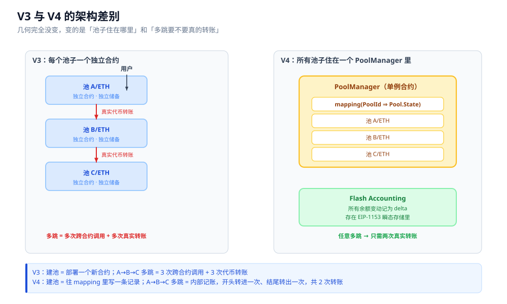

# 04 · V4 架构与机制

## 本章回答什么问题

前面三章把 AMM 的**几何**讲完了：状态空间里的双曲线 `x·y = K`、从原点出发的价格射线、V3 的有限弧与区间。

那么 V4 到底改了什么？

本章要回答：

1. V4 的**仓位数学有没有变**？我需不需要重新学一遍集中流动性？
2. 如果几何没变，那 V4 究竟动了哪里？
3. Singleton、Flash Accounting、原生 ETH、动态费率、ERC-6909、Subscribers 这些名词，各自解决什么具体问题？
4. V4 引入了哪些**新的风险面**？

---

## 一、总纲：几何完全没变，变的是架构与可编程性

这是本章最重要的一句话，先说清楚：

> **V4 的集中流动性，和 V3 是同一套数学。**

具体说，下面这些在 V4 里**一个字都没变**：

| 概念 | V3 | V4 |
|---|---|---|
| tick 价格公式 | $P(i) = 1.0001^{i}$ | 完全相同 |
| 流动性定义 | $L = \sqrt{x_{virtual} \cdot y_{virtual}}$ | 完全相同 |
| 实际储备 | $x_{real} = L\left(\frac{1}{\sqrt{P}} - \frac{1}{\sqrt{p_b}}\right)$，$y_{real} = L\left(\sqrt{P} - \sqrt{p_a}\right)$ | 完全相同 |
| 区间端点 | $P = p_a$ 时 $y_{real} = 0$；$P = p_b$ 时 $x_{real} = 0$ | 完全相同 |
| 价格冲击 | $\Delta\sqrt{P} = \Delta y / L$ | 完全相同 |
| 无常损失 | $IL(r) = \dfrac{2\sqrt{r}}{1+r} - 1$ | 完全相同 |
| 资本效率 | $E = \dfrac{1}{1 - \sqrt{p_a / P}}$ | 完全相同 |

**所以第 03 章画的那些图，在 V4 上可以原样使用**：同一条双曲线、同一段弧、同样的「价格从左扫到右时仓位形变」的过程。

详见 [03-V3 集中流动性](03-V3-集中流动性.md)。

那 V4 改了什么？两件事：

```
① 架构
   V3：每个池子 = 一个独立部署的合约
   V4：所有池子 = 一个 PoolManager 合约里的一堆 mapping 条目

② 可编程性
   V3：池子行为写死（恒定乘积 + 固定费率档）
   V4：在关键动作前后插入 Hook，可以改费率、改曲线、抽成、返利
```

> **一句话：V2→V3 是几何革命（曲线从"整条"变成"一段"）；V3→V4 是架构革命与可编程性革命（几何一点没动）。**

V4 的 Hook 机制篇幅很大，单独成章，见 [05-V4 Hook 机制](05-V4-Hook机制.md)。

---

## 二、Singleton 单例架构

### V3 的做法：一个池子一个合约

```
V3
├── Pool(USDC/ETH, 0.05%)      ← 独立合约，独立地址
├── Pool(USDC/ETH, 0.30%)      ← 又一个独立合约
├── Pool(DAI/USDC, 0.01%)      ← 又一个独立合约
└── ...                        ← 每建一个池，就部署一个新合约
```

**代价：**

- **建池贵**：部署合约要付一笔可观的 gas，还要写入初始化状态
- **多跳贵**：`A → B → C → D` 要跨三个合约，每跨一次就是一次外部调用 + 一次代币转账
- **状态碎片化**：流动性分散在不同地址，路由要逐个查询

### V4 的做法：所有池子在一个合约里

```
V4
└── PoolManager                        ← 全球唯一一个合约
    └── mapping(PoolId => Pool.State)  ← 每个池子只是这里的一条记录
```

**建池从「部署合约」变成了「写一条 mapping 记录」。**

| | V3 | V4 |
|---|---|---|
| 建池操作 | `new UniswapV3Pool(...)` | `poolManager.initialize(key, sqrtPriceX96)` |
| 建池成本 | 部署合约的 gas | 一次 mapping 写入 |
| 多跳路径 | 跨 N 个合约调用 | 同一个合约内 N 次记账 |
| 池子身份 | 合约地址 | `PoolId`（由 `PoolKey` 哈希得到） |

> **一句话：V3 的池子是"一个地址"，V4 的池子是"一个哈希"。**

---

## 三、PoolKey 结构

池子的身份由 `PoolKey` 决定，它对五个字段做哈希得到 `PoolId`：

```solidity
struct PoolKey {
    Currency currency0;
    Currency currency1;
    uint24 fee;
    int24 tickSpacing;
    IHooks hooks;
}
```

逐字段说明：

| 字段 | 类型 | 含义 | 注意 |
|---|---|---|---|
| `currency0` | `Currency` | 排序后的第一个币 | 必须 `currency0 < currency1`（按地址排序） |
| `currency1` | `Currency` | 排序后的第二个币 | 价格 $P$ 是「多少个 currency1 换 1 个 currency0」 |
| `fee` | `uint24` | 费率，单位 pip（百万分之一） | 可以是固定值，也可以是动态费率标记 |
| `tickSpacing` | `int24` | tick 的最小步长 | **与 `fee` 解耦**，可自由组合 |
| `hooks` | `IHooks` | 挂载的 Hook 合约地址 | 零地址 = 无 Hook |

**三个关键点：**

1. **排序规则没变。** 和 V3 一样，`currency0` 必须是地址较小的那个。所以「$P$ 是哪一个币计哪一个币」取决于地址排序，不取决于你的直觉。

2. **`tickSpacing` 与 `fee` 解耦。** V3 里费率档和 tickSpacing 是绑死的（见 [03-V3 集中流动性](03-V3-集中流动性.md) 的对应表：0.01% → 1，0.05% → 10，0.30% → 60，1.00% → 200）。V4 允许任意组合——你可以要一个「0.05% 费率 + tickSpacing 200」的池子。

3. **`hooks` 一旦建池就不可更改。** 这是安全属性，也是风险属性——详见本章第八节和 [05-V4 Hook 机制](05-V4-Hook机制.md)。

> ⚠️ **未验证**：`PoolKey` 字段顺序与类型在 v4-core 的历史版本中曾有过调整（早期版本 `hooks` 的类型写法不同）。上面给出的是任务给定的形式；实际开发时请以你锁定的 `@uniswap/v4-core` 版本为准。

---

## 四、Flash Accounting（闪电记账）

这是 V4 在 gas 上最实质的改进。

### 问题：V3 的多跳要真的搬钱

在 V3 上做 `A → B → C → D` 四跳，中间要经过 B 和 C 两个中转币。传统做法是：每一跳都真实地转账一次代币。

```
V3 四跳
  转 1000 A 进 Pool1  →  转出 1010 B
  转 1010 B 进 Pool2  →  转出 1005 C
  转 1005 C 进 Pool3  →  转出 950  D    ← 共 6 次代币转账
```

**但 B 和 C 只是过路币**——你买进来又马上卖出去，最终你根本不持有它们。这 4 次中间转账纯属浪费。

### V4 的做法：全部记为 delta，最后一次性结算

V4 引入了 `unlock` / `unlockCallback` 模式：

```solidity
// 1. 调用者解锁 PoolManager
poolManager.unlock(abi.encode(...));

// 2. PoolManager 回调调用者
function unlockCallback(bytes calldata data) external returns (bytes memory) {
    // 3. 在这个回调里自由地做任意多跳
    poolManager.swap(key1, params1, "");   // A → B
    poolManager.swap(key2, params2, "");   // B → C
    poolManager.swap(key3, params3, "");   // C → D
    // 4. 此时【没有任何代币被转账】，只有 delta 被记录
    return "";
}
// 5. 回调结束，PoolManager 检查所有 delta 是否已结清
```

每一次 swap **不转账**，只是把余额变动累加成 `delta`：

| 操作 | 你的 delta 变化 |
|---|---|
| 起始 | `0` |
| A→B | `−1000 A`，`+1010 B` |
| B→C | `−1010 B`，`+1005 C` |
| C→D | `−1005 C`，`+950 D` |
| **净额** | **`−1000 A`，`+950 D`**（B 和 C 完全抵消） |

> ⚠️ 上述 1010 / 1005 / 950 是**示意数字**，仅用于说明抵消机制，不是任何真实池子的报价。

**于是真正发生的代币转账只有两次：**

```
V4 四跳
  ① 转入 1000 A
  ② 转出 950  D
```

**从 6 次转账降到 2 次。而且跳数越多，节省越明显**——因为中间币的转账次数是 $2(N-1)$，而 V4 永远是 2 次。

### delta 存在哪里：EIP-1153 瞬态存储

`delta` 存在 **EIP-1153 瞬态存储（transient storage）** 里（`TSTORE` / `TLOAD`）。

瞬态存储的关键性质：**在同一笔交易内可读可写，交易结束自动清零，且比常规 `SSTORE` 便宜得多**。

这正好匹配 Flash Accounting 的需求——delta 的生命周期就是一笔交易，不需要持久化。

> **一句话：Flash Accounting 把「每一次交换都真的搬钱」变成了「先记账，最后只搬净额」。中间币根本不落地。**

### 额外的副产品：免费闪电贷

因为 `unlock` 期间**先拿钱后还钱**是被允许的（只要回调结束时 delta 结清即可），V4 天然支持闪电贷：**借出任何池子里的任何代币，只要在同一笔交易内还上**。

V3 需要专门部署闪电贷合约，V4 是架构自带的。

---

## 五、原生 ETH 支持

V3 的池子只认 ERC-20，所以用 ETH 做 LP 必须先包成 WETH：

```
V3 流程：ETH → wrap → WETH → 存入池子
        取出时：WETH → unwrap → ETH
```

V4 用 `Currency` 类型替代 `IERC20`：

```solidity
// Currency 可以表示两种东西
// 1. 原生 ETH（用一个特殊地址标识）
// 2. 任意 ERC-20
type Currency is address;
```

**好处：**

- **省掉 wrap/unwrap 两次操作**，直接省 gas
- **省掉 WETH 的授权步骤**，少一次 `approve`
- **少一层合约风险**（不用信任 WETH 合约）

---

## 六、费率系统

### 任意 pip 精度

V3 的费率是**固定档位**：0.01% / 0.05% / 0.30% / 1.00%。

V4 的 `fee` 是 `uint24`，单位是 **pip（百万分之一）**，所以**任意值都合法**：

```
100 pips    = 0.01%
500 pips    = 0.05%
3000 pips   = 0.30%
10000 pips  = 1.00%
700 pips    = 0.07%    ← V3 做不到
```

### 动态费率

池子可以选择「费率不是常数」，而是运行时可变的。

**标记方式：LP fee 字段用 `0x800000` 作为动态费率的标记位。**

```
uint24 fee 字段
  ├── 最高位 (bit 23) = 1  →  这是一个【动态费率池】，实际费率运行时决定
  └── 最高位 = 0           →  固定费率，低 23 位就是费率值
```

**两种设置动态费率的途径：**

| 途径 | 调用方 | 生效时机 |
|---|---|---|
| `PoolManager.updateDynamicLPFee(key, newFee)` | 池子指定的 Hook | 立即生效，影响后续所有 swap |
| `beforeSwap` 返回 `uint24` | Hook | **只影响这一笔 swap** |

第二种途径有严格的格式要求（次高位 `0x400000` 必须置位，且值 ≤ 1,000,000），细节见 [05-V4 Hook 机制](05-V4-Hook机制.md)。

> ⚠️ **未验证**：只有池子自己的 Hook 才有权限调用 `updateDynamicLPFee` 这一限制，来自 V4 官方文档的描述。本次未能逐行核对 `PoolManager.sol` 中的权限检查实现，开发前请以源码为准。

### 一个不可逆的决定

> **「这个池子是不是动态费率池」在建池时就定死了，之后不可更改。**

所以建池是一个**需要想清楚的决定**：

- 建成固定费率池 → 永远不能动态调费
- 建成动态费率池 → 必须有一个可信的 Hook 来管这个费率

**后者是一个中心化/信任风险点。**

---

## 七、协议费

V4 引入了协议层面的抽成机制，和 LP 费是**两笔独立的费用**。

| 属性 | 值 |
|---|---|
| 上限 | **0.1%（1000 pips）** |
| 方向性 | 可以**只对 token0 收、只对 token1 收、或两边都收** |
| 计算顺序 | **先算协议费，再在剩余部分上算 LP 费** |

### 复合公式

两笔费用叠加时，不是简单相加，而是复合：

$$swapFee = protocolFee + lpFee - \frac{protocolFee \cdot lpFee}{1{,}000{,}000}$$

**为什么要减去交叉项？** 因为 LP 费是在**扣掉协议费之后**的金额上计算的，所以 $\text{protocolFee} \times \text{lpFee}$ 这部分被重复计算了一次，要减掉。

### 数值验证

设协议费 = 50 pips，LP 费 = 3000 pips：

$$
\begin{aligned}
swapFee &= 50 + 3000 - \frac{50 \times 3000}{1{,}000{,}000} \\
       &= 3050 - \frac{150{,}000}{1{,}000{,}000} \\
       &= 3050 - 0.15 \\
       &= 3049.85 \text{ pips} \approx 0.304985\%
\end{aligned}
$$

**如果简单相加会得到 3050 pips，误差 0.15 pips。** 数值不大，但这是一个必须写对的公式——否则协议的账目会和实际余额对不上。

---

## 八、ERC-6909 债权凭证

### 问题：外部代币调用是不可控的

在 V3 里，你从池子取出的代币会真实转到你的钱包，这需要调用外部 ERC-20 合约。而外部合约可能：

- **有黑名单**（如 USDC）——某个地址被拉黑，转账直接 revert
- **有转账税 / 钩子逻辑**——实际到账金额和名义不符
- **gas 成本高**——每次 `transfer` 都是一次外部调用

### V4 的做法：把余额留在 PoolManager 内部

V4 允许你**选择不把代币转出来**，而是让 PoolManager 记一笔 **ERC-6909 余额**（一种极简的多代币标准）。

```
传统路径：PoolManager → transfer → 你的钱包 → approve → 再存回去
ERC-6909：PoolManager 内部账本上写着「你有 X 个 token Y」
```

**好处：**

- **省掉外部 `transfer` 调用**
- **绕开代币特有的转账逻辑**（黑名单、转账税等）
- **在下一次操作时直接内部划转**，不用先转出再转入

详见 [99-附录](99-附录-公式速查与源码索引.md) 的源码索引。

---

## 九、其他机制

### Subscribers（订阅者）

**问题**：V3 的 LP 仓位是 ERC-721。如果你想让第三方「质押」你的仓位，必须**真的把 NFT 转过去**——这有托管风险，而且转移本身要 gas。

**V4 的做法**：仓位流动性或所有者变化时，**通知订阅者**，但**不需要转移 ERC-721**。

```
V3：质押 = 把 NFT 转给质押合约（托管风险）
V4：订阅 = 注册一个订阅者，事件触发时被通知（无托管）
```

### `salt`（盐）

`PoolKey` 之外还可以传一个 `salt`，用于**仓位隔离**。

用途：**同一个池子里，同一个地址可以拥有多个互相独立的仓位**，即使它们的参数（区间、流动性）看起来一样。

### `donate`（捐赠）

**直接向池子捐代币，但不换取代币。**

捐赠**不改变价格**（因为不改变 $x/y$ 的比例关系含义——它只是增加储备），而是**增加现有 LP 的每单位流动性价值**。

对应到 Hook，有 `beforeDonate` / `afterDonate` 两个回调点。

### `sync`（同步）

**把 PoolManager 记录的内部余额，与实际代币合约的余额对上。**

这是必要的，因为有些代币的余额会因为**外部原因**变化（例如转账税代币、或者有人直接 `transfer` 给 PoolManager）。`sync` 让池子重新锚定真实余额。

---

## 十、风险面

V4 的强大来自灵活性，风险也来自同一处。**这一节要诚实。**

### 1. 恶意或越权的 Hook 可以抽走价值

带 delta 返回权限的 Hook，可以在每笔 swap 上返回一个「应收」的 delta。**而 delta 是由用户承担的**（`swapDelta = swapDelta - hookDelta`）。

**极端情况下，一个恶意 Hook 理论上可以抽走远超正常费率的价值。**

细节见 [05-V4 Hook 机制](05-V4-Hook机制.md) 的安全模型一节。

### 2. 动态费率操纵

如果 Hook 的费率逻辑依赖**可被操纵的输入**（比如池子自身的瞬时价格），攻击者可以用闪电贷扭曲这个输入，把费率压到极低或抬到极高，从而套利。

**防范思路**：费率逻辑不能依赖单点瞬时状态，应该用时序平滑的指标（如 TWAP）。

### 3. 无许可建池

**任何人都可以建任意参数的池子**，包括：

- 币对排序正确但其中一个是**假币**
- 费率设为极端的值
- 挂一个恶意 Hook

这本身不是漏洞（V3 也是无许可的），但它意味着：

> **「这是一个 V4 池子」完全不代表「这是一个安全的池子」。** 判断依据必须来自池子背后是谁、流动性是否锁定、Hook 是否可信。

### 4. MEV / 套利成本更低

Flash Accounting 让多跳套利变得更便宜，这**对套利者是好事**，但意味着：

- **价格发现更快**（好事）
- **LP 被套利的速度也更快**（坏事）

> ⚠️ **未验证**：本次未能取得 V3 → V4 的 gas 节省百分比的一手测量数据。社区流传的「省 99%」一类数字**未经验证，不应作为事实引用**。

---



*图：V3 的多个独立池子合约（左）对比 V4 的单一 `PoolManager` 内部记账（右）。关键差异在于：左图的多跳必须跨合约真实转账，右图的所有余额变动只在内部分录为 `delta`，直到最后一刻才结算净额。*

---

## 本章要点

1. **V4 的几何和 V3 完全一样。** tick 公式、$L$ 的定义、实际储备公式、区间端点、价格冲击、无常损失、资本效率——一个字都没变。第 03 章的所有图和结论可以直接用。

2. **V4 真正改的是两件事：架构（Singleton）和可编程性（Hook）。**

3. **Singleton 让建池从「部署合约」变成「写一条 mapping 记录」**，池子的身份从「合约地址」变成了「`PoolKey` 的哈希」。

4. **Flash Accounting 让任意多跳只需要两次真实代币转账**（开头一次转入，结尾一次转出）。中间币只是 delta 上的加减，从不落地。delta 存在 **EIP-1153 瞬态存储**里，交易结束自动清零。

5. **原生 ETH 支持**省掉了 WETH 的 wrap / unwrap / approve 三步。

6. **费率可以是任意 pip 精度**，且 `tickSpacing` 与 `fee` 解耦。**动态费率池的标记位是 `0x800000`，且这个身份在建池时定死，不可更改。**

7. **协议费上限 0.1%（1000 pips），方向性收取，先于 LP 费计算。** 复合公式：
   $$swapFee = protocolFee + lpFee - \frac{protocolFee \cdot lpFee}{1{,}000{,}000}$$

8. **ERC-6909 让你把代币留在 PoolManager 内部记账**，避免外部 `transfer` 和代币特有逻辑。

9. **Subscribers 让质押不再需要转移 ERC-721。**

10. **风险面必须正视**：Hook 抽成、动态费率操纵、无许可建池、套利更快。「是 V4 池子」不等于「是安全池子」。

---

**下一章**：[05-V4 Hook 机制](05-V4-Hook机制.md) —— 源码级拆解 Hook 的 14 个权限位、地址编码、delta 机制与安全模型。

**相关章节**：[03-V3 集中流动性](03-V3-集中流动性.md)（几何基础）、[08-误区纠正与安全检查](08-误区纠正与安全检查.md)（风险评估）
