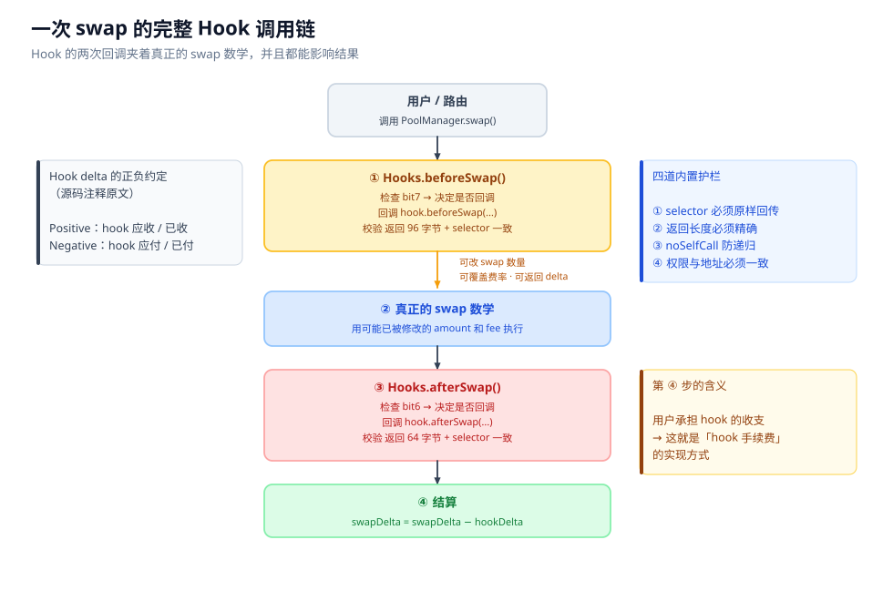

# 05 · V4 Hook 机制

## 本章回答什么问题

上一章讲了 V4 的架构。但 V4 另一半的革新是**可编程性**——Hook。

本章要回答：

1. Hook 到底是什么？它和池子的关系是什么？
2. 「14 个权限位」分别是什么？为什么有 4 个位看起来不像回调函数？
3. 为什么 V4 要把权限编码进**合约地址的二进制位**里？
4. Hook 怎么从「旁观者」变成「参与者」？`delta` 是什么？
5. 一次带 Hook 的 swap，完整调用链长什么样？
6. **站在 LP 的角度**：一个带 Hook 的池子，我该检查什么？

> 本章的权限位、字节数、标志位全部逐字对照 v4-core 源码核实，可配合 [99-附录](99-附录-公式速查与源码索引.md) 的 V4 权限位表复核。

---

## 一、Hook 是什么

> **Hook 是挂在池子上的外部合约，PoolManager 在做关键动作的前后会回调它。它可以读取状态、修改参数、甚至抽走或注入价值。**

三个必须记住的约束：

```
① 每个池子最多挂 1 个 Hook
   （但 1 个 Hook 可以服务无限多个池子）

② Hook 在建池时指定，之后【不可更改】

③ 哪些回调会被调用，由 Hook 【合约地址的二进制位】决定
```

第 ③ 点是最有特色、也最容易踩坑的设计，本章第三节专门讲。

```
   swap / 加流动性 ──►  PoolManager ──回调（按地址位决定调哪些）──►  Hook 合约
                        (含 Pool.State)                              (外部合约)
```

**关键：Hook 不是在池子上「加插件」，而是 PoolManager 在流程中主动 `call` 它。** 这意味着 Hook 是一个**外部调用**，有 gas 成本，也有安全边界。

---

## 二、14 个权限位

V4 一共定义了 **14 个权限位**，占据 Hook 地址的**最低 14 位**。以下是源码原文常量：

```solidity
uint160 internal constant ALL_HOOK_MASK = uint160((1 << 14) - 1);

uint160 internal constant BEFORE_INITIALIZE_FLAG       = 1 << 13   // 0x2000
uint160 internal constant AFTER_INITIALIZE_FLAG        = 1 << 12   // 0x1000
uint160 internal constant BEFORE_ADD_LIQUIDITY_FLAG    = 1 << 11   // 0x0800
uint160 internal constant AFTER_ADD_LIQUIDITY_FLAG     = 1 << 10   // 0x0400
uint160 internal constant BEFORE_REMOVE_LIQUIDITY_FLAG = 1 << 9    // 0x0200
uint160 internal constant AFTER_REMOVE_LIQUIDITY_FLAG  = 1 << 8    // 0x0100
uint160 internal constant BEFORE_SWAP_FLAG             = 1 << 7    // 0x0080
uint160 internal constant AFTER_SWAP_FLAG              = 1 << 6    // 0x0040
uint160 internal constant BEFORE_DONATE_FLAG           = 1 << 5    // 0x0020
uint160 internal constant AFTER_DONATE_FLAG            = 1 << 4    // 0x0010
uint160 internal constant BEFORE_SWAP_RETURNS_DELTA_FLAG            = 1 << 3  // 0x0008
uint160 internal constant AFTER_SWAP_RETURNS_DELTA_FLAG             = 1 << 2  // 0x0004
uint160 internal constant AFTER_ADD_LIQUIDITY_RETURNS_DELTA_FLAG    = 1 << 1  // 0x0002
uint160 internal constant AFTER_REMOVE_LIQUIDITY_RETURNS_DELTA_FLAG = 1 << 0  // 0x0001
```

### 完整对照表

| 位 | 权限常量 | 回调函数 | 返回值 | 十六进制 |
|---|---|---|---|---|
| 13 | `BEFORE_INITIALIZE_FLAG` | `beforeInitialize` | `bytes4` | `0x2000` |
| 12 | `AFTER_INITIALIZE_FLAG` | `afterInitialize` | `bytes4` | `0x1000` |
| 11 | `BEFORE_ADD_LIQUIDITY_FLAG` | `beforeAddLiquidity` | `bytes4` | `0x0800` |
| 10 | `AFTER_ADD_LIQUIDITY_FLAG` | `afterAddLiquidity` | `(bytes4, BalanceDelta)` | `0x0400` |
| 9 | `BEFORE_REMOVE_LIQUIDITY_FLAG` | `beforeRemoveLiquidity` | `bytes4` | `0x0200` |
| 8 | `AFTER_REMOVE_LIQUIDITY_FLAG` | `afterRemoveLiquidity` | `(bytes4, BalanceDelta)` | `0x0100` |
| 7 | `BEFORE_SWAP_FLAG` | `beforeSwap` | `(bytes4, BeforeSwapDelta, uint24)` | `0x0080` |
| 6 | `AFTER_SWAP_FLAG` | `afterSwap` | `(bytes4, int128)` | `0x0040` |
| 5 | `BEFORE_DONATE_FLAG` | `beforeDonate` | `bytes4` | `0x0020` |
| 4 | `AFTER_DONATE_FLAG` | `afterDonate` | `bytes4` | `0x0010` |
| 3 | `BEFORE_SWAP_RETURNS_DELTA_FLAG` | —（见下） | — | `0x0008` |
| 2 | `AFTER_SWAP_RETURNS_DELTA_FLAG` | —（见下） | — | `0x0004` |
| 1 | `AFTER_ADD_LIQUIDITY_RETURNS_DELTA_FLAG` | —（见下） | — | `0x0002` |
| 0 | `AFTER_REMOVE_LIQUIDITY_RETURNS_DELTA_FLAG` | —（见下） | — | `0x0001` |

### 位 0–3 的特殊性（容易看错的地方）

> **位 0–3 不是 4 个额外的回调点，而是「给已有回调加权限」。**

它们本身不会触发任何函数调用。它们的作用是**声明「这个 Hook 允许在被调用时返回 delta」**。

**对应关系：**

| 想启用的能力 | 必须**同时**设置的位 |
|---|---|
| `beforeSwap` 可以返回 delta | 位 7（`BEFORE_SWAP_FLAG`） **和** 位 3（`BEFORE_SWAP_RETURNS_DELTA_FLAG`） |
| `afterSwap` 可以返回 delta | 位 6（`AFTER_SWAP_FLAG`） **和** 位 2（`AFTER_SWAP_RETURNS_DELTA_FLAG`） |
| `afterAddLiquidity` 可以返回 delta | 位 10 **和** 位 1 |
| `afterRemoveLiquidity` 可以返回 delta | 位 8 **和** 位 0 |

**源码里有强制检查**——只设了 delta 位却没设对应的 action 位，地址不合法：

```solidity
// 若未设置 AFTER_SWAP_FLAG，则不允许设置 AFTER_SWAP_RETURNS_DELTA_FLAG
if (!self.hasPermission(AFTER_SWAP_FLAG)
        && self.hasPermission(AFTER_SWAP_RETURNS_DELTA_FLAG)) {
    return false;
}
```

> **一句话：想让 `afterSwap` 能返回 delta，地址的低 14 位必须同时有 bit6 和 bit2，即掩码里必须包含 `0x0040 | 0x0004 = 0x0044`。**---

## 三、地址权限编码（本章最有特色的部分）

### 3.1 机制：一行代码

PoolManager **不查询** Hook 实现了什么接口，而是**直接看它的地址**：

```solidity
function hasPermission(IHooks self, uint160 flag) internal pure returns (bool) {
    return uint160(address(self)) & flag != 0;
}
```

**就是一次位与运算。** 没有任何存储读取、没有任何外部调用。

### 3.2 官方源码注释里的例子：`0x...2400`

源码注释原文：

```solidity
/// For example, a hooks contract deployed to address:
/// 0x0000000000000000000000000000000000002400
/// has the lowest bits '10 0100 0000 0000' which would cause the
/// 'before initialize' and 'after add liquidity' hooks to be used.
```

**逐步验算给读者看：**

**第一步：把 `0x2400` 展开成二进制。**

```
0x2400
  = 0x2000 + 0x0400
  = 2^13  + 2^10
```

写成 16 位二进制（只看低 16 位）：

```
0x2400 = 0010 0100 0000 0000
         ↑           ↑
       bit13       bit10
       (0x2000)    (0x0400)
```

源码注释里写的是 `10 0100 0000 0000`（14 位），去掉高两位对齐：

```
14 位视角（去掉 bit15、bit14）：
  10 0100 0000 0000
  ↑↑ ↑
  ││ └── bit10 = 1  →  AFTER_ADD_LIQUIDITY_FLAG
  │└──── bit11 = 0
  └───── bit13 = 1  →  BEFORE_INITIALIZE_FLAG
                (bit12 = 0)
```

**第二步：逐位对照第二节的常量表。**

| 位 | `0x2400` 中的值 | 对应权限 | 是否启用 |
|---|---|---|---|
| 13 | **1** | `BEFORE_INITIALIZE_FLAG` | ✅ **启用** |
| 12 | 0 | `AFTER_INITIALIZE_FLAG` | ❌ |
| 11 | 0 | `BEFORE_ADD_LIQUIDITY_FLAG` | ❌ |
| 10 | **1** | `AFTER_ADD_LIQUIDITY_FLAG` | ✅ **启用** |
| 9–0 | 全 0 | 其余全部 | ❌ |

> **结论：部署在 `0x...2400` 的 Hook，只会收到两个回调：`beforeInitialize` 和 `afterAddLiquidity`。** 其他 8 个回调永远不会被调用——**即使这个 Hook 合约里写了这些函数**。

### 3.3 为什么要这么设计？——省 gas

假设不用地址编码，PoolManager 每次 swap 都要知道「这个 Hook 实现了哪些回调」。有两种替代方案：

| 方案 | 做法 | 成本 |
|---|---|---|
| 方案 A：接口探测 | 调用 Hook 上的查询函数 | 一次**外部调用**的 gas |
| 方案 B：存储权限位 | 建池时把权限写进 storage，运行时读 | 一次 **`SLOAD`**（冷读 2100 gas） |
| **方案 C：地址编码（V4 采用）** | `address & flag` | **纯计算，近乎 0 gas** |

**swap 是最高频的操作**，每笔都要做这个检查。把它从「外部调用 / 存储读取」降级为「一次位与运算」，是实打实的节省。

> **一句话：V4 用「挖地址的麻烦」换掉了「每笔交易的 gas」。这是一个把成本从运行期搬到部署期的设计。**

### 3.4 代价：必须「挖地址」

因为地址决定了权限，**你不能随便 `new MyHook()`**——部署出来的地址是随机的，低位不可能恰好符合要求。必须用 **`CREATE2` + salt 暴力搜索**：

```solidity
// 目标：找到一个 salt，使 CREATE2 算出的地址满足想要的权限掩码

// 例：只想要 beforeSwap (bit7) + afterSwap (bit6)
// 期望的低 14 位 = 0x0040 | 0x0080 = 0x00C0

uint160 constant EXPECTED_FLAGS = 0x00C0;
uint160 constant MASK = 0x3FFF;   // 低 14 位

// 反复换 salt，直到：
//   uint160(computedAddress) & MASK == EXPECTED_FLAGS
```

**期望尝试次数：**

因为低 14 位必须**精确匹配**一个目标模式，这是一个均匀分布上的命中问题：

$$E[\text{尝试次数}] \approx 2^{14} = 16{,}384$$

**约 1.6 万次哈希运算**——用 Foundry 脚本通常几秒到几分钟就能挖出来，成本可以接受。

> ⚠️ **未验证**：`2^14` 是「低 14 位需要精确匹配」这一前提下的期望值。实际挖矿难度取决于你要实现哪些回调、是否同时想要地址上的其他特征（如易读的前缀）。部分工具/教程中出现的更大数字，可能包含了额外的 vanity 要求，**本次未逐项核实**。

### 3.5 自检：`validateHookPermissions`

这是 V4 一个很贴心的安全设计。Hook 可以在**自己的 constructor 里**主动校验：

```solidity
function validateHookPermissions(IHooks self, Permissions memory permissions) internal pure {
    if (permissions.beforeInitialize != self.hasPermission(BEFORE_INITIALIZE_FLAG)
            || permissions.afterInitialize != self.hasPermission(AFTER_INITIALIZE_FLAG)
            // ... 14 项逐一比对
    ) {
        HookAddressNotValid.selector.revertWith(address(self));   // ★ 部署时直接失败
    }
}
```

> **作用：如果地址挖错了（比如你声明要实现 `beforeSwap`，但地址的 bit7 是 0），合约会在【部署时】直接 revert。**

这把「权限声明与实际地址不匹配」这类**静默 bug** 变成了**硬失败**。如果没这个检查，后果是：你以为 Hook 在保护池子，实际上它从来没被调用过。

### 3.6 `isValidHookAddress`：四种合法情形

```solidity
return address(self) == address(0)
    ? !fee.isDynamicFee()
    : (uint160(address(self)) & ALL_HOOK_MASK > 0 || fee.isDynamicFee());
```

拆解成四种情形：

| # | 情形 | 是否合法 | 说明 |
|---|---|---|---|
| 1 | 地址 = `0`（无 Hook），固定费率 | ✅ 合法 | 最普通的情况，行为等价于 V3 集中流动性 |
| 2 | 地址 = `0`（无 Hook），**动态费率** | ❌ **不合法** | 动态费率必须有人来管，不能没有 Hook |
| 3 | 有 Hook，低位**至少 1 个 flag** | ✅ 合法 | 常规情况 |
| 4 | 有 Hook，低位**全 0**，**但是动态费率池** | ✅ **合法** | ★ 特殊情况，见下 |

**第 4 种情形值得单独说：**

> **你可以部署一个「零回调、只提供动态费率」的 Hook。**

这种 Hook 的低 14 位全是 0——它**不接收任何回调**。它唯一的作用是拥有调用 `PoolManager.updateDynamicLPFee()` 的权限，从外部调整费率。**费率管理逻辑不必写在回调里，可以是一个独立的外部合约/治理流程。**

## 四、delta 机制：Hook 从观察者变成参与者

**没有 delta 权限的 Hook，只能「看」和「revert」。有了 delta 权限，它就能「动钱」。**

### 4.1 正负约定（源码注释原文）

> **Positive: the hook is owed/took currency（hook 应收 / 已收）**
> **Negative: the hook owes/sent currency（hook 应付 / 已付）**

| delta 符号 | 含义 | 典型用途 |
|---|---|---|
| **正** | Hook 应收到代币 | 抽取手续费、拿走价值 |
| **负** | Hook 应付出代币 | 返还 MEV、补贴交易者、注入激励 |

### 4.2 `BeforeSwapDelta` 拆成两部分

```solidity
struct BeforeSwapDelta {
    int128 deltaSpecified;    // 在【用户指定的那个币】上的 delta
    int128 deltaUnspecified;  // 在【另一个币】上的 delta
}
```

**为什么要分 specified / unspecified？** 因为 swap 有两种模式：

| 模式 | 用户指定什么 | `specified` 是哪个币 |
|---|---|---|
| **exact-in** | 输入数量（我要花掉 100 A） | 输入币（A） |
| **exact-out** | 输出数量（我要拿到 100 B） | 输出币（B） |

**Hook 不可能事先知道用户用哪种模式**，所以要分两个字段：`deltaSpecified` = 「我要在用户确定的那个维度上抽/给」；`deltaUnspecified` = 「我要在另一个维度上操作」。**这样同一套 Hook 逻辑才能同时正确服务于 exact-in 和 exact-out。**

### 4.3 `beforeSwap` 的三个返回值

```solidity
function beforeSwap(
    address sender, PoolKey calldata key,
    SwapParams calldata params, bytes calldata hookData
) external returns (
    bytes4,            // ① 函数选择器（必须原样回传）
    BeforeSwapDelta,   // ② Hook 的 delta
    uint24             // ③ 可选的 LP 费率覆盖
);
```

> **返回数据必须恰好 96 字节**（32 字节 selector + 32 字节 delta + 32 字节 fee），否则 revert。

#### ① selector 必须原样回传 —— 防呆检查

```solidity
// 长度至少 32 字节，且返回的 selector 必须和调用时一致
if (result.length < 32 || result.parseSelector() != data.parseSelector()) {
    InvalidHookResponse.selector.revertWith();
}
```

> **Hook 必须把收到的函数选择器原样返回。**

**这防止了两类问题：**

- **调用错了函数**（Hook 实现有 bug，把 `beforeSwap` 转发到了别的函数）
- **代理返回垃圾数据**（Hook 是代理合约，delegatecall 目标不对）

**没有这个检查，PoolManager 会把垃圾数据当成合法的 delta 解析** —— 后果可能是灾难性的。

#### ② delta 可以被直接加进 swap 数量

```solidity
int128 hookDeltaSpecified = hookReturn.getSpecifiedDelta();
if (hookDeltaSpecified != 0) {
    bool exactInput = amountToSwap < 0;
    amountToSwap += hookDeltaSpecified;              // ★ 直接改用户要 swap 的量

    // 但不允许把 exact-in 翻转成 exact-out
    if (exactInput ? amountToSwap > 0 : amountToSwap < 0) {
        HookDeltaExceedsSwapAmount.selector.revertWith();
    }
}
```

> **Hook 可以直接增减用户实际成交的数量。**

**同时有一道保护**：不允许这个改动**把 exact-in 翻转成 exact-out**（符号翻转）——否则语义就完全变了，代码会 revert。

### 4.4 `afterSwap` 只返回一个 `int128`

```solidity
function afterSwap(
    address sender, PoolKey calldata key, SwapParams calldata params,
    BalanceDelta delta, bytes calldata hookData
) external returns (bytes4, int128);
```

> **只能返回 unspecified 维度的 delta，返回数据必须恰好 64 字节。**

**为什么只有 unspecified？** 因为 specified 维度已经在 `beforeSwap` 里定过了——swap 数量已经确定，不可能在 swap 执行完之后再改。所以 `afterSwap` 只能在另一个维度上操作。

### 4.5 谁承担 delta？—— **用户**

```solidity
// the caller has to pay for (or receive) the hook's delta
swapDelta = swapDelta - hookDelta;
```

> **Hook 抽走的价值，从 swap 的调用者（用户 / 路由）身上扣。**

**这就是「Hook 手续费」的实现方式。**

举例：用户在池子里换出 100 B，Hook 在 `afterSwap` 返回 `+1 B` 的 delta：

```
用户原本应得：  +100 B
Hook 返回：      +1 B （Hook 应收）
结算：swapDelta = 100 - 1 = 99 B
─────────────────────────────
用户实际拿到：   99 B
Hook 拿到：       1 B
```

**流动性回调同理：**

```solidity
hookDelta   = BalanceDelta.wrap(self.callHookWithReturnDelta(...));
callerDelta = callerDelta - hookDelta;   // 加/撤流动性的调用者承担
```

**加流动性和撤流动性时，Hook 同样可以抽成。**

---

## 五、动态费率的 Hook 通道

`beforeSwap` 的第三个返回值是费率覆盖，但**有三重限制**（源码注释原文）：

> 1. **the Pool has a dynamic fee** —— 池子必须是动态费率池
> 2. **the value's 2nd highest bit is set** —— **次高位（23 位，`0x400000`）必须置位**
> 3. **the value is less than or equal to the maximum fee** —— **值 ≤ 1,000,000**

```solidity
if (key.fee.isDynamicFee()) lpFeeOverride = result.parseFee();
```

**用位来区分语义，和地址编码是同一套思路：**

```
uint24 返回值布局
  ┌─ 次高位 (0x400000) = 1  →  「这是一个费率覆盖」，而不是其他含义
  └─ 低 23 位               →  实际费率值（pip），必须 ≤ 1,000,000
```

**和 `0x800000`（池子级的动态费率标记）区分清楚：**

| 标志位 | 位置 | 含义 |
|---|---|---|
| `0x800000` | `PoolKey.fee` 的**最高位** | 这个**池子**是动态费率池（建池时定死） |
| `0x400000` | `beforeSwap` 返回值的**次高位** | 这**一笔 swap** 要覆盖费率 |

**两层是独立的**：池子必须是动态费率池，Hook 才能逐笔覆盖费率。固定费率池上返回什么都会被忽略。

---

## 六、一次 swap 的完整调用链

```
用户 / 路由 调用 PoolManager.swap()      （必须先在 unlock 上下文里）
        │
        ▼
┌──────────────────────────────────────────────────────┐
│ ① Hooks.beforeSwap()                                 │
│    ├─ 检查 bit7        → 决定是否调用                 │
│    ├─ 回调 hook.beforeSwap(...)                       │
│    ├─ 校验：96 字节 + selector 一致                   │
│    ├─ 解析 deltaSpecified → amountToSwap += delta     │
│    ├─ 校验：不允许 exact-in / exact-out 翻转          │
│    └─ 解析 fee override（仅当池子是动态费率池）        │
└──────────────────────────────────────────────────────┘
        ▼
┌──────────────────────────────────────────────────────┐
│ ② 执行真正的 swap 数学                                │
│    使用【可能已被 Hook 修改的】amount 和 fee          │
│    Δ√P = Δy / L    ← 与 V3 完全相同                   │
└──────────────────────────────────────────────────────┘
        ▼
┌──────────────────────────────────────────────────────┐
│ ③ Hooks.afterSwap()                                  │
│    ├─ 检查 bit6        → 决定是否调用                 │
│    ├─ 回调 hook.afterSwap(...)                        │
│    ├─ 校验：64 字节 + selector 一致                   │
│    └─ 累加 deltaUnspecified                           │
└──────────────────────────────────────────────────────┘
        ▼
   ④ swapDelta = swapDelta − hookDelta
      ★ 用户承担 Hook 的全部收支
```

> **关键：Hook 的两次调用【夹着】真正的 swap 数学，并且两次都能影响最终结果。**



*图：一次带 Hook 的 swap 的完整生命周期。注意 `beforeSwap` 可以修改 swap 数量和费率，`afterSwap` 可以追加 delta，最终两者的 delta 都从用户的结算额中扣除。*

---

## 七、源码里内置的 4 道安全护栏

| # | 护栏 | 源码机制 | 挡住什么 |
|---|---|---|---|
| ① | **selector 回传校验** | `result.parseSelector() != data.parseSelector()` → revert | 调用错函数、代理返回垃圾数据 |
| ② | **返回长度校验** | `beforeSwap` 必须 96 字节；`afterSwap` 必须 64 字节 | 数据格式错误导致的静默错读 |
| ③ | **禁止自调用** | `modifier noSelfCall(IHooks self)` | Hook 自己触发自己造成无限递归 |
| ④ | **权限一致性** | `isValidHookAddress` + `validateHookPermissions` | 声明的权限与地址编码不匹配 |

### 护栏 ③ 的实现细节

```solidity
modifier noSelfCall(IHooks self) {
    if (msg.sender != address(self)) {
        _;
    }
}
```

> **如果这个操作是 Hook 自己发起的，就不再回调它自己。**

**为什么需要？** 设想一个 Hook 在 `afterSwap` 里又去调用 `poolManager.swap()` —— 如果没有这道护栏，就会形成 `afterSwap → swap → afterSwap → ...` 的无限递归。

**有了 `noSelfCall`，Hook 自己发起的 swap 不会触发自己的回调。** 这让 Hook 可以安全地在回调里嵌套调用 PoolManager。

---

## 八、Hook 能力分级

按「能做什么」分成三级。**级别越高，能力越强，风险也越大。**

### 第 1 级：只读 + 拦截（无 delta 权限）

**能力**：观察状态、记录事件、**revert 掉不合规的操作**。**限制**：不能动钱，只能「允许」或「拒绝」。

| 用途 | 机制 |
|---|---|
| **准入白名单 / 黑名单** | `beforeSwap` 里检查 `sender`，不合规直接 revert |
| **交易开关** | 维护一个 `paused` 标志，暂停时 revert |
| **预言机记录** | 在 `afterSwap` 里把价格/累计量写进自己的存储（TWAP） |
| **链下索引事件** | 在回调里 `emit` 自定义事件 |

**特点：即使 Hook 完全恶意，它也只能「阻止交易」，不能「偷走资金」。** 这是风险最低的一级。

### 第 2 级：动态费率

**能力**：调整 LP 费率（需要池子是动态费率池）。

| 用途 | 机制 |
|---|---|
| **按波动率调费** | 波动率高时提费，补偿 LP |
| **按成交量调费** | 成交量达标后降费，吸引流量 |
| **按时段调费** | 特定时段（如高 MEV 时段）提费 |
| **订单流歧视（Order Flow Discrimination）** | 识别「有毒流」（套利者）并对其加价，对普通用户保持低价 |

> 官方文档明确把 **"Order Flow Discrimination"** 列为动态费率的用例。

### 第 3 级：返回 delta（能动钱）

**这一级才是真正的「可编程 AMM」。** 需要位 0–3 的 `RETURNS_DELTA` 权限。

| 用途 | 机制 |
|---|---|
| **Hook 手续费** | `beforeSwap` / `afterSwap` 返回正 delta 抽成 |
| **MEV 返还** | 把捕获的价值以负 delta 返还给交易者 |
| **限价单** | 在特定 tick 用 delta 撮合，价格到位才成交 |
| **自定义定价曲线** | 用 delta 补贴/惩罚，让有效价格偏离 $x \cdot y = K$ |
| **TWAMM** | 把大单拆成多笔，按时间线性执行 |
| **借贷 / 衍生品集成** | 在 swap 前后同步清算或对冲 |

> **官方原话：`Customized AMMs with different pricing curves than xy = k.`**
>
> **也就是说：$x \cdot y = K$ 只是 V4 的【默认实现】，你可以用 Hook 把它换成别的曲线。** 这是 V4 相对 V3 最根本的开放性——V3 的曲线是写死的，V4 的曲线是「默认值」。

---

## 九、`hookData` 参数

每个回调都带一个 `bytes calldata hookData`：

```solidity
function beforeSwap(
    address sender, PoolKey calldata key, SwapParams calldata params,
    bytes calldata hookData        // ★ 调用者自己塞的任意数据
) external returns (bytes4, BeforeSwapDelta, uint24);
```

> **调用者（路由 / 用户）在调 `swap()` 时可以携带一段任意 `bytes`，PoolManager 原样传给 Hook。**

**这解锁了很多设计：**

| 用法 | 说明 |
|---|---|
| **签名订单** | 传一段链下签名，Hook 验签后按订单参数成交（链下限价单） |
| **策略参数** | 同一个 Hook 服务多个池子，用 `hookData` 区分行为 |
| **路由上下文** | 把路由信息传给 Hook，用于返利/记账 |
| **权限凭证** | 传一个证明，Hook 验证后给予费率优惠 |

> **没有这个参数，Hook 就只能是无状态的通用逻辑。有了它，Hook 才能针对「这一次具体操作」做出不同反应。**

---

## 十、可能失败的地方 / 陷阱

### 1. 同一个区块内创建并初始化 Hook

> ⚠️ **未验证**：有一个广为流传的说法是 **Hook 无法在同一个区块内被创建和初始化**，因为 `beforeInitialize` 可能依赖 Hook 自身已经部署完成的前置状态。**本次未能取得可核对的源码或官方文档依据，引用前请自行验证。**

**实践上的稳妥做法**：先把 Hook 部署好并验证，再建池。这样无论上面那条限制是否成立，都不会有问题。

### 2. gas 开销：每多一个回调就是一次跨合约调用

| | 无 Hook 的池子 | 有 Hook 的池子 |
|---|---|---|
| swap 回调次数 | 0 | **1–2 次** |
| 加/撤流动性回调次数 | 0 | **1–2 次** |
| 权限检查成本 | 无 | 近乎 0（地址位运算） |

> **每多一个回调，就是一次跨合约调用 + Hook 自己的逻辑执行。** 一个在 `beforeSwap` / `afterSwap` 都做重活的 Hook，gas 会明显高于无 Hook 池子。**这也是 V4 要把权限检查做成「地址位运算」的原因**——把唯一能省的那部分省掉。

### 3. 无 Hook ≠ 无风险

`hooks == address(0)` 只说明**没有 Hook 带来的风险**。池子本身仍然有：假币、未锁定流动性、极端参数等问题。

---

## 十一、安全模型（重头戏）

**Hook 是 V4 最大的新增攻击面。** 四类风险：

### 风险 ①：恶意抽成

**机制**：有 `RETURNS_DELTA` 权限的 Hook，在 `beforeSwap` / `afterSwap` 返回大额正 delta。

**后果**：每笔交易被抽走远超预期费率的价值。**用户可能完全没有察觉**——钱包里收到的就是少一点，没有报错。

**检查点**：抽成逻辑是否公开？**有没有上限**？上限是否可被 owner 修改？

### 风险 ②：阻止撤资 ★ 最狠的一类

**机制**：Hook 在 `beforeRemoveLiquidity` 里**无条件 revert**，或者 revert 条件可被恶意触发。

**后果**：

> **LP 的钱被永久锁死，取不出来。这不是「无常损失」，这是「本金归零」。**

**为什么最狠**：无常损失是「赚少了」，这个是「拿不回来」。

**检查点**：`beforeRemoveLiquidity` / `afterRemoveLiquidity` 里有没有 revert 路径？触发条件是否只依赖可信输入？

### 风险 ③：私自改状态

**机制**：Hook 合约**没有校验 `msg.sender == PoolManager`**。

**后果**：任何人都能直接调用 Hook 的回调函数，伪造「PoolManager 调我」的假象，篡改 Hook 内部状态（如白名单、费率、累计量）。

**检查点**：Hook 是否继承 `BaseHook` 或自行实现了 `onlyPoolManager` 修饰器？

### 风险 ④：动态费率操纵

**机制**：Hook 的费率逻辑依赖**可被操纵的输入**（典型：池子自身的瞬时价格）。

**攻击路径**：

```
闪电贷扭曲池子瞬时价格
        ↓
Hook 算出错误的费率（极低或极高）
        ↓
在同一笔交易内以错误费率完成大额 swap
        ↓
套走 LP 的价值
```

**防范思路**：费率逻辑必须依赖**时序平滑**的指标（TWAP、多区块累计量），不能依赖单点瞬时状态。

---

## 十二、Hook 审核清单

**LP 之前，逐条过一遍：**

```
□ 1. PoolKey.hooks 是什么地址？是不是零地址？
     → 零地址 = 无 Hook，行为等价于 V3 集中流动性，可以跳过后续检查

□ 2. 把地址的低 14 位解码出来，列出它有哪些权限
     → 逐个对照第二节的对照表
     → ★ 特别注意位 0–3（RETURNS_DELTA）：有权【动钱】

□ 3. 有 RETURNS_DELTA 的 Hook，抽成逻辑是否公开？有没有上限？
     → 无上限的抽成，理论上可以把每笔交易的价值全抽走

□ 4. beforeRemoveLiquidity / afterRemoveLiquidity 有没有 revert 路径？
     → 有的话，触发条件是否可控？会不会被人恶意触发锁池？

□ 5. Hook 合约有没有 onlyPoolManager 校验？
     → 没有的话，任何人都能伪造调用、篡改 Hook 状态

□ 6. Hook 是否可升级 / 状态是否可被 owner 修改？
     → 可升级 = 今天安全不代表明天安全

□ 7. Hook 的所有权在谁手里？
     → 如果 owner 能改抽成比例或暂停撤资，这是中心化风险
```

**第 2 步是最关键的**——它决定后面几步要不要做。**权限位是公开的、无法隐藏的元数据**，这是地址编码设计的一个额外好处：**任何人都能独立验证一个 Hook 的权限范围。**

---

## 十三、实用判断捷径

```
PoolKey.hooks == address(0)
        │
        ├─ 是 → 这个池子没有任何 Hook
        │       行为等价于 V3 集中流动性
        │       只需按 V3 的方式评估（流动性锁定、费率、区间）
        │
        └─ 否 → 必须把那个 Hook 合约当成【池子的一部分】来审计
                走完第十二节的 7 条清单
```

> **一句话：V4 时代看池子，第一件事就是查 `PoolKey.hooks` 是不是零地址。**


*图：Hook 地址低 14 位的权限位图。每一位对应一个回调或一个附加权限；位 0–3 是「给已有回调加 delta 权限」，不单独触发调用。图中标注了源码注释里的 `0x2400` 示例（bit13 + bit10）。*

---

## 本章要点

1. **Hook 是挂在池子上的外部合约**，PoolManager 在关键动作前后回调。三个约束：**每池最多 1 个 Hook**（但一个 Hook 可服务无限多池）、**建池后不可更改**、**哪些回调被调用由地址的二进制位决定**。

2. **共 14 个权限位，占据地址最低 14 位**（`ALL_HOOK_MASK = (1 << 14) - 1`）。

3. **位 0–3 不是回调点**，而是「给已有回调加 delta 权限」。想让 `afterSwap` 返回 delta，必须**同时**设置位 6 和位 2。

4. **权限检查就是 `uint160(address(self)) & flag != 0`** —— 纯计算，零存储读取、零外部调用。用地址编码换取每笔 swap 的 gas 节省。

5. **源码示例 `0x...2400`**：`0x2400 = 0x2000 + 0x0400`（bit13 + bit10）→ 只有 `beforeInitialize` 和 `afterAddLiquidity` 会被调用。

6. **代价是必须挖地址**：低 14 位需精确匹配，期望尝试次数约 $2^{14} = 16{,}384$。

7. **`validateHookPermissions` 在 constructor 里自检**，地址挖错就**部署时直接 revert**。这把静默 bug 变成了硬失败。

8. **`isValidHookAddress` 有四种合法情形**，其中特殊的一种是：**有 Hook、低位全 0、但池子是动态费率池** —— 即「零回调、只提供动态费率」的 Hook。

9. **delta 的正负约定**：正 = Hook 应收/已收；负 = Hook 应付/已付。`BeforeSwapDelta` 拆成 `deltaSpecified` / `deltaUnspecified`，以同时支持 exact-in 与 exact-out。

10. **`beforeSwap` 返回恰好 96 字节**（selector + delta + fee），**`afterSwap` 返回恰好 64 字节**。**selector 必须原样回传**，否则 `InvalidHookResponse`。

11. **Hook 可以改 swap 数量**（`amountToSwap += hookDeltaSpecified`），但不允许把 exact-in 翻转成 exact-out。

12. **`swapDelta = swapDelta - hookDelta` —— 用户承担 Hook 的全部收支。这就是 Hook 手续费的实现方式。**

13. **动态费率的三重限制**：池子必须是动态费率池、返回值次高位（`0x400000`）置位、值 ≤ 1,000,000。

14. **4 道内置护栏**：selector 回传校验、返回长度校验、`noSelfCall` 防递归、权限一致性。

15. **能力分三级**：只读+拦截（只能看和 revert）→ 动态费率 → 返回 delta（能动钱）。**第 3 级才是真正的可编程 AMM**，官方称之为 `Customized AMMs with different pricing curves than xy = k`。

16. **`hookData` 让调用者透传任意 bytes 给 Hook**，解锁签名订单、策略参数等设计。

17. **四类安全风险**：恶意抽成、**阻止撤资（能锁死本金，最狠）**、私自改状态、动态费率操纵。

18. **实用捷径**：`PoolKey.hooks == address(0)` ⇒ 行为等价于 V3，可跳过 Hook 审计。

---

## 源码出处

| 文件 | 内容 |
|---|---|
| [`Hooks.sol`](https://raw.githubusercontent.com/Uniswap/v4-core/main/src/libraries/Hooks.sol) | 14 个权限位定义、`validateHookPermissions`、`isValidHookAddress`、`callHook`、`noSelfCall`、`beforeSwap` / `afterSwap` 的完整 delta 处理逻辑 |
| [`IHooks.sol`](https://raw.githubusercontent.com/Uniswap/v4-core/main/src/interfaces/IHooks.sol) | 10 个回调的完整签名与参数语义 |
| [V4 Hooks 概念文档](https://raw.githubusercontent.com/Uniswap/docs/main/archive/docs/contracts/v4/concepts/hooks.mdx) | 设计意图与用例 |

> ⚠️ **未验证**：`BaseHook` 基类本次按 v4-periphery 常见路径抓取时返回 **404**（仓库结构可能已调整）。本章中关于 `BaseHook` 的描述基于既有理解，**未经本次源码验证**。如需基于它开发，请以你实际安装的 `@uniswap/v4-periphery` 版本为准。

---

**上一章**：[04-V4 架构与机制](04-V4-架构与机制.md)

**相关章节**：[03-V3 集中流动性](03-V3-集中流动性.md)（几何基础）、[08-误区纠正与安全检查](08-误区纠正与安全检查.md)（安全检查）、[99-附录](99-附录-公式速查与源码索引.md)（源码索引）
