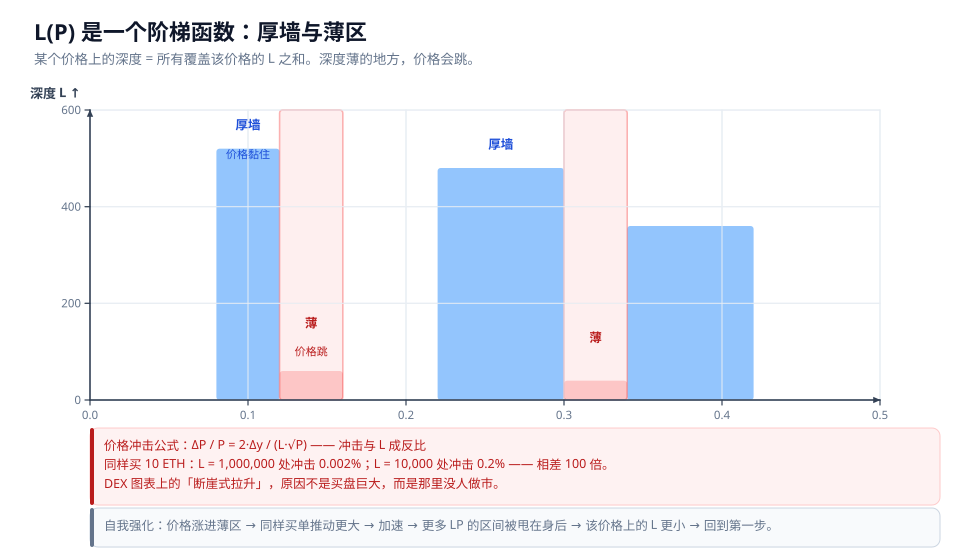

# 06 实战：MEME 做市与区间决策

## 本章回答什么问题

1. 为什么集中流动性（V3/V4）在稳定币对上很好用，在 MEME 上却会出问题？
2. 我设的区间大概能存活多久？有没有可算的公式？
3. 价格涨出区间之后到底发生什么？为什么说"不止是赚不到手续费"？
4. 为什么价格在有些区间会"跳"？这跟我的仓位有什么关系？
5. 那区间到底该设多宽？有没有规则可循？
6. 现实中有哪些可选策略，各自的代价是什么？

前置阅读：[03-V3 集中流动性](03-V3-集中流动性.md)（区间、`L`、`√P` 的定义）、[02-V2 恒定乘积与无常损失](02-V2-恒定乘积与无常损失.md)（`IL(r)` 公式）。

---

## 一、MEME 做市的本质困境

在 [03-V3 集中流动性](03-V3-集中流动性.md) 里我们已经建立了几何图像：**V3 的一个仓位，是双曲线 `xy = K` 上的一段有限弧，弧的两个端点精确落在坐标轴上。**

这意味着什么？

- **V2**：曲线贯穿整个第一象限，两端无限延伸 → 价格范围 $(0, \infty)$，你的仓位永远"在线"
- **V3**：只有一段弧 → 价格范围 $[p_a, p_b]$，**价格一旦走出这段弧，你的仓位就死掉了**

所以 V3 把 LP 这件事的性质改变了：

> **一句话：V2 的 LP 是"无论价格去哪我都一样地被动收租"；V3 的 LP 是"卖出一个有到期日的期权"——区间就是那个期权的有效期。**

"到期日"这个说法不是比喻，是结构上成立的：

| 期权的性质 | V3 仓位的对应物 |
|---|---|
| 有效期 | 价格停留在 $[p_a, p_b]$ 内的时间 |
| 权利金收入 | 手续费 |
| 到期作废 | 价格走出区间，停止赚费 |
| 行权后的敞口 | 仓位变成 100% 单边，随市场继续波动 |

对一个稳定币对，这个"有效期"可以长达几个月；**对一个日均波动 30% 的 MEME，有效期以小时计。** 下一节把这个直觉量化。

---

## 二、区间寿命的数学

### 2.1 推导思路

把价格近似看作**无漂移的随机游走**（几何布朗运动的简化），单位时间波动率为 $\sigma$，区间对数半宽为 $\delta$。从区间中心出发，首次触达 $\pm\delta$ 边界的**期望时间**是标准结果：

$$E[T] \approx \frac{\delta^2}{\sigma^2}$$

**请注意这是平方关系，不是线性关系。** 这一点极其重要：

$$\text{区间窄一半} \;\Longrightarrow\; \delta \to \delta/2 \;\Longrightarrow\; E[T] \to \frac{(\delta/2)^2}{\sigma^2} = \frac{1}{4}\cdot\frac{\delta^2}{\sigma^2}$$

**区间窄一半，停留时间只剩四分之一。** 而资本效率（见 [03-V3 集中流动性](03-V3-集中流动性.md)）却只按 $\delta$ 的倒数增长——**这就是矛盾的根源**：收窄区间带来的效率增益是线性的，而寿命的损失是平方的。

### 2.2 区间寿命表

| 资产 | 日波动率 $\sigma$ | 区间半宽 $\delta$ | 期望出界时间 |
|---|---|---|---|
| 稳定币 | 0.1% | ±1% | ~100 天 |
| ETH | 3% | ±10% | ~11 天 |
| ETH | 3% | ±3% | ~1 天 |
| MEME | 30% | ±10% | **~2.7 小时** |
| MEME | 30% | ±50% | ~2.8 天 |

验算最后两行：

- MEME，$\delta = 0.10$，$\sigma = 0.30$：$E[T] = 0.10^2 / 0.30^2 = 0.01/0.09 = 0.111$ 天 $\approx 2.67$ 小时
- MEME，$\delta = 0.50$，$\sigma = 0.30$：$E[T] = 0.25/0.09 = 2.78$ 天

再验算稳定币那行：$\delta = 0.01$，$\sigma = 0.001$，$E[T] = 0.0001/0.000001 = 100$ 天。

> **一句话：MEME 在 ±10% 的区间里，平均只能待约 2.7 小时。这不是策略没做好，这是波动率本身决定的数学结果。**

**⚠️ 这个公式是估算，有明确的乐观偏差**：

- 假设无漂移。真实的 MEME 有强趋势（drift），趋势会让出界**单向且更快**，而且**出去了基本不会回来**
- 假设波动率恒定。真实波动率会聚集（volatility clustering），暴涨时 $\sigma$ 远高于均值
- 假设连续路径。真实市场有跳空（fat tail），跳空直接跨过边界

**所以真实寿命通常比表里更短，而且出界往往是"跳出"而非"走出"。**

---

## 三、出界不是结束，是痛苦的开始

这是本章最重要的一节。

很多人以为"出区间"的代价就是"停止赚手续费"。**错了。真正的代价在出界之后才开始累积。**

### 3.1 主例子 E 的完整数字

```
MEME/ETH，入场 P = 1，区间 [0.9, 1.4]，投入 10,000
```

先算入场时的持仓。代入 V3 实际储备公式

$$x_{real} = L\left(\frac{1}{\sqrt{P}} - \frac{1}{\sqrt{p_b}}\right), \qquad y_{real} = L\left(\sqrt{P} - \sqrt{p_a}\right)$$

在 $P = 1$、$p_a = 0.9$、$p_b = 1.4$ 处：

- $\sqrt{P} = 1$，$\sqrt{0.9} = 0.948683$，$\sqrt{1.4} = 1.183216$
- $1/\sqrt{P} = 1$，$1/\sqrt{1.4} = 0.845154$
- $x_{real} = L(1 - 0.845154) = 0.154846\,L$
- $y_{real} = L(1 - 0.948683) = 0.051317\,L$

在 $P = 1$ 处的总价值 $V = x_{real}\cdot P + y_{real} = 0.154846L + 0.051317L = 0.206163\,L$。

令 $V = 10{,}000$，得 $L = 48{,}505.4$，于是：

```
入场持仓 = 7,510.6 MEME + 2,489.4 ETH
```

### 3.2 价格走到 1.4（刚撞上界）

$P = p_b$ 时，由端点取值公式 $x_{real} = 0$：

$$y_{real} = L(\sqrt{p_b} - \sqrt{p_a}) = 48{,}505.4 \times (1.183216 - 0.948683) = 48{,}505.4 \times 0.234533 = 11{,}376.5$$

```
仓位 = 0 MEME + 11,376.5 ETH      ← MEME 已全部卖光
```

对照"什么都不做、直接持币"：

```
持币 = 7,510.6 × 1.4 + 2,489.4 = 10,514.8 + 2,489.4 = 13,004.2

IL = 11,376.5 / 13,004.2 − 1 = −12.5%
```

### 3.3 价格继续走到 10

价格已远在区间之外，仓位**冻结**：

```
仓位 = 0 MEME + 11,376.5 ETH      ← 和 P=1.4 时一模一样，一动不动
```

而市场并没有冻结：

```
持币 = 7,510.6 × 10 + 2,489.4 = 75,106 + 2,489.4 = 77,595.4

IL = 11,376.5 / 77,595.4 − 1 = −85.3%
```

**从 −12.5% 恶化到 −85.3%。你的仓位一分钱没动，损失却扩大了近 7 倍。**

### 3.4 对照 V2 全区间

同样 10,000 投入，如果是 V2 全区间仓位，在 $P = 1$ 处：

$$L_{v2} = \frac{V}{2\sqrt{P}} = \frac{10{,}000}{2} = 5{,}000 \;\Longrightarrow\; x = 5{,}000 \text{ MEME},\; y = 5{,}000 \text{ ETH（价值 } 5{,}000 + 5{,}000 = 10{,}000)$$

价格到 10 时：

$$x = \frac{L}{\sqrt{P}} = \frac{5{,}000}{\sqrt{10}} = 1{,}581.1, \qquad y = L\sqrt{P} = 5{,}000\sqrt{10} = 15{,}811.4$$

$$V = 1{,}581.1 \times 10 + 15{,}811.4 = 15{,}811 + 15{,}811 = 31{,}622$$

$$\text{持币} = 5{,}000 \times 10 + 5{,}000 = 55{,}000 \qquad IL = \frac{31{,}622}{55{,}000} - 1 = -42.5\%$$

用标准公式交叉验证：$r = 10$，$IL = 2\sqrt{10}/11 - 1 = 6.3246/11 - 1 = -42.5\%$ ✓

### 3.5 关键机制：仓位冻结，市场不冻结

```
       你的仓位                          市场价格
          │                                │
     ┌────┴────┐                      ┌────┴────┐
     │ 冻住了   │                      │ 继续涨   │
     │ 11,376   │                      │ 77,595   │
     └─────────┘                      └─────────┘
          │                                │
          └────────► 差距持续扩大 ◄────────┘
```

出界后，你被迫在区间内把上涨的资产**全部卖光**，然后眼看它继续飞，而你手里只剩另一种币。**你不仅不赚手续费，还在持续承受一个不断扩大的机会成本。**

> **一句话：集中流动性放大手续费收入，也以同样的机制放大无常损失——本案例中窄区间的 IL（−85.3%）正好是全区间（−42.5%）的两倍。**

**⚠️ 需要区分的两种损失状态**：上面算出的 −85.3% 是**账面差额**（相对持币的机会成本）。只要你不撤出、不 rebalance，它就还没有被"实现"。这个区别在第六节会变得非常关键。

---

## 四、薄区间导致价格跳变

这一节回答一个常见困惑：**为什么 DEX 图表上会出现"断崖式拉升"？**

### 4.1 根本原因：$L(P)$ 不是常数，是分段函数

V2 里每个价格的深度都是 $\sqrt{K}$，是常数。**V3 里，某个价格上的可用深度等于所有覆盖该价格的仓位之和**：

$$L(P) = \sum_{i:\ p_{a,i} \le P \le p_{b,i}} L_i$$

**这是一个阶梯函数**，在每个 tick 边界上跳变。



*图注：横轴是价格，纵轴是该价格上的总流动性 $L(P)$。高柱是"厚墙"，价格在这里很难推动；低柱是"薄区"，价格在这里会被少量成交大幅推动。*

### 4.2 价格冲击公式

在 V3 里，向池中注入 $\Delta y$（计价币）会推动：

$$\Delta\sqrt{P} = \frac{\Delta y}{L} \quad\Longrightarrow\quad \boxed{\frac{\Delta P}{P} = \frac{2\,\Delta y}{L\sqrt{P}}}$$

**价格冲击与 $L$ 成反比。**

### 4.3 数值验证

同样一笔 **10 ETH** 的买单，在 $P = 1$ 处，只改变该处的 $L$：

| 所在位置 | 该处 $L$ | $\Delta P/P = 2\Delta y/(L\sqrt{P})$ |
|---|---|---|
| 厚墙 | 1,000,000 | $2\times10/(1{,}000{,}000\times1) = 0.002\%$ |
| 薄区 | 10,000 | $2\times10/(10{,}000\times1) = 0.2\%$ |

**$L$ 相差 100 倍，价格冲击相差 100 倍。**

> **一句话：同样一笔买单，在薄区推动的价格是厚区的 100 倍。这就是"剧烈波动"的全部来源。**

### 4.4 自我强化雪崩

更糟的是，这个过程会自我强化：

```
价格涨进薄区
     ↓
同样买单推动更大（ΔP/P ∝ 1/L）
     ↓
价格跳得更快
     ↓
更多 LP 的区间上界被甩在身后 → 覆盖该价格的仓位变少 → L 进一步下降
     ↓
（回到第一步，继续加速）
```

第三步的机制值得单独说明：**当价格上行穿越一批仓位的上界 $p_b$ 后，那些仓位在该价格上就不再提供流动性了**（它们已经变成 100% 单边，见第三节）。如果 LP 们倾向于把区间堆在低位，那么价格越高，覆盖它的仓位越少，$L$ 越小，冲击越大。

> **一句话：DEX 上"断崖式拉升"的物理机制是那里根本没人挂单，而不是买盘巨大。**

### 4.5 反直觉的补充：薄区对被动 LP 是灾难，对主动 LP 是金矿

同样一个薄区：

| 视角 | 结论 |
|---|---|
| **被动 LP** | 区间被瞬间穿过，手续费没赚到，还承担了出界后的 IL 恶化 |
| **主动 LP（JIT）** | 如果提前把区间放在价格即将经过的位置，**可以在极短时间内独吞该价格上几乎全部手续费**——因为 $L(P)$ 里只有他一个人 |

**"薄区"本身不是问题，问题是你在不知道价格会往哪走的情况下被动地待在里面。**

---

## 五、最优区间宽度

既然区间窄了会瞬间出界、宽了又没效率，那最优宽度在哪？

### 5.1 推导

**设定**：投入资金 $C$ 固定，区间对数半宽 $\delta$，计划持有期 $H$，波动率 $\sigma$。

**第一步：流动性 $L$ 与 $\delta$ 的关系。**

在几何均值处 $P = \sqrt{p_a p_b}$，区间内总价值为（见 [99-附录](99-附录-公式速查与源码索引.md)）

$$V = 2L(\sqrt{P} - \sqrt{p_a})$$

当 $\delta$ 较小时，$\sqrt{p_a} = \sqrt{P}e^{-\delta/2} \approx \sqrt{P}(1 - \delta/2)$，于是

$$V \approx 2L\sqrt{P}\cdot\frac{\delta}{2} = L\sqrt{P}\,\delta \quad\Longrightarrow\quad L \propto \frac{C}{\delta}$$

**资金固定时，$L$ 与区间宽度成反比。这就是集中流动性的资本效率来源。**

**第二步：停留时间。**

$$T = \min\left(H,\ \frac{\delta^2}{\sigma^2}\right)$$

**第三步：分两种情况讨论手续费收入。** 手续费收入正比于 $L \times T$。

**情况一：区间很窄**（$\delta^2/\sigma^2 < H$，即还没到持有期就出界了）

$$\text{手续费} \propto L \cdot T \propto \frac{C}{\delta}\cdot\frac{\delta^2}{\sigma^2} = \frac{C\,\delta}{\sigma^2}$$

→ **随 $\delta$ 增大而增大。** 区间窄到一定程度，你还没赚到钱就出界了，手续费收入趋近于零。

**情况二：区间很宽**（$\delta^2/\sigma^2 > H$，即整个持有期都没出界）

$$\text{手续费} \propto L \cdot T \propto \frac{C}{\delta}\cdot H = \frac{C\,H}{\delta}$$

→ **随 $\delta$ 增大而减小。** 区间太宽，$L$ 太小，单位时间赚得太少。

**两段一夹，最优解在交点处**：

$$\frac{\delta^2}{\sigma^2} = H \quad\Longrightarrow\quad \boxed{\delta^* \approx \sigma\sqrt{H}}$$

### 5.2 最优区间表

| 资产 | $\sigma$（日） | $H$ | $\delta^*$ | 建议价格区间 |
|---|---|---|---|---|
| 稳定币 | 0.1% | 30 天 | 0.55% | [0.995, 1.006] |
| ETH | 3% | 30 天 | 16.4% | [0.85, 1.18] |
| ETH | 3% | 7 天 | 7.9% | [0.92, 1.08] |
| MEME | 30% | 1 天 | 30% | [0.74, 1.35] |
| MEME | 30% | 7 天 | **79%** | **[0.45, 2.21]** |

验算：稳定币 $0.001 \times \sqrt{30} = 0.005477 = 0.55\%$；ETH $0.03\times\sqrt{30} = 0.1643 = 16.4\%$；MEME $0.30\times\sqrt{7} = 0.7937 = 79\%$。价格区间由 $e^{\pm\delta}$ 换算。

### 5.3 与现实做法的对照

**值得注意的是，这个公式给出的建议与现实中专业 LP 的常用区间吻合：**

- 稳定币 $\pm 0.55\%$ / 月 → 现实中稳定币 LP 常用 $\pm 0.5\%$ 到 $\pm 1\%$
- ETH $\pm 16\%$ / 月 → 现实中 ETH LP 常用 $\pm 10\%$ 到 $\pm 20\%$

**模型抓住了主要矛盾。**

### 5.4 再看 MEME 那一行

公式告诉你：打算在 MEME 上放一周，区间要开到 $[0.45\times, 2.2\times]$——**允许价格腰斩或翻倍**。

而这样的区间意味着资本效率几乎退化到 V2 水平（对照 [03-V3 集中流动性](03-V3-集中流动性.md) 的资本效率表：$\pm1\%$ 是 199.5 倍，宽度放大到 $\pm 80\%$ 时 $E = 1/(1-\sqrt{0.45/1}) \approx 3.0$ 倍）。

> **一句话：MEME + V3 被动做市，"高资本效率"和"不频繁出界"在数学上不可兼得——这是 $\delta$ 的线性增益与 $\delta^2$ 的寿命损失之间的矛盾。**

**⚠️ 这是规则，不是精确解。** 推导中忽略了至少四项：

1. **drift（趋势）**——有趋势时出界单向且更快，最优区间应更宽
2. **fat tail（肥尾/跳空）**——跳空直接跨过边界，等效于 $\sigma$ 更大
3. **竞争份额**——公式假设你的 $L$ 占 $L_{total}$ 的比例固定，但别人也在调区间
4. **gas 成本**——主动 rebalance 的成本没有进入模型，这在以太坊主网上是关键约束（见 [07-生态-以太坊与Solana](07-生态-以太坊与Solana.md)）

另外，模型只优化了手续费收入，**没有把 IL 纳入目标函数**。补上 IL 的考虑会让最优区间**更宽**（因为宽区间卖得更分散、平均成交价更好，同样的价格变动产生的 IL 更小）。

---

## 六、实际可选的策略

| 方案 | 具体做法 | 代价 |
|---|---|---|
| **① 加宽区间** | 按 $\delta^* \approx \sigma\sqrt{H}$ 设区间，接受低资本效率 | 手续费收入退化到接近 V2，"用 V3"的意义被削弱 |
| **② 主动管理** | 价格移动就重新居中（rebalance） | **每次 rebalance 都会把浮亏变成实亏** + 付 gas |
| **③ 用最高费率档** | 用 1% 费率档，把手续费前置 | 交易者会绕开你，成交量下降 |
| **④ V4 动态费率** | 高波动时自动提高费率 | 需要 hook，引入额外合约风险（见 [05-V4-Hook机制](05-V4-Hook机制.md)） |
| **⑤ 反过来做 JIT** | 不做被动 LP，专门在薄区做即时流动性 | 本质变成 MEV 竞争，需要速度优势，不是做市 |
| **⑥ 干脆不做** | 直接持有，或使用 V2 全区间 | 放弃手续费收入 |

### 6.1 特别强调：rebalance 会把浮亏变实亏

这是最容易被低估的一条。

回到第三节的数字：

```
P = 1.4 时，你的仓位 = 0 MEME + 11,376.5 ETH，账面 IL = −12.5%
P = 10 时，同样仓位         = 0 MEME + 11,376.5 ETH，账面 IL = −85.3%
```

**在这两个时点之间，你的仓位没有任何变化。** 那 −85.3% 只是"如果你当初持币会多出这么多"的机会成本。

但是——**如果你在 $P = 1.4$ 时选择"重新居中"**：

1. 你撤出仓位，拿回 11,376.5 ETH
2. 用这 11,376.5 ETH 在 $[1.26, 1.96]$（围绕 1.4 的新区间）重新建仓
3. 此时你买回一部分 MEME —— **买在 1.4 的价格上**

**这一步操作把"MEME 从 1 涨到 1.4 期间被迫卖出"这件事彻底锁死了。** 之后无论价格怎么走，那部分损失都已经实现。而在 P=10 的场景下，你在 1.4 卖出、又在 1.4 附近买回的净效果，就是**永久错过了 1.4 → 10 的全部涨幅**。

> **一句话：不撤出时，−85.3% 是"账面差额"；一旦 rebalance，它就变成"已实现亏损"。主动管理不是免费的，它的成本就是无常损失的兑现。**

这不是说主动管理一定错——如果价格在新区间里震荡，你确实能靠持续收手续费把损失赚回来一部分。**但你必须清楚：每一次重新居中，都是在用"兑现当前 IL"换取"未来可能的手续费"。**

---

## 七、V4 针对性设计对照表

值得注意的是，V4 的几乎每一项架构改进都精准打在 MEME 做市的痛点上（V4 架构详见 [04-V4-架构与机制](04-V4-架构与机制.md)）。

| MEME 做市的痛点 | V4 的对应设计 | 为什么有帮助 |
|---|---|---|
| 建池贵，长尾币种建池不经济 | **Singleton**（单一 PoolManager） | 建池从"部署合约"变成"写一条 mapping 记录" |
| 多跳交易转账成本高 | **Flash Accounting** | 任意多跳只在最后结算一次，实际转账次数大幅减少 |
| 必须 wrap 成 WETH | **原生 ETH 支持**（`Currency` 类型） | 省掉一轮 wrap/unwrap 的 gas 与步骤 |
| 无法自动重新居中 | **Hooks** | 可把"跟随价格 rebalance"变成合约逻辑 |
| 波动率变化但费率固定 | **动态费率** | 高波动时自动提费，直接对冲 IL 风险 |
| 质押要转出 ERC-721 | **Subscribers** | 仓位变动时通知订阅者，不必转移 NFT |
| 高频交易 gas 开销 | **ERC-6909 claims** | 内部结算用 claims token，减少真实转账 |

**这张表说明一件事：V4 的每一项改进，本质上都是在降低"链上操作的成本"，从而让"主动管理 LP"在经济上变得可行。** 因为——如第五节推导所示——**MEME 做 LP 的唯一出路就是主动管理，而主动管理的死穴是操作成本。**

关于 V4 每项设计的机制细节，见 [04-V4-架构与机制](04-V4-架构与机制.md)；关于 hook 如何实现动态费率和自动 rebalance，见 [05-V4-Hook机制](05-V4-Hook机制.md)。

---

## 八、决策图


*图注：横轴为日波动率 $\sigma$，纵轴为计划持有期 $H$，曲线为 $\delta^* = \sigma\sqrt{H}$。左上区域（低波动、长期持有）适合窄区间被动做市；右下区域（高波动、短期持有）窄区间会瞬间出界，应改用宽区间或不做 LP。具体边界请以第五节公式代入自己的参数计算。*

**使用方式**：估算目标资产的日波动率 $\sigma$ 和你打算持有的时间 $H$，代入 $\delta^* \approx \sigma\sqrt{H}$ 得到建议半宽，再对照 [03-V3 集中流动性](03-V3-集中流动性.md) 的资本效率表，判断这个宽度下的效率是否还值得用 V3。

---

## 本章要点

1. **V3 把 LP 从"被动收租"变成了"卖出一个有到期日的期权"，区间就是有效期。** 稳定币的有效期以月计，MEME 以小时计。

2. **区间寿命 $E[T] \approx \delta^2/\sigma^2$ 是平方关系**：区间窄一半，寿命只剩四分之一。而资本效率只按 $1/\delta$ 线性增长——**这就是矛盾的结构性来源**。MEME 在 ±10% 区间里平均只能待约 2.7 小时。

3. **出界不是结束，是痛苦的开始。** 主例子 E：$P=1.4$ 时 $IL = -12.5\%$，仓位冻结而市场继续走，到 $P=10$ 时 $IL$ 恶化到 $-85.3\%$。**仓位冻结，市场不冻结。**

4. **集中流动性同等放大手续费和 IL。** 同一案例中，窄区间 IL（$-85.3\%$）是全区间对照（$-42.5\%$）的两倍。

5. **薄区导致价格跳变：$\Delta P/P = 2\Delta y/(L\sqrt{P})$，冲击与 $L$ 成反比。** 同样 10 ETH 买单，$L$ 相差 100 倍则冲击相差 100 倍。并且会自我强化成雪崩。**DEX 的"断崖式拉升"是因为那里没人挂单，不是买盘巨大。**

6. **最优区间宽度 $\delta^* \approx \sigma\sqrt{H}$**，由"$L \propto C/\delta$"与"$T = \min(H, \delta^2/\sigma^2)$"两段夹逼得出。公式建议与专业 LP 的常用区间吻合（稳定币 ±0.55%/月、ETH ±16%/月）。**这是规则不是精确解**，忽略了 drift、肥尾、竞争和 gas，也**没有把 IL 纳入目标函数**（纳入后最优区间会更宽）。

7. **MEME + V3 被动做市，高资本效率与不出界不可兼得。** 六种可行策略各有代价，其中最关键的一条是：**rebalance 会把浮亏变成实亏**——不撤出时 −85.3% 只是账面差额，一旦重新居中就成为已实现亏损。

8. **V4 的每项架构改进都在降低链上操作成本，从而让"主动管理 LP"在经济上可行。** 这正是 MEME 做 LP 的唯一出路，也正是 V4 针对性解决的问题。
