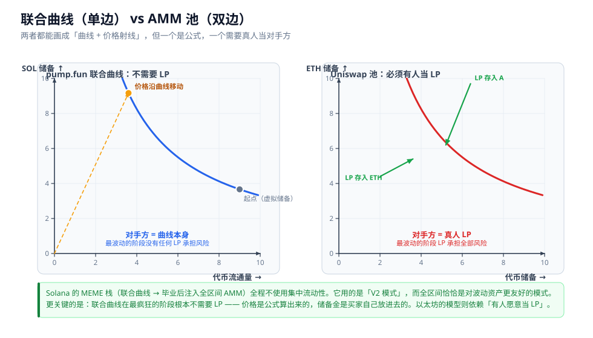

# 07 生态：以太坊与 Solana

## 本章回答什么问题

1. "V3 对 MEME 不友好，所以以太坊输掉了 MEME"——这个推理成立吗？哪里需要修正？
2. Solana 上的 MEME 交易到底跑在什么机制上？它用集中流动性吗？
3. 为什么 Solana 的发射机制不需要 LP？这跟以太坊有什么结构差异？
4. 在"以太坊 vs Solana"的因果链里，AMM 设计到底排第几？
5. "以太坊的流动性和天花板更低"这句话，成立吗？
6. L2 在这件事里扮演什么角色？
7. Uniswap 自己是怎么回应的？

前置阅读：[06-实战-MEME做市与区间决策](06-实战-MEME做市与区间决策.md)（区间寿命、出界代价、$\delta^*$ 公式）、[04-V4-架构与机制](04-V4-架构与机制.md)。

> **⚠️ 本章涉及市场判断，与前面几章的性质不同。**
> 前面几章的结论来自数学推导和源码，可以验证；本章涉及"为什么某个生态胜出"这类问题，**存在归因争议，且部分事实无法用一手数据证实**。
> 因此本章对**每一条陈述都标注了性质**：
> - **[推导]** = 从本套文档已建立的机制推出，可自行验证
> - **[事实]** = 有明确机制或公开源码支撑
> - **[推理]** = 结构性分析，逻辑成立但无一手数据支撑
> - **[⚠️ 未验证]** = 无可靠来源，仅供思考，不得作为决策依据
>
> **本章不写任何具体交易量、市值排名或市场份额数字**，因为本次写作未能取得可核实的一手数据（见文末"来源与核实状态"）。

---

## 一、要修正的一个常见推理

在 [06-实战-MEME做市与区间决策](06-实战-MEME做市与区间决策.md) 里我们确认了：

> **V3 集中流动性对 MEME 做市不友好。** —— 这一条是 **[推导]**，成立。

从这个前提出发，一个很自然的推理是：

```
V3 集中流动性不适合 MEME                     [推导] ✅
        ↓
LP 风险高 → LP 不愿提供 → 深度薄             [推导] ✅
        ↓
所以 Solana 更受青睐                          [推理] ⚠️ 结果成立，但因果不完整
        ↓
所以以太坊的流动性和天花板更低                [推理] ❌ 需要拆开
```

**问题出在第三、四步。** 第三步把"AMM 设计"当成了决定因素，但实际上还有两个更大的变量被跳过了；第四步则把两个不同的指标混成了一个词。

下面逐条修正。

---

## 二、关键事实：Solana 的 MEME 交易栈根本不用集中流动性

这是最容易被搞反的一点。

### 2.1 Solana 的 MEME 交易流程

**[事实]** Solana 上 MEME 的主流路径是：

```
第一阶段：pump.fun 联合曲线（bonding curve）
          ← 不是 AMM，是【带虚拟储备的恒定乘积曲线】
          ← 本质上是【全区间】的
                    ↓ 曲线"打满"后毕业
第二阶段：注入 Raydium / pump.swap 等 AMM
          ← 同样【全区间】
```

**整个流程，一次集中流动性都没有用到。**

### 2.2 为什么这一点至关重要

回到 [02-V2 恒定乘积与无常损失](02-V2-恒定乘积与无常损失.md) 和 [06-实战-MEME做市与区间决策](06-实战-MEME做市与区间决策.md) 的结论：

| 模式 | 会不会"出界停赚" | 同样价格变动下的 IL |
|---|---|---|
| **全区间（V2 模式）** | **不会**，永远在线 | 较低（主例子 E 中为 −42.5%） |
| **窄区间（V3 集中）** | **会**，且出界后 IL 持续恶化 | 较高（主例子 E 中为 −85.3%） |

**全区间恰恰是对波动资产更友好的那个模式。**

所以真实情况不是"Solana 有更好的集中流动性"，而是：

> **一句话：Solana 直接绕开了集中流动性这个问题——它的 MEME 栈从头到尾用的都是全区间曲线。**

**以太坊的旗舰 DEX，其核心差异化能力（集中流动性）恰好是 MEME 用例里最不该用的那个工具。** 这一条是 **[推理]**——机制对比是 **[推导]**，但"这就是 Solana 胜出的原因"是归因判断。

---

## 三、更深一层：Solana 的发射机制根本不需要 LP

这一层比上一节更根本。

### 3.1 联合曲线里没有 LP

**[事实]** 在 pump.fun 的联合曲线阶段：

- 价格由**公式**决定，不是由双边挂单撮合出来
- 储备金是**买家自己放进去的**（买入时打入 SOL，卖出时取回 SOL）
- **不存在"LP"这个角色**

也就是说：**一枚币从零涨到很高市值的整个过程里，没有任何一个 LP 在承担风险**——因为根本没有 LP 存在。

**只有毕业之后，真实的双边流动性才出现。而那时最疯狂的波动阶段已经过去了。**

### 3.2 对比表

| | 联合曲线（pump.fun 模式） | Uniswap 池 |
|---|---|---|
| **谁是对手方** | 曲线自身 | **必须有人自愿做 LP** |
| **最波动阶段谁承担风险** | 没有人 | **LP** |
| **需不需要有人"愿意"** | 不需要 | **需要，且要持续愿意** |
| **LP 无常损失** | 不存在（无 LP） | 存在，且高波动时极大 |
| **上线门槛** | 极低（公式即市场） | 需要有人提供初始流动性 |

### 3.3 这解释了为什么"LP 风险"在前一章占那么重的位置

回顾 [06-实战-MEME做市与区间决策](06-实战-MEME做市与区间决策.md)：MEME 做 LP 的核心困难是——区间寿命以小时计，出界后 IL 持续恶化，而唯一出路（主动管理）又被操作成本卡住。

**这个困难之所以存在，前提是"必须有人愿意当 LP"。**

- **Solana 的发射机制绕开了这个前提**：最波动的阶段不需要 LP
- **以太坊的模式依赖这个前提**：你要在价格最疯狂的时候，说服真人把真金白银放进去当对手方，并且眼睁睁看着自己的仓位被扫出区间

> **一句话：这不只是"V3 的数学对 MEME 不友好"，而是"以太坊的模型需要 LP 自愿承担最疯狂阶段的风险，而 Solana 的模型不需要任何人承担"。**

**[推理]** 需要说明：这不是说 Solana 没有 LP 风险。毕业后进入全区间 AMM 的池子，LP 照样承担无常损失和 rug 风险（见 [08-误区纠正与安全检查](08-误区纠正与安全检查.md)）。**差别在于"最波动的阶段"是否被暴露给 LP。**

---

## 四、但真正的第一因是 gas，不是 AMM 数学

这是我要修正的第二个地方。

### 4.1 成本对比

| 维度 | 以太坊主网 | Solana |
|---|---|---|
| 单笔 swap 成本 | 显著高于 Solana | 极低 |
| 出块时间 | 秒级 | 亚秒级 |
| 一笔小额买入的手续费占比 | 可能达到 **1%–20%** 量级 | 可忽略 |
| LP 主动 rebalance 成本 | 每次数美元到数十美元 | 近乎免费 |

> **⚠️ 未验证**：上表中**没有写具体数字**。本次写作未能取得可核实的一手 gas 与手续费数据，因此只给出量级关系的定性描述。**若需要具体数字用于决策，请自行查询 Etherscan Gas Tracker、Solana 浏览器等一手来源。**
> 唯一可以确定的结构性事实是：**两者在小额交易成本上存在数量级差异**——这是 **[推理]**，但方向明确、争议很小。

### 4.2 关键推论：以太坊上"主动管理 LP"在经济上不可行

把上一张表和 [06-实战-MEME做市与区间决策](06-实战-MEME做市与区间决策.md) 的结论接起来：

```
MEME 做 LP 的唯一出路是【主动管理】              [推导，见 06 章第六节]
        ↓
主动管理 = 频繁 rebalance
        ↓
以太坊：每次 rebalance 成本数美元～数十美元
        而仓位可能只有 1,000 美元
        ↓
【成本 > 收益】→ 主动管理在经济上不可行
        ↓
只能被动持有窄区间 → 被瞬间扫出界 → IL 恶化
        ↓
深度变薄、体验变差
```

**在 Solana 上，同样的操作几乎免费，所以主动管理是可行的。**

**[推导]** 这个推论只依赖一个前提："rebalance 成本与仓位规模之比在两条链上差一个数量级以上"。这个前提的**方向**是可靠的。

### 4.3 修正后的因果链

```
以太坊主网操作成本高 + 出块慢
        ↓
小额交易不经济 → 长尾资产难以形成有效交易
        ↓
主动 LP 管理不可行 → 只能被动持有窄区间 → 被扫出界
        ↓
深度变薄、体验变差
        ↓
交易活动向成本更低的场所迁移
```

> **一句话：V3 的集中流动性在因果链里是"放大器"，不是"起因"。它确实让 MEME 做 LP 更难，但真正把小额交易和主动管理排除在外的是操作成本。**

---

## 五、"天花板更低"需要拆成两个指标

你用的"天花板"这个词，实际上混了两个完全不同的指标：

| 指标 | 含义 | 决定因素 | 谁占优 |
|---|---|---|---|
| **高度** | 单个资产最高能到多少市值 | **能承接的资本深度** | **[推理]** 以太坊可能更高 |
| **吞吐** | 能产出多少个成功的资产 | **发射和交易的成本** | **[推理]** Solana 明显占优 |

### 5.1 为什么"高度"上以太坊可能不输

**[推理]** 单个资产能到的市值上限，取决于**有多少资本能承接它**。以太坊生态沉淀的资金体量、稳定币规模、机构资金通道都远超 Solana 生态。

> **⚠️ 未验证**：我**没有引用任何具体市值排名或项目名称**来支撑这一点，因为无法核实。这里的论证是纯结构性的：**资本深度决定高度上限**。如果你要验证，需要自行查阅可靠的市值数据源。

### 5.2 为什么"吞吐"上 Solana 占优

**[推理]** 能产出多少个成功资产，取决于**发射和交易的成本**。

当单笔交易成本相对于交易金额不可忽略时，低于某个金额的交易在经济上就是负和，整个"长尾"区间无法形成有效市场。**这跟 [06-实战-MEME做市与区间决策](06-实战-MEME做市与区间决策.md) 里"薄区导致价格跳变"是同一类结构问题**：不是机制错了，而是参与者根本不进来。

### 5.3 结论

> **一句话：以太坊缺的不是"天花板高度"，而是"漏斗的通过率"——不是装不下高市值的资产，而是根本筛不出那么多能走到高市值的资产，因为绝大多数在很早期就因为成本不经济而停滞了。**

**[推理]** 这个推论也隐含一个可观察的预测：如果成立，那么以太坊上的资产往往在**已经获得一定关注度之后**才被搬上来，而不是原生从这里长出来。这一条我没有数据验证，仅供参考。

---

## 六、被忽略的变量：L2

### 6.1 大量以太坊生态活动发生在 L2

**[推理]** 现在以太坊生态的 MEME 类活动大量发生在 Base 等 L2 上，而不是主网：

```
以太坊主网：  操作成本高，长尾资产难以存活
Base / L2：   成本低，活动活跃
Solana：      成本低 + 单体架构 + 原生发射台
```

**所以"以太坊输掉 MEME"这个说法本身要加限定词——输掉的是主网，而 L2 在承接这部分流量。**

### 6.2 但碎片化本身是真实的劣势

**[推理]** 碎片化会带来一个结构性代价：

```
Solana：  一个池子（单体 L1，流动性不分散）
以太坊：  二十个池子（主网 + 多个 L2）
```

对依赖**注意力集中**的资产类别（MEME 恰恰是典型），流动性分散是致命的：同一时间点的买盘被切分到多个场所，每个场所的 $L(P)$ 都更小。

**回到 [06-实战-MEME做市与区间决策](06-实战-MEME做市与区间决策.md) 的价格冲击公式：**

$$\frac{\Delta P}{P} = \frac{2\,\Delta y}{L\sqrt{P}}$$

**同样一笔 $\Delta y$，分布在两个池子里意味着每个池子分到一半，但冲击不会减半——因为冲击与 $L$ 成反比，而 $L$ 也减半了，所以单位冲击不变，但每个池子的深度都更薄、更容易被推动。**

> **一句话：流动性碎片化不会因为"总量不变"而无害——它让每个场所都更薄，而薄区正是价格跳变的来源。**

### 6.3 一条相关的社区讨论

关于 L2 与 Solana 的对比，我找到一条**论坛讨论**（非权威来源）：

> "When we talk about 'Ethereum DEX volume,' are we including Base, Arbitrum, Optimism...? Base alone has been doing significant DEX volume."
>
> —— [Web3 Developer Forum 讨论帖](https://blockeden-forum.onbex.co/forum/t/solana-dex-volume-hit-117-7b-in-january-while-ethereum-dexs-stagnated-the-defi-liquidity-migration-nobody-predicted/824/3)

> **⚠️ 未验证**：这是**论坛用户发言，不是权威数据源**，其中提到的任何数字都未经验证。引用它**仅用于说明"以太坊 L1 与以太坊生态是两个不同口径"这个方法论问题**，不用于支撑任何量化结论。
>
> 同一讨论中还包含对 Solana 单点故障、验证者中心化、状态膨胀的质疑，同样属于**未验证的社区观点**。

**方法论要点（这一条是可靠的）**：讨论"某条链的 DEX 交易量"时，必须明确口径是 **L1 单独**还是 **L1 + L2 合计**。两个口径的结论可能相反。

---

## 七、Uniswap 已经在正面回应

**[推导]** 值得注意的是，V4 的几乎每一项改进，都精准打在"操作成本"和"LP 可管理性"上——也就是本章第四节和第二节指出的那两个死穴（V4 架构详见 [04-V4-架构与机制](04-V4-架构与机制.md)）。

| MEME 做市的痛点 | V4 的对应设计 |
|---|---|
| 建池贵，长尾资产建池不经济 | **Singleton** |
| 多跳转账成本高 | **Flash Accounting** |
| 必须 wrap 成 WETH | **原生 ETH 支持** |
| 无法自动重新居中 | **Hooks** |
| 波动率变化但费率固化 | **动态费率** |
| 质押要转出 NFT | **Subscribers** |
| 高频交易 gas 开销 | **ERC-6909 claims** |

**这张表说明：Uniswap 完全诊断出了这个问题。** V4 的每一条都是"让链上操作变便宜、让 LP 能被自动化管理"——也就是让 [06-实战-MEME做市与区间决策](06-实战-MEME做市与区间决策.md) 中"唯一出路（主动管理）"在经济上变得可行。

**此外，Uniswap 推出了自己的应用链（UniChain），目标同样是压低成本。**

> **⚠️ 未验证**：我**没有核实** V4 相对于 V3 的具体 gas 节省比例。坊间流传的某些百分比数字**未经本次写作验证，不予引用**。官方文档仅表述为"显著降低"。至于 UniChain 的实际效果、上线状态和采用情况，同样**未经验证**。
>
> 另需注意一个**结构性的反论**：`[推理]` V4 的这些改进**并不改变 AMM 的几何本身**（见 [05-V4-Hook机制](05-V4-Hook机制.md)——hook 没有改变 `x·y=K` 的曲线形状，只允许在其上叠加逻辑）。**所以 V4 让主动管理变便宜了，但没有让"集中流动性对波动资产不友好"这件事消失。** 它降低的是操作成本，不是波动率。

---

## 八、结论修正表

| 常见说法 | 修正后 | 性质 |
|---|---|---|
| V3 对 MEME 做市不友好 | ✅ **成立**，而且比想象的更严重（出界后 IL 会持续恶化到 −85.3%） | [推导] |
| 所以 LP 风险更高 | ✅ 成立，但**这是"以太坊需要 LP、Solana 不需要"的结构差异**，不只是 V3 的数学问题 | [推导] + [推理] |
| Solana 的 MEME 更受青睐 | ✅ 结果成立，但**主因是操作成本与交易体验，AMM 设计是二阶因素** | [推理] |
| 所以 Solana 有更好的集中流动性 | ❌ **搞反了**。Solana 的 MEME 栈用的是**全区间**联合曲线和全区间 AMM，**根本不用集中流动性** | [事实] |
| 所以以太坊流动性更低 | ⚠️ **要限定口径**：主网确实更差，但 L2 在承接；且流动性碎片化本身是独立劣势 | [推理] |
| 所以以太坊天花板更低 | ⚠️ **要拆开**：**高度**未必更低（沉淀资本更多），**吞吐量**明显更低 | [推理] |
| 以太坊输掉 MEME 是因为 V3 | ❌ **归因错误**。V3 是**放大器**，操作成本是**起因** | [推导] + [推理] |

---

## 九、机制对比图



*图注：左侧为联合曲线——单边公式定价，储备由买家注入，不存在 LP 角色，因此最波动阶段无人承担 LP 风险；右侧为 AMM 池——双边储备，必须由 LP 自愿提供，LP 承担全部无常损失。两者在价格空间上都是全区间分布（对照 [03-V3 集中流动性](03-V3-集中流动性.md) 的价格空间图），这正是它们对波动资产比集中流动性更友好的原因。*

---

## 十、来源与核实状态

本章的可靠性分级如下：

| 内容 | 状态 |
|---|---|
| V3 集中流动性对 MEME 的困难、区间寿命、出界代价 | ✅ **已验证**（数学推导 + [06](06-实战-MEME做市与区间决策.md) 章数值，可自行复算） |
| 联合曲线是"带虚拟储备的恒定乘积曲线"、本质全区间 | ⚠️ **机制描述基于既有理解，本次未取得原始文档**（抓取该主题的参考资料时网络请求失败）。**建议以 pump.fun 官方文档核对后再引用。** |
| Solana MEME 主流路径为联合曲线 → 毕业后进入 AMM | ⚠️ 同上，**未取得一手来源** |
| 两条链的操作成本存在数量级差异 | ⚠️ **定性方向可靠，具体数字未验证** |
| "资本深度决定高度上限""成本决定吞吐" | ⚠️ **结构性推理，无数据支撑** |
| L2 承接了以太坊生态的 MEME 活动 | ⚠️ **推理 + 一条论坛讨论（非权威）** |
| V4 各项设计与 MEME 痛点的对应 | ✅ **已验证**（对照 [04](04-V4-架构与机制.md)、[05](05-V4-Hook机制.md) 的源码与文档） |
| V4/UniChain 的具体效果与节省比例 | ⚠️ **未验证**，官方表述为"显著" |

**本章刻意没有写任何具体的交易量数字、市值数字或市场份额数字**，因为本次写作未能取得可核实的一手数据源。如果你需要用这些数据做决策，请查阅 Dune、DefiLlama 等一手数据平台，并**明确区分 L1 与 L1+L2 两种口径**。

---

## 本章要点

1. **"V3 不好所以以太坊输掉 MEME"这个推理需要修正。** V3 对 MEME 不友好是成立的 **[推导]**，但把它当作生态胜负的起因是归因错误——**V3 是放大器，操作成本是起因**。

2. **Solana 的 MEME 交易栈根本不用集中流动性** **[事实]**：pump.fun 的联合曲线是带虚拟储备的恒定乘积曲线，本质是**全区间**；毕业后进入的 AMM 也是全区间。**而全区间恰恰是对波动资产更友好的模式**（不会出界停赚，IL 更低）。

3. **Solana 的发射机制根本不需要 LP** **[事实]**：联合曲线里没有 LP，价格由公式决定，储备是买家自己注入的。**最波动的阶段，没有任何 LP 在承担风险。** 而以太坊的模型依赖"有人愿意当 LP"。

4. **真正的第一因是操作成本，不是 AMM 数学。** 关键推论：**以太坊上 LP 主动管理在经济上不可行**（rebalance 成本可能超过仓位规模），而 [06 章](06-实战-MEME做市与区间决策.md) 已证明主动管理是 MEME 做 LP 的唯一出路。

5. **"天花板更低"要拆成"高度"和"吞吐"两个指标。** **高度**取决于资本深度——以太坊可能更高 **[推理]**；**吞吐**取决于发射与交易成本——Solana 明显占优 **[推理]**。**以太坊缺的不是天花板高度，是漏斗的通过率。**

6. **L2 是被忽略的变量。** "以太坊输掉 MEME"要限定为"**主网**输掉"。但碎片化本身是独立劣势：由 $\Delta P/P = 2\Delta y/(L\sqrt{P})$ 可知，流动性分散会让**每个场所都更薄**，而薄区正是价格跳变的来源。

7. **Uniswap 已在正面回应。** V4 的每项改进都指向"降低操作成本、让 LP 可自动化管理"。但要清醒：**hook 没有改变 `x·y=K` 的几何，V4 降低的是操作成本，不是波动率。**

8. **本章大量陈述属于结构性推理而非已验证事实**，已逐条标注。**未写任何具体市场数据**——需要时请查阅一手数据源，并明确 L1 / L1+L2 口径。
