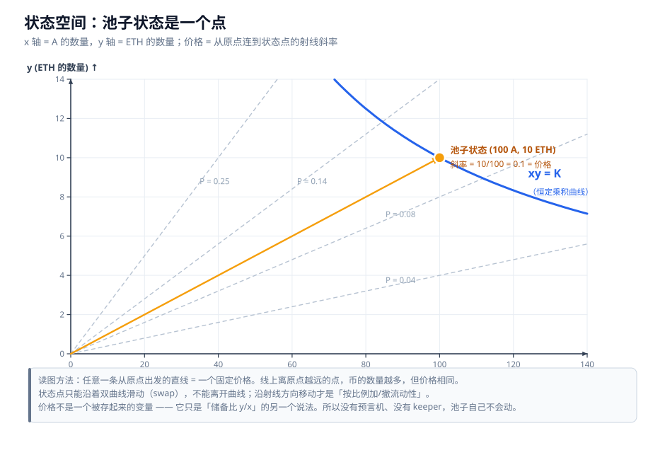
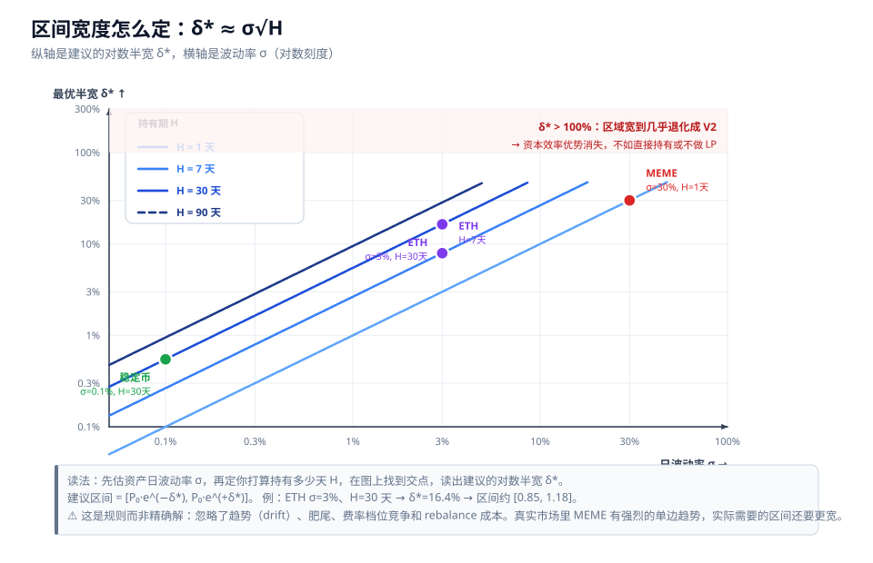
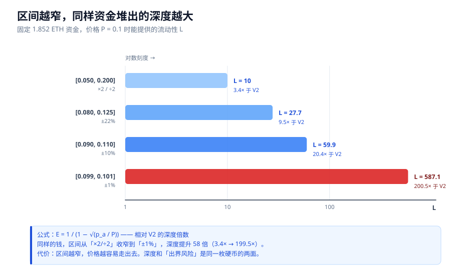
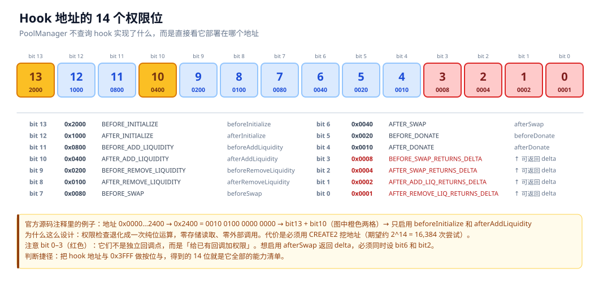

# Uniswap 流动性做市笔记

> 从 `x · y = K` 到 V4 Hook 源码的一整套推导。
> 全部结论都带推导过程和数值验算，不是"结论速记"。

---

## 这套笔记在讲什么

一句话：**把 Uniswap 的池子看成一个几何对象——一条曲线、一条从原点出发的射线、以及 LP 自己选的那段弧。**

一旦你脑子里有了这张图，V2 / V3 / V4 的所有行为都能自己推出来，不用背。



---

## 阅读路径

| 你想干什么 | 读这些 | 大概要多久 |
|---|---|---|
| **搞懂原理** | [01](01-地基-坐标系统与价格.md) → [02](02-V2-恒定乘积与无常损失.md) → [03](03-V3-集中流动性.md) → [04](04-V4-架构与机制.md) → [05](05-V4-Hook机制.md) | 2–3 小时 |
| **做 LP 决策** | [01](01-地基-坐标系统与价格.md) → [02](02-V2-恒定乘积与无常损失.md) → [03](03-V3-集中流动性.md) → [06](06-实战-MEME做市与区间决策.md) → [08](08-误区纠正与安全检查.md) | 1.5 小时 |
| **只想看 V4 / Hook** | [03](03-V3-集中流动性.md)（前两节） → [04](04-V4-架构与机制.md) → [05](05-V4-Hook机制.md) | 1 小时 |
| **只查公式** | [99-附录](99-附录-公式速查与源码索引.md) | 10 分钟 |
| **避坑** | [08-误区纠正与安全检查](08-误区纠正与安全检查.md) | 20 分钟 |

---

## 一页速查卡

### 坐标系（一切的基础）

| 概念 | 含义 |
|---|---|
| `x` | 池中 token0 / 基础币的数量 |
| `y` | 池中 token1 / 计价币的数量 |
| `P = y / x` | **价格的定义**。不是被存起来的变量 |
| 射线的斜率 | 从原点连到状态点 → 斜率就是价格 |
| `K = x · y` | 恒定乘积，曲线下的"面积" |

**记住一句话：价格不是池子里的一个字段，它只是储备比的另一个说法。**

### 操作 → 效果

| 操作 | `K` | 价格 |
|---|---|---|
| 交易 swap | 名义不变（手续费使其微增） | **变** |
| **按比例**加 / 撤 LP | **变**（`K' = K·(1±s)²`） | 不变 |
| **非比例**加 LP | **变** | **也变** |

> 加流动性**必然**改变 `K`。需要保持的是**比例**，因为比例决定价格。

### 四条最常用的公式

$$P = \frac{y}{x} \qquad x = \sqrt{\frac{K}{P}} \qquad y = \sqrt{K \cdot P}$$

$$\text{你的 ETH} = s\sqrt{K \cdot P} \qquad \text{你的 A} = s\sqrt{\frac{K}{P}} \qquad \Longrightarrow \quad \frac{\text{ETH}}{\text{A}}\text{ 数量比} = P$$

$$IL(r) = \frac{2\sqrt{r}}{1+r} - 1 \qquad (r = P_1 / P_0)$$

$$\frac{\Delta P}{P} \approx 2 \cdot \frac{\Delta x}{x}$$

### V3 集中流动性

$$L = \sqrt{x_{\text{virtual}} \cdot y_{\text{virtual}}} \qquad P(i) = 1.0001^{\,i}$$

$$x_{\text{real}} = L\left(\frac{1}{\sqrt{P}} - \frac{1}{\sqrt{p_b}}\right) \qquad y_{\text{real}} = L\left(\sqrt{P} - \sqrt{p_a}\right)$$

**几何本质**：V3 没有改变曲线形状，只是把同一条双曲线**平移**了一下，让它在第一象限只剩一段**有限的弧**，两端**精确落在坐标轴上**。

$$E = \frac{1}{1 - \sqrt{p_a / P}} \quad\text{（相对 V2 的深度倍数，在几何均值 } P^* \text{ 处取值）}$$

### 区间宽度怎么定

$$E[T] \approx \frac{\delta^2}{\sigma^2} \qquad\qquad \delta^* \approx \sigma\sqrt{H}$$

| 资产 | 日波动率 | 区间 | 期望出界时间 |
|---|---|---|---|
| 稳定币 | 0.1% | ±1% | ~100 天 |
| ETH | 3% | ±10% | ~11 天 |
| ETH | 3% | ±3% | ~1 天 |
| **MEME** | **30%** | **±10%** | **~2.7 小时** |
| MEME | 30% | ±50% | ~2.8 天 |



### 资本效率

| 区间（中枢 0.1） | 宽度 | 相对 V2 的深度 |
|---|---|---|
| [0.05, 0.20] | ×2 / ÷2 | 3.4× |
| [0.08, 0.125] | ±22% | 9.5× |
| [0.09, 0.11] | ±10% | 20.4× |
| [0.099, 0.101] | ±1% | **200.5×** |

> 口径说明：`E` 在区间的**几何均值** $P^* = \sqrt{p_a p_b}$ 处取值（即仓位 50/50 的价格点）。



### V4 Hook

14 个权限位编码在 hook **合约地址的最低 14 位**里：

```
0x3FFF  = 全部 14 位的掩码
0x2000  = bit13  beforeInitialize
0x0400  = bit10  afterAddLiquidity
0x0008  = bit3   beforeSwap 可返回 delta
0x0001  = bit0   afterRemoveLiquidity 可返回 delta
```

**判断捷径**：拿 hook 地址与 `0x3FFF` 做按位与，得到的 14 位就是它全部的能力清单。

| 位 | 权限 | 位 | 权限 |
|---|---|---|---|
| 13 | `beforeInitialize` | 6 | `afterSwap` |
| 12 | `afterInitialize` | 5 | `beforeDonate` |
| 11 | `beforeAddLiquidity` | 4 | `afterDonate` |
| 10 | `afterAddLiquidity` | 3 | ↑ beforeSwap 可返回 delta |
| 9 | `beforeRemoveLiquidity` | 2 | ↑ afterSwap 可返回 delta |
| 8 | `afterRemoveLiquidity` | 1 | ↑ afterAddLiquidity 可返回 delta |
| 7 | `beforeSwap` | 0 | ↑ afterRemoveLiquidity 可返回 delta |



**最重要的一条安全常识**：`PoolKey.hooks == address(0)` 的池子行为等价于 V3；**不是零地址，就必须把那个 hook 合约当成池子的一部分来审计**。

---

## 十条最容易被搞错的（详见 [08 章](08-误区纠正与安全检查.md)）

| # | ❌ 常见误解 | ✅ 正确理解 |
|---|---|---|
| 1 | ETH 涨价，池子就"失衡"了 | `x·(y/x) = y` 是代数恒等式，池子**永远不会失衡** |
| 2 | 加流动性要保持 `K` 不变 | 正相反，加流动性**必然**改 `K`；要保的是**比例** |
| 3 | "V2 均匀分布" = 两种币数量相等 | 指 `L = √K` 在整条价格轴上处处相同，**不是数量相等** |
| 4 | 组 LP 能保住 ETH 本位的本金 | **完全不保证**。`ETH ∝ √P`，暴跌时 ETH 数量真实缩水 |
| 5 | 集中流动性改变了曲线形状 | **形状没变**，还是 `xy = K`；变的是它**存在的范围** |
| 6 | V2 里 LP 两边永远各占 50% | 只对 V2 全区间成立。V3 里只有价格在**几何均值**处才 50/50 |
| 7 | 出区间只是少赚手续费 | 仓位**冻结**但市场继续走，**IL 会持续恶化**（−12.5% → −85.3%） |
| 8 | 手续费收入 ≈ 费率 × 成交量 | 暴涨暴跌池里**严重高估**（贬值币种收的费会贬值，−85.7%） |
| 9 | 出界了重新设个区间就行 | 每次 rebalance 都在**把浮亏变成实亏** |
| 10 | V4 的曲线设计和 V3 不同 | V4 的**几何完全没变**，变的是架构和可编程性 |

---

## 核心洞察（如果只记四句话）

> **① 价格 = 从原点连到状态点的射线斜率。** 池子状态点只能沿曲线滑动（swap），或沿射线移动（按比例加减流动性）。

> **② V2 的双曲线贯穿整个象限、永远碰不到坐标轴 → 价格范围 (0, ∞)、每个价格深度相同、资金 99.5% 闲置。**
> **V3 把这条曲线平移，让第一象限只剩一段两端落在轴上的弧 → 价格范围 [p_a, p_b]、区间内深度厚、出界即失效。**

> **③ 集中流动性是杠杆：它按比例放大手续费收入，也按比例放大无常损失。** `±1%` 的区间给你 200× 的深度，也让你在价格走开时承受 2 倍以上的 IL。

> **④ Hook 的本质是把 AMM 的一次原子操作拆成"前/中/后"三段，允许你的代码参与资金结算（delta）。**
> 有 delta 权限的 hook 等于池子的**共同所有者**——能动你的钱；能在 `beforeRemoveLiquidity` 里 revert 的 hook **能锁死你的钱**。

---

## 文件清单

| 文件 | 内容 | 页数 |
|---|---|---|
| [01-地基-坐标系统与价格](01-地基-坐标系统与价格.md) | 状态空间、价格=斜率、`K` 的真实性质、操作→效果表 | ~610 |
| [02-V2-恒定乘积与无常损失](02-V2-恒定乘积与无常损失.md) | 均匀分布、滑点推导、1:1 恒等式、IL、往返行情、Rug Pull | ~830 |
| [03-V3-集中流动性](03-V3-集中流动性.md) | 几何本质、`L`/`√P` 推导、tick、feeGrowth、资本效率、出界困境 | ~1160 |
| [04-V4-架构与机制](04-V4-架构与机制.md) | Singleton、Flash Accounting、原生 ETH、动态费率、ERC-6909 | — |
| [05-V4-Hook机制](05-V4-Hook机制.md) | 14 个回调、地址权限编码、delta 结算、安全模型（源码级） | — |
| [06-实战-MEME做市与区间决策](06-实战-MEME做市与区间决策.md) | MEME 困境、区间寿命、`σ√H`、薄区跳变、策略选择 | ~415 |
| [07-生态-以太坊与Solana](07-生态-以太坊与Solana.md) | 联合曲线 vs AMM、成本结构、天花板拆解 | ~335 |
| [08-误区纠正与安全检查](08-误区纠正与安全检查.md) | 11 条误区 + 三份审核清单 | ~291 |
| [99-附录-公式速查与源码索引](99-附录-公式速查与源码索引.md) | 公式分组速查、术语表、源码链接、未验证事项 | ~370 |

---

## 关于插图

正文用的是 `figures/*.svg` **矢量图**，可以无损放大，也可以直接用文本编辑器改。

如果你的环境不方便看 SVG，`figures/preview/` 里有同样 11 张图的 **PNG 版本**，可以直接打开：

| SVG（正文引用） | PNG（方便查看） |
|---|---|
| `figures/fig-01-state-space.svg` | `figures/preview/fig-01-state-space.png` |
| …共 11 张 | … |

所有图都是脚本生成的，不是手绘。想改颜色、改数值、改标签，直接编辑 `_tools/gen_figures.py` 再跑一次即可：

```bash
python _tools/gen_figures.py      # 重新生成全部 SVG
python _tools/render_preview.py   # 顺便导出 PNG 预览
python _tools/validate_svg.py     # 检查文字越界 / 重叠 / 数值是否对得上
```

> 最后一条值得一跑：它会拿正文里的关键数值（V3 弧端点、例子 E 的持仓、四档资本效率）和图上实际画出来的坐标做比对，图错了会报出来。

`_tools/` 里另外两个文件：`CANONICAL.md` 是全套笔记的写作规范（统一记号、统一数值、统一公式），`check_docs.py` 用来查交叉引用死链和口径不一致。**这两个是内部维护用的，不影响阅读。**

---

## 关于可靠性

这套笔记对**每一条结论**都区分了性质，不混为一谈：

- **纯粹数学推导** —— 可以自己验算。文中的数值都给了中间步骤。
- **协议实现细节** —— 尽量对照源码（v3-core / v4-core）逐条核实，并给出文件链接。
- **市场判断** —— 会显式标注是**结构性推理**还是**已验证事实**。

**任何未经验证的内容**都会标注：

> ⚠️ **未验证**：……

完整的未验证事项清单在 [99-附录](99-附录-公式速查与源码索引.md) 的 E 节。

**本笔记不构成投资建议。** 里面的数字是为了说明机制而构造的算例，不是任何真实池子的数据。
